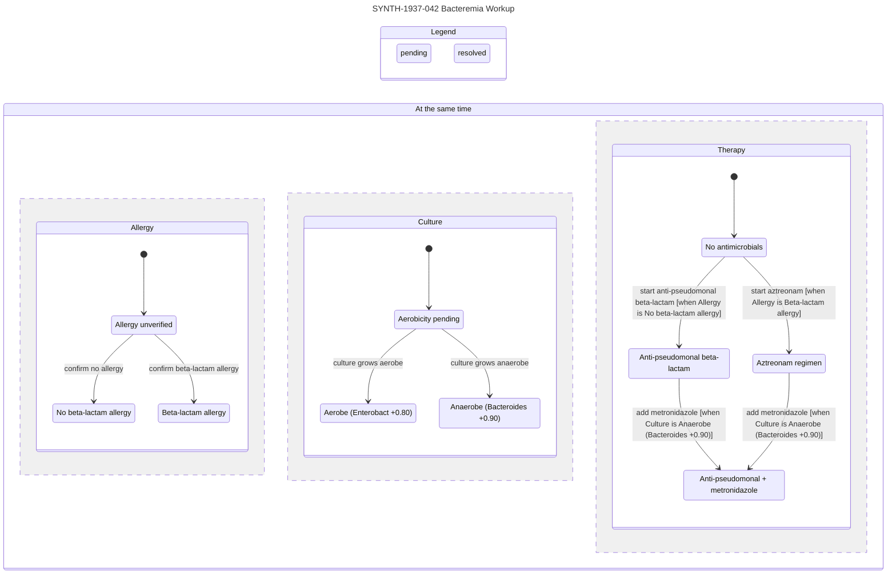
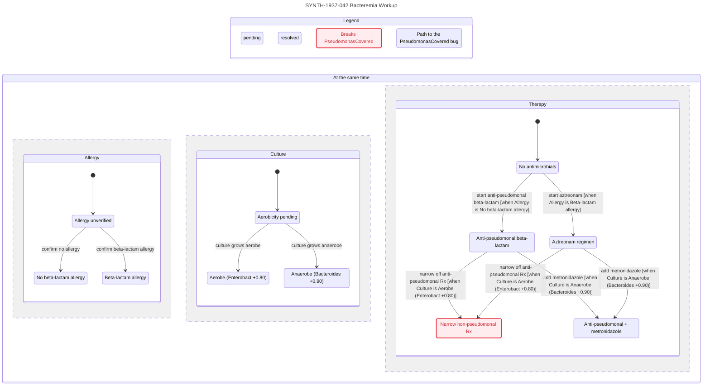

# `.med` — Biomedical Graph-Logic Meta-Specification

**Media Type:** `text/vnd.med+markdown` · **Extension:** `.med` · **Version:** `1.0.0`

`.med` (**medfile**) is an agent-native file format and formal model specification for biomedical workups. It unifies three orthogonal substrates into a single strict superset of CommonMark Markdown:

1. **Agent Context & Verification (`[1]`)** — [Cursor Statechart](https://github.com/cursor/plugins/tree/main/pstack/skills/statechart): bounded, invariant-checked TLA+ transition models projected into human-legible Mermaid `stateDiagram-v2` and Pele SVG statecharts.
2. **Knowledge Graph Traversal (`[2]`)** — [OpenGigantic ObjectGraph (`arXiv:2604.27820v1`)](https://arxiv.org/html/2604.27820v1): typed, role-scoped, progressively disclosed directed knowledge graphs consumed via two-primitive \(O(1)\) index routing rather than full-document context injection.
3. **Epistemic Workup Calculus (`seed`)** — [MYCIN (`cl-aip/mycin`)](https://github.com/cl-aip/mycin): hierarchical context instantiation, goal-directed backward-chaining (`find-out`), signed Certainty Factor (\(\text{CF} \in [-1, +1]\)) propagation, and introspective justification (`WHY` / `HOW`), generalized from infectious bacteremia to arbitrary biomedical reasoning.

> **Research & Safety Boundary.** `.med` is a formal knowledge-and-workup representation for research and verification. Examples in this specification use synthetic identifiers (`SYNTH-`) and invented timelines (`1937`). A `.med` artifact is not a medical device, prescription, or autonomous clinical order; clinical action requires review and signature by a licensed clinician.

---

## 1. Pipeline Contract & Design Axioms

```plaintext
INPUT:   clinical case --natural-language
PROCESS: agent.workup { CRAWLS [2] }
OUTPUT:  graph.logic --fileformat .med { RENDERS [1] }
```

To minimize structural complexity while maximizing clinical utility and cross-domain generality, `.med` enforces four axioms:

1. **Markdown Superset & Homoiconic Closure.** Every valid CommonMark `.md` document is a valid stage-0 `.med` document (equivalent to a single unindexed `::full` prose block). Reusable reference knowledge bases crawled during `agent.workup` and case-specific workup graphs emitted as `.med` outputs share the identical schema and compose across files via URI-qualified edge pointers (`<uri>#<node-id>`).
2. **Traversal Over Injection (`CRAWLS [2]`).** Biomedical corpora are never injected wholesale into an agent prompt. Agents inspect the `::index` routing manifest (\(\approx 30 + 6k\) tokens), traverse typed `:requires` dependencies, enforce `scope` access control at the index boundary, deduplicate session reads (`skip-if-known`), and treat `::warning` blocks as non-skippable at every disclosure depth.
3. **Signed Epistemic Tri-Separation (`Mycin`).** Affirmation (\(\text{cf} > 0\)), explicit negation (\(\text{cf} < 0\)), and ignorance/pending workup (\(\text{cf} = 0\)) remain algebraically distinct. Unmentioned history or pending assays stay `0.00` (never coerced to negative), and hedged language (`"possible"`, `"?"`) binds intermediate certainty (never promoted to `+1.00`).
4. **Confluent Deduction / Explicit Transition Split (`RENDERS [1]`).** Deductive `rule` nodes evaluate as pure, permutation-invariant state-level operators, while external clinical `action` nodes (diagnostic observations, therapies, escalations, dispositions) form the named transition relation `Next`. This eliminates rule-interleaving diamond blow-up and keeps rendered `[1]` statecharts within TLC's 500-state chart budget and \(\lesssim 20\) human-readable arrows.

---

## 2. Formal Model

A `.med` specification denotes a unified triple \(\mathcal{M} = (G, \mathcal{E}, \mathcal{A})\) over a single underlying node-and-edge store.

### 2.1 Graph Layer \(G = (V, E, \tau_V, \lambda_E, \rho)\)

\(G\) specializes the OpenGigantic ObjectGraph tuple with a closed biomedical-epistemic ontology of **6 domain node types** (plus optional `.og` `meta` nodes) and **7 edge labels**.

| Node Type \(\tau_V(v)\) | Epistemic Role (`Mycin`) | Graph Role (`[2]`) | Statechart Role (`[1]`) |
|---|---|---|---|
| `context` | Instantiated entity frame (`defcontext`, `goals`) | Subgraph container | Region or compound state namespace |
| `finding` | Observable / askable parameter (`ask-first`) | Source-grounded leaf (`src`) | State variable (if `cf = 0.00`) or constant (if bound) |
| `hypothesis` | Inferred goal / parameter (`infer-first`) | Derived epistemic node | State-level operator `Cf_<id>(vars)` |
| `rule` | Production `IF P THEN w Q` (`defrule`) | Deductive hyperedge | Pure operator term inside `Cf_<id>` |
| `action` | Discriminative inquiry or therapy | Procedural step | Named disjunct in `Next` |
| `invariant` | Hard clinical or epistemic constraint | Executable `::assertion` | `INVARIANT` or temporal `PROPERTY` |
| `meta` | Provenance, view config, delta log | `__changelog`, `__view` | `view.mjs` projection exports |

| Edge Label \(\lambda_E(u, v)\) | Syntax | Traversal (`[2]`) | Epistemic / Automaton Contract (`Mycin` + `[1]`) |
|---|---|---|---|
| `:contains` | `->[:contains] v` | Structural | Instantiates child `context` inside parent `context` DAG |
| `:requires` | `->[:requires] v` | **Auto-traversed** | Premise input to `rule` or precondition dependency of `action` |
| `:supports` | `->[:supports cf=w] v` | Forward trace | Positive attenuation \(w \in (0, +1.0]\) into `hypothesis` \(v\) |
| `:contradicts` | `->[:contradicts cf=w] v` | Conflict check | Negative attenuation \(w \in [-1.0, 0)\) or drug-condition exclusion |
| `:resolves` | `->[:resolves] v` | Inquiry link | Diagnostic `action` \(u\) observes unknown `finding` \(v\) (`cf = 0.00`) |
| `:transitions` | `->[:transitions] v` | Sequential | Workflow phase / sequencing edge between `action` nodes |
| `:supersedes` | `->[:supersedes] v` | Lineage / Federation | Updates prior observation or links local node to reference `uri#id` |

Role scope \(\rho: V \to \mathcal{S}\) filters visibility during Pass 1 (`search_index`) over \(\mathcal{S} = \{\texttt{all}, \texttt{clinician}, \texttt{orchestrator}, \texttt{worker}, \texttt{patient}\}\) (extensible in `::schema`). Any consumer with role \(r\) sees iff \(\rho(v) \in \{\texttt{all}, r\}\).

### 2.2 Epistemic Layer \(\mathcal{E} = (\mathcal{C}, \Pi, \mathcal{R}, \mu, \tau_+, \tau_-)\)

Let \(\Pi = V_{\text{finding}} \cup V_{\text{hypothesis}}\) be the set of typed parameters attached to context instances \(c \in \mathcal{C}\), where each \(p \in \Pi\) has domain \(\text{Dom}(p)\) and certainty valuation \(\mu_p: \text{Dom}(p) \to [-1.0, +1.0]\) with `0.0` denoting `unknown`.

1. **Activation & Pruning Thresholds.** With default cutoffs \((\tau_+, \tau_-) = (+0.20, -0.80)\) (matching Norvig's EMYCIN seed; configurable per `::schema`):
   \[
   \text{true?}(c) \iff c > \tau_+, \qquad \text{false?}(c) \iff c < \tau_-
   \]
2. **Atomic Condition Evaluation.** For condition \(\phi = (p, \text{op}, x)\):
   \[
   \text{eval}(\phi) = \text{clamp}_{[-1, 1]}\!\left(\sum_{v \in \text{Dom}(p),\, \text{op}(v, x)} \mu_p(v)\right)
   \]
3. **Premise Combination & Short-Circuit Rejection.** For rule premises \(P = (\phi_1, \dots, \phi_m)\):
   - **Early rejection (`reject-premise`):** If any already-bound \(\phi_i\) satisfies \(\text{false?}(\text{eval}(\phi_i))\) without querying unknowns, the rule aborts in \(O(1)\) without recursive traversal.
   - **Conjunction / Disjunction / Negation:**
     \[
     \text{CF}(\phi_1 \land \dots \land \phi_m) = \min_{1 \le i \le m} \text{eval}(\phi_i), \qquad \text{CF}(\phi_1 \lor \dots \lor \phi_m) = \max_{1 \le i \le m} \text{eval}(\phi_i), \qquad \text{CF}(\lnot \phi) = -\text{eval}(\phi)
     \]
4. **Rule Attenuation.** A `rule` \(r\) with weight \(w_r \in [-1.0, +1.0]\) fires iff \(\text{true?}(\text{CF}(P_r))\), emitting derived evidence \(e_r = \text{CF}(P_r) \cdot w_r\) toward its target `(hypothesis, value)`.
5. **Canonical Bipolar Evidence Combination (\(\oplus\)).** Given multiset \(E = \{e_1, \dots, e_k\}\) of active rule contributions to the same `(hypothesis, value)`, partition \(E^+ = \{e \in E \mid e > 0\}\) and \(E^- = \{e \in E \mid e < 0\}\):
   \[
   c_+ = 1 - \prod_{e \in E^+} (1 - e), \qquad c_- = -1 + \prod_{e \in E^-} (1 + e)
   \]
   \[
   \bigoplus E = \begin{cases}
   \bot_{\text{conflict}} & \text{if } c_+ = +1.0 \land c_- = -1.0 \\
   \dfrac{c_+ + c_-}{1 - \min(c_+,\, |c_-|)} & \text{otherwise}
   \end{cases}
   \]
   For \(|E| = 2\), \(\bigoplus \{a, b\}\) is identical to classical pairwise MYCIN `cf-or(a, b)`. For \(|E| \ge 3\) with mixed signs, bipolar partitioning eliminates sequential order dependence, making \(\bigoplus\) **strictly commutative, associative, and confluent** across arbitrary graph crawl orders. Hard contradiction (\(c_+ = +1.0 \land c_- = -1.0\)) raises \(\bot_{\text{conflict}}\) and violates the implicit `NoHardConflict` invariant rather than silently cancelling to `0.0`.

### 2.3 Automaton & Projection Layer \(\mathcal{A} = (S, S_0, \Sigma, \Delta, \mathcal{I}, \mathcal{P}, \mathcal{V})\)

To verify clinical trajectories and render `[1]`:

- **State Vector (`vars`):** One state variable for each unresolved `finding` (\(v \in V_{\text{finding}}\) with initial \(\text{cf} = 0.00\) targeted by at least one `:resolves` edge) ranging over `{"unknown"}` \(\cup \text{Dom}(v)\), plus one variable per mutable `state` field declared on a `context` node (e.g., `regimen`, `disposition`, `phase`). Bound case findings (\(\text{cf} \ne 0.00\) without `:resolves`) compile to constants.
- **Initial Predicate (`Init`):** Sets unresolved findings to `"unknown"` and `context` state fields to their declared `:=` initial values.
- **State-Level Epistemic Operators:** Stratified `hypothesis` nodes compile to deterministic TLA+ operators over `vars` using integer-scaled centi-certainty \(C = \text{round}(100 \cdot \text{cf}) \in -100..100\).
- **Named Transition Relation (`Next`):**
  \[
  \texttt{Next} \triangleq \Big(\bigvee_{(a, f) \in E_{\text{resolves}},\, x \in \text{Dom}(f)} \texttt{Observe\_}f\texttt{\_}x\Big) \;\lor\; \Big(\bigvee_{a \in V_{\text{action}} \setminus V_{\text{obs}}} \texttt{Act\_}a\Big) \;\lor\; \texttt{Done}
  \]
  where `Done` stutters (`UNCHANGED vars`) solely on valid terminal clinical dispositions so genuine dead ends violate `NoDeadlock` (`CHECK_DEADLOCK`) while completed workups do not.
- **Invariants (\(\mathcal{I}\)) & Properties (\(\mathcal{P}\)):** Every `invariant` node with `kind=safety` compiles to a TLA+ `INVARIANT`; `kind=liveness` (containing `[]`, `<>`, or `~>`) compiles to a `PROPERTY`.
- **Reader View (\(\mathcal{V}\)):** Projects `vars` via `(state, step, group, colors, title)` into clinician-readable words, rendering parallel clinical dimensions as orthogonal regions (`state "At the same time" as all`) unless cross-region reachability would be misrepresented (`regionsLie`), in which case `[1]` automatically lifts to hierarchical parent states.

---

## 3. Concrete Syntax & EBNF Grammar

A structured `.med` file begins with three manifest blocks (`::meta`, `::schema`, `::index`) followed by zero or more `::node` definitions. Standard Markdown outside `::` blocks is preserved verbatim for human readers.

### 3.1 Block Taxonomy

| Block | Scope | Requirement | Contract |
|---|---|---|---|
| `::meta` | File | Mandatory (indexed mode) | Document identity, version, domain tags, synthetic/provenance hash |
| `::schema` | File | Mandatory (indexed mode) | Declared node types, edge types, scopes, and `cf-thresholds` |
| `::index` | File | Mandatory (indexed mode) | Pipe table `id \| type \| scope \| cf \| keywords` read in \(O(1)\) |
| `::dense` | Node | Mandatory | Pipe-delimited token summary (\(\le 15\) tokens) for Pass 2 triage |
| `::full` | Node | Optional | Clinical prose, verbatim quote provenance (`[src: ...]`), `WHY` rationale |
| `::logic` | Node | Conditional | Formal parameter, rule, action guard/effect, invariant, or view definition |
| `::warning` | Node | Safety-conditional | **Protocol-non-skippable** red flag, allergy, or contraindication |
| `::edges` | Node | Optional | Directed typed edges (`->[:label attrs] target` or `uri#target`) |

### 3.2 Formal Grammar (EBNF)

```ebnf
med_file        = markdown_raw
                | manifest , { node_block | markdown_prose } ;

manifest        = meta_block , schema_block , index_block ;

meta_block      = "::meta" , NEWLINE , { kv_line } , "::end" , NEWLINE ;
schema_block    = "::schema" , NEWLINE , { kv_line } , "::end" , NEWLINE ;
index_block     = "::index" , NEWLINE , { comment_line | index_row } , "::end" , NEWLINE ;

index_row       = id , [ WS ] , "|" , [ WS ] , node_type , [ WS ] , "|" , [ WS ] , scope ,
                  [ WS ] , "|" , [ WS ] , signed_cf , [ WS ] , "|" , [ WS ] , keyword_csv , NEWLINE ;

node_block      = "::node" , [ WS ] , "[" , attr_list , "]" , NEWLINE ,
                  dense_block ,
                  { full_block | logic_block | warning_block | edges_block | og_ext_block } ,
                  "::end" , [ WS , "#" , [ WS ] , id ] , NEWLINE ;

attr_list       = attr , { WS , attr } ;
attr            = id , "=" , ( id | STRING | signed_cf | BOOL ) ;

node_type       = "context" | "finding" | "hypothesis" | "rule" | "action" | "invariant" | "meta" ;
scope           = "all" | "clinician" | "orchestrator" | "worker" | "patient" | id ;
signed_cf       = [ "+" | "-" ] , ( "1.00" | "1.0" | "0." , DIGIT , { DIGIT } | "0" ) ;

dense_block     = "::dense" , NEWLINE , token_pipe_list , NEWLINE , "::end" , NEWLINE ;
full_block      = "::full" , NEWLINE , VERBATIM_TEXT , "::end" , NEWLINE ;
warning_block   = "::warning" , NEWLINE , VERBATIM_TEXT , "::end" , NEWLINE ;
edges_block     = "::edges" , NEWLINE , { edge_decl } , "::end" , NEWLINE ;

edge_decl       = edge_dir , "[:" , edge_type , { WS , attr } , "]" , WS , edge_target , NEWLINE ;
edge_dir        = "->" | "<-" | "<>" ;
edge_type       = "contains" | "requires" | "supports" | "contradicts"
                | "resolves" | "transitions" | "supersedes" ;
edge_target     = [ URI_PATH , "#" ] , id ;

logic_block     = "::logic" , NEWLINE , logic_body , "::end" , NEWLINE ;
logic_body      = context_logic | param_logic | rule_logic | action_logic | inv_logic | view_logic ;

context_logic   = "entity:" , WS , id , NEWLINE ,
                  { "state:" , WS , id , WS , "in" , WS , id_list , WS , ":=" , WS , literal , NEWLINE } ,
                  [ "initial:" , WS , id_list , NEWLINE ] ,
                  "goals:" , WS , id_list , NEWLINE ;

param_logic     = "domain:" , WS , id_list , NEWLINE ,
                  [ "value:" , WS , literal , NEWLINE ] ,
                  [ "ask-first:" , WS , BOOL , NEWLINE ] ,
                  [ "src:" , WS , STRING , NEWLINE ] ;

rule_logic      = "if:" , WS , bool_expr , NEWLINE ,
                  "then:" , WS , signed_cf , WS , assignment_list , NEWLINE ;

action_logic    = "kind:" , WS , ( "observe" | "intervene" | "escalate" | "terminal" ) , NEWLINE ,
                  "guard:" , WS , bool_expr , NEWLINE ,
                  "effect:" , WS , effect_expr , NEWLINE ;

inv_logic       = "kind:" , WS , ( "safety" | "liveness" ) , NEWLINE ,
                  "check:" , WS , temporal_expr , NEWLINE ;

view_logic      = { ( "title:" , WS , STRING
                    | ( "regions:" | "groups:" | "colors:" | "steps:" ) , WS , map_expr ) , NEWLINE } ;

temporal_expr   = [ ( "always" | "eventually" ) , WS ] , bool_expr , [ WS , "~>" , WS , bool_expr ] ;
bool_expr       = impl_term , [ WS , "=>" , WS , bool_expr ] ;
impl_term       = bool_term , { WS , ( "and" | "or" ) , WS , bool_term } ;
bool_term       = "not" , WS , bool_term | "(" , bool_expr , ")" | atom_cond ;
atom_cond       = id , WS , ( "is" | "!=" | ">" | ">=" | "<" | "<=" ) , WS , literal
                | id , WS , "in" , WS , id_list
                | "cf(" , id , [ "," , [ WS ] , literal ] , ")" , WS , ( ">" | ">=" | "<" | "<=" ) , WS , signed_cf ;

assignment_list = id , WS , "=" , WS , literal , { "," , [ WS ] , id , WS , "=" , WS , literal } ;
effect_expr     = id , WS , ":=" , WS , literal
                | id , WS , "in" , WS , id_list ;
id_list         = "[" , [ literal , { "," , [ WS ] , literal } ] , "]" ;
map_expr        = "{" , [ WS ] , [ id , ":" , WS , ( id | STRING ) , { "," , [ WS ] , id , ":" , WS , ( id | STRING ) } ] , [ WS ] , "}" ;
literal         = id | NUMBER | STRING | BOOL ;
id              = ( LETTER | "_" ) , { LETTER | DIGIT | "_" | "-" } ;
```

---

## 4. Execution Semantics: `agent.workup { CRAWLS [2] }`

### 4.1 Two-Primitive Graph Crawl Interface

`agent.workup` interacts with external biomedical ObjectGraphs (`*.og` or reference `*.med` libraries) exclusively through the two ObjectGraph primitives:

1. **`search_index(uri, role)`** \(\to\) Returns `::meta`, `::schema`, and all `::index` rows where `scope` \(\in \{\texttt{all}, \text{role}\}\). Cost: \(C_{\text{index}} \approx 30 + 6k\) tokens.
2. **`resolve_context(uri, node_ids, depth, role, session)`** \(\to\) Filters `node_ids` against `session.visited` (skipping nodes marked `skip-if-known=true`), transitively expands `:requires` edges, enforces `scope`, and returns `::dense` at `depth="dense"` or `::full` + `::logic` + `::edges` at `depth="full"`. **Safety Override:** Any node containing `::warning` always resolves its full `::warning` block regardless of `depth`.

### 4.2 Goal-Directed Workup Algorithm

Given natural-language case text \(T_{\text{case}}\), agent role \(r\), and knowledge graph corpus \(\mathcal{K}\):

1. **Case Grounding (`INPUT`).**
   - Instantiate root `context` node(s) (e.g., `patient-1`, `encounter-1`) and extract observable `finding` nodes mentioned in \(T_{\text{case}}\).
   - Every extracted `finding` MUST record verbatim span provenance `src` and calibrated certainty:
     - Definite present finding \(\to \text{cf} = +1.00\)
     - Definite negated finding (`"denies"`, `"no"`, `"ruled out"`) \(\to \text{cf} = -1.00\)
     - Hedged clinical note (`"possible"`, `"?"`, `"cannot exclude"`) \(\to \text{cf} \in (+0.20, +0.70]\)
     - Unmentioned or pending result \(\to \text{cf} = 0.00\) (`value: unknown`)
2. **Index-Routed Knowledge Crawl (`CRAWLS [2]`).**
   - Invoke `search_index(kb, r)` across relevant domain graphs in \(\mathcal{K}\).
   - Using LLM-as-Router over `::index` keywords and extracted syndromes/findings, select candidate `context`, `hypothesis`, `rule`, `action`, and `invariant` IDs; triage via `resolve_context(..., depth="dense")` and promote relevant reasoning chains via `resolve_context(..., depth="full")`.
3. **Backward-Chaining & Epistemic Closure (`find-out`).**
   - For each `goal` hypothesis \(h\) in each active `context` instance (depth-first across `:contains`):
     - Gather rules \(R(h)\) linked to \(h\) via `:supports` or `:contradicts`.
     - For each \(r_j \in R(h)\), run `reject-premise`: if any premise is already `false?` (\(< \tau_-\)), prune \(r_j\) in \(O(1)\) without crawling its remaining unknown premises.
     - Otherwise recursively evaluate premises (`ask-first` checks bound case findings first; `infer-first` evaluates upstream rules first).
     - Combine active rule outputs via canonical bipolar combination \(\bigoplus\) to assign \(\text{cf}(h)\).
   - Collect all unknown `finding` nodes (\(\text{cf} = 0.00\)) lying on unpruned rules for unresolved goals or safety `invariant` guards; bind candidate diagnostic `action` nodes (`:resolves`) to form the pending workup frontier.
4. **Introspective Provenance (`WHY` / `HOW`) & Emission (`OUTPUT`).**
   - For each pending diagnostic `action`, partition the premises of downstream rules/invariants into `knowns` (\(\text{true?}\)) and `unknowns` (`WHY` trace) inside `::full`.
   - For each inferred `hypothesis`, retain the active `:supports` / `:contradicts` subgraph (`HOW` trace) and federated `:supersedes` pointers (`kb#id`).
   - Emit the self-contained `.med` document and verify its statechart projection (`§5`).

---

## 5. Verification & Rendering Semantics: `{ RENDERS [1] }`

Every `.med` workup graph compiles deterministically into a three-file bundle `(SPEC.tla, SPEC.cfg, view.mjs)` consumed by Cursor's statechart harness:

```sh
statechart SPEC.tla --config SPEC.cfg --view view.mjs --out SPEC-chart
```

### 5.1 Deterministic Lowering Rules (`.med` \(\to\) TLA+ & `view.mjs`)

| `.med` Construct | Lowered TLA+ / `SPEC.cfg` / `view.mjs` Artifact |
|---|---|
| Integer CF Algebra | Standard preamble: `CfMin(a,b)`, `CfPos(a,b) == a + b - ((a * b) \div 100)`, `CfNeg(a,b) == a + b + (((-a) * (-b)) \div 100)`, and `CfBipolar(cp, cn)` over `-100..100` |
| Bound `finding` (\(\text{cf} \ne 0\), no `:resolves`) | Constant operator `F_<id> == <scaled_cf>` |
| Unresolved `finding` (`cf = 0.00` with `:resolves`) | `VARIABLE <id>` (hyphens mapped to `_`) with `TypeOK` domain `{"unknown"} \cup Dom(<id>)` and `Init` `<id> = "unknown"` |
| `context` `state:` field (`s in [...] := v0`) | `VARIABLE <s>` with `TypeOK` domain `[...]` and `Init` `<s> = "v0"` |
| `rule` + `hypothesis` | Stratified state-level operator `Cf_<hyp>` folding `CfPos` over active `:supports` rules and `CfNeg` over active `:contradicts` rules into `CfBipolar` |
| `action` (`kind: observe`, `:resolves f`) | One named action per outcome \(x \in \text{Dom}(f)\): `<Action>_<x> == guard /\ f' = x /\ UNCHANGED other_vars` |
| `action` (`intervene` / `escalate` / `terminal`) | Named action `<Action> == guard /\ effect /\ UNCHANGED other_vars` |
| Terminal states | `Done == (<terminal_disjunction>) /\ UNCHANGED vars` appended to `Next` (`NoDeadlock` compliance) |
| `invariant` (`kind: safety`) | State predicate listed under `INVARIANT` in `SPEC.cfg` (alongside `TypeOK` and `NoHardConflict`) |
| `invariant` (`kind: liveness`) | Temporal formula (`[]`, `<>`, `~>`) listed under `PROPERTY` in `SPEC.cfg` |
| `node[id=__view type=meta]` | ES module `view.mjs` exporting only subset of `{"state", "step", "group", "colors", "title"}`, with `colors` restricted to `{"blue", "orange", "purple", "yellow", "teal", "tan", "pink"}` and `step("Done")` returning `null` |

### 5.2 Visual Semantics & Safety Marks

Running `statechart` executes SANY + TLC (`tla2tools.jar`) and emits `report.md` and `chart.mmd` (rendered to adaptive light/dark SVG via `pele@1.9.0` with `{ limit: 1_000_000, outputLimit: 8_000_000, maxEdges: 10_000 }`):

- **`breaks` (`#ffecee` / stroke `#e72e3b`):** Every underlying model state mapped to this chart state violates a clinical `INVARIANT`.
- **`mayBreak` (`#fff3e6` / stroke `#e8730c`):** State coarsening merged safe and unsafe clinical configurations; `state(vars)` must split the label until every violation is isolated as `breaks`.
- **`bugPath` (stroke `#1680f3`):** Marks states along TLC's shortest counterexample trace from `Init` to a rule violation.
- **`repeats` (dashed stroke `#9b35d6`):** Marks a stuttering or cyclic diagnostic lasso violating a liveness `PROPERTY` (e.g., unbounded re-testing without disposition).

---

## 6. Canonical End-to-End Instantiation

### 6.1 `INPUT`: Natural-Language Clinical Case

```text
Case SYNTH-1937-042 (1937-05-14):
58-year-old male admitted with serious thermal burn injuries and acute rigor/fever (39.2 C).
Peripheral blood culture (CULTURE-1, obtained 24h ago) preliminary Gram stain shows
Gram-negative rods; culture aerobicity and genus identity remain pending.
History significant for neutropenia (immunocompromised host). Beta-lactam allergy status is
undocumented (patient obtunded; next-of-kin en route). No antimicrobials started yet.
```

### 6.2 `PROCESS`: `agent.workup { CRAWLS [2] }` Trace

1. **Index Crawl:** `search_index("kb/bacteremia.med", role="clinician")` returns 12 indexed nodes (~102 tokens vs. full guideline injection).
2. **Pruning & Resolution:** `LLM-as-Router` selects Gram-negative bacteremia rules (`rule-052`, `rule-073`, `rule-075`, `rule-107`) and antimicrobial safety invariants (`inv-allergy-gate`, `inv-pseudomonas-cover`, `inv-anaerobe-cover`). Gram-positive cocci rules (`rule-071`, `rule-165`) fail `reject-premise` immediately because `gram = neg` implies \(\text{eval}(\texttt{gram is pos}) = -1.00 < -0.80\).
3. **Epistemic Closure at Intake:**
   - `rule-052` (`site=blood /\ gram=neg /\ morph=rod /\ burn=serious`) fires with \(w = +0.40\) toward `pseudomonas`.
   - `rule-075` (`gram=neg /\ morph=rod /\ compromised=yes`) fires with \(w = +0.60\) toward `pseudomonas`.
   - Canonical combination yields:
     \[
     \text{CF}(\texttt{pseudomonas}) = 0.40 \oplus 0.60 = 0.40 + 0.60 - (0.40)(0.60) = +0.76 > +0.20
     \]
   - `enterobacteriaceae` (`rule-107`, \(w = +0.80\)) and `bacteroides` (`rule-073`, \(w = +0.90\)) remain at `0.00` pending `find-aerobicity`.
   - `find-allergy-blactam` carries a non-skippable `::warning`, gating empiric \(\beta\)-lactam selection.

### 6.3 `OUTPUT`: `.med` Graph-Logic Specification (`synth-1937-042.med`)

```markdown
::meta
title: SYNTH-1937-042 Burn Bacteremia Workup
version: 1.0.0
updated: 1937-05-14
case-id: SYNTH-1937-042
domain: infectious-disease|bacteremia|critical-care
scope: all
checksum: sha256:7d4e9b1c2a0f8831
::end

::schema
node-types: [context, finding, hypothesis, rule, action, invariant, meta]
edge-types: [contains, requires, supports, contradicts, resolves, transitions, supersedes]
scope-levels: [all, clinician, orchestrator, worker, patient]
cf-thresholds: [0.20, -0.80]
::end

::index
# id                 | type       | scope     | cf    | keywords
ctx-patient          | context    | all       | +1.00 | patient, host, burn, neutropenia
ctx-culture          | context    | all       | +1.00 | blood, culture, specimen, venipuncture
ctx-organism         | context    | all       | +1.00 | organism, isolate, pathogen, identity
find-burn            | finding    | all       | +1.00 | thermal, burn, serious, skin
find-compromised     | finding    | all       | +1.00 | neutropenia, immunocompromised, host
find-gram-rod        | finding    | all       | +1.00 | blood, gram-negative, rod, stain
find-aerobicity      | finding    | all       |  0.00 | aerobicity, aerobic, anaerobic, pending
find-allergy-blactam | finding    | all       |  0.00 | allergy, beta-lactam, penicillin, unverified
hyp-pseudomonas      | hypothesis | clinician | +0.76 | pseudomonas, bacteremia, opportunistic
hyp-enterobact       | hypothesis | clinician |  0.00 | enterobacteriaceae, aerobic, rod
hyp-bacteroides      | hypothesis | clinician |  0.00 | bacteroides, anaerobic, rod
rule-052             | rule       | clinician | +0.40 | mycin-52, burn, blood, gram-neg-rod
rule-075             | rule       | clinician | +0.60 | mycin-75, compromised, gram-neg-rod
rule-107             | rule       | clinician | +0.80 | mycin-107, aerobic, enterobacteriaceae
rule-073             | rule       | clinician | +0.90 | mycin-73, anaerobic, bacteroides
act-verify-allergy   | action     | all       | +1.00 | allergy, history, family, verify
act-await-aerobicity | action     | all       | +1.00 | culture, incubation, aerobicity, lab
act-start-blactam    | action     | clinician | +1.00 | cefepime, piperacillin, beta-lactam, empiric
act-start-aztreonam  | action     | clinician | +1.00 | aztreonam, allergy-safe, anti-pseudomonal
act-add-anaerobe     | action     | clinician | +1.00 | metronidazole, anaerobic, bacteroides
inv-allergy-gate     | invariant  | all       | +1.00 | safety, allergy, beta-lactam, gate
inv-pseudo-cover     | invariant  | clinician | +1.00 | safety, pseudomonas, premature-narrowing
inv-anaerobe-cover   | invariant  | clinician | +1.00 | safety, bacteroides, anaerobic, coverage
__view               | meta       | all       | +1.00 | statechart, regions, mermaid, pele
::end

::node [id=ctx-patient type=context cf=+1.00 scope=all]
::dense
SYNTH-1937-042|male|58y|burn=serious|compromised=yes
::end
::logic
entity: PATIENT
state: regimen in [none, empiric_blactam, empiric_aztreonam, targeted_combo, narrow_nonpseudo] := none
initial: [find-burn, find-compromised, find-allergy-blactam]
goals: [inv-allergy-gate, inv-pseudo-cover, inv-anaerobe-cover]
::end
::edges
->[:contains] ctx-culture
::end
::end # ctx-patient

::node [id=ctx-culture type=context cf=+1.00 scope=all]
::dense
CULTURE-1|site=blood|age=24h|preliminary-stain
::end
::logic
entity: CULTURE
initial: [find-gram-rod]
goals: []
::end
::edges
->[:contains] ctx-organism
::end
::end # ctx-culture

::node [id=ctx-organism type=context cf=+1.00 scope=all]
::dense
ORGANISM-1|blood-isolate|identity-goal
::end
::logic
entity: ORGANISM
initial: [find-gram-rod, find-aerobicity]
goals: [hyp-pseudomonas, hyp-enterobact, hyp-bacteroides]
::end
::end # ctx-organism

::node [id=find-burn type=finding cf=+1.00 scope=all context=ctx-patient]
::dense
burn=serious|cf=+1.00|case-line-1
::end
::logic
domain: [no, mild, serious]
value: serious
ask-first: true
src: "L1: admitted with serious thermal burn injuries"
::end
::end # find-burn

::node [id=find-compromised type=finding cf=+1.00 scope=all context=ctx-patient]
::dense
compromised-host=yes|neutropenia|cf=+1.00|case-line-4
::end
::logic
domain: [yes, no]
value: yes
ask-first: true
src: "L4: History significant for neutropenia (immunocompromised host)"
::end
::end # find-compromised

::node [id=find-gram-rod type=finding cf=+1.00 scope=all context=ctx-organism]
::dense
site=blood|gram=neg|morphology=rod|cf=+1.00
::end
::logic
domain: [gram_neg_rod, gram_pos_coccus, other]
value: gram_neg_rod
ask-first: true
src: "L2-L3: Peripheral blood culture ... preliminary Gram stain shows Gram-negative rods"
::end
::end # find-gram-rod

::node [id=find-aerobicity type=finding cf=0.00 scope=all context=ctx-organism]
::dense
aerobicity=unknown|pending-subculture|discriminates-R107-R073
::end
::full
WHY needed: find-gram-rod (+1.00) is established; resolving aerobicity discriminates
hyp-enterobact (rule-107, +0.80) from hyp-bacteroides (rule-073, +0.90).
::end
::logic
domain: [aerobic, anaerobic]
value: unknown
ask-first: true
::end
::end # find-aerobicity

::node [id=find-allergy-blactam type=finding cf=0.00 scope=all context=ctx-patient]
::dense
beta-lactam-allergy=unknown|obtunded-patient|blocks-blactam
::end
::warning
Beta-lactam allergy status is UNVERIFIED (cf=0.00). Do not read undocumented status as
negative; beta-lactam administration is blocked until confirmed negative.
::end
::logic
domain: [pos, neg]
value: unknown
ask-first: true
src: "L4-L5: Beta-lactam allergy status is undocumented (patient obtunded)"
::end
::end # find-allergy-blactam

::node [id=rule-052 type=rule cf=+0.40 scope=clinician]
::dense
MYCIN-R052|blood+gram-neg-rod+serious-burn->pseudomonas(+0.40)
::end
::logic
if: find-gram-rod is gram_neg_rod and find-burn is serious
then: +0.40 hyp-pseudomonas = present
::end
::edges
->[:requires] find-gram-rod
->[:requires] find-burn
->[:supports cf=+0.40] hyp-pseudomonas
->[:supersedes] kb/mycin.med#rule-052
::end
::end # rule-052

::node [id=rule-075 type=rule cf=+0.60 scope=clinician]
::dense
MYCIN-R075|gram-neg-rod+compromised-host->pseudomonas(+0.60)
::end
::logic
if: find-gram-rod is gram_neg_rod and find-compromised is yes
then: +0.60 hyp-pseudomonas = present
::end
::edges
->[:requires] find-gram-rod
->[:requires] find-compromised
->[:supports cf=+0.60] hyp-pseudomonas
->[:supersedes] kb/mycin.med#rule-075
::end
::end # rule-075

::node [id=rule-107 type=rule cf=+0.80 scope=clinician]
::dense
MYCIN-R107|gram-neg-rod+aerobic->enterobacteriaceae(+0.80)
::end
::logic
if: find-gram-rod is gram_neg_rod and find-aerobicity is aerobic
then: +0.80 hyp-enterobact = present
::end
::edges
->[:requires] find-gram-rod
->[:requires] find-aerobicity
->[:supports cf=+0.80] hyp-enterobact
->[:supersedes] kb/mycin.med#rule-107
::end
::end # rule-107

::node [id=rule-073 type=rule cf=+0.90 scope=clinician]
::dense
MYCIN-R073|blood+gram-neg-rod+anaerobic->bacteroides(+0.90)
::end
::logic
if: find-gram-rod is gram_neg_rod and find-aerobicity is anaerobic
then: +0.90 hyp-bacteroides = present
::end
::edges
->[:requires] find-gram-rod
->[:requires] find-aerobicity
->[:supports cf=+0.90] hyp-bacteroides
->[:supersedes] kb/mycin.med#rule-073
::end
::end # rule-073

::node [id=hyp-pseudomonas type=hypothesis cf=+0.76 scope=clinician context=ctx-organism]
::dense
pseudomonas|cf=+0.76|R052(+0.40)+R075(+0.60)|active
::end
::full
HOW derived: rule-052 (+0.40) combined with rule-075 (+0.60) via MYCIN bipolar
disjunction yields 0.40 + 0.60 - 0.24 = +0.76 (strongly suggestive).
::end
::logic
domain: [present]
value: present
::end
::end # hyp-pseudomonas

::node [id=hyp-enterobact type=hypothesis cf=0.00 scope=clinician context=ctx-organism]
::dense
enterobacteriaceae|cf=0.00|pending-aerobicity=aerobic(+0.80)
::end
::logic
domain: [present]
value: unknown
::end
::end # hyp-enterobact

::node [id=hyp-bacteroides type=hypothesis cf=0.00 scope=clinician context=ctx-organism]
::dense
bacteroides|cf=0.00|pending-aerobicity=anaerobic(+0.90)
::end
::logic
domain: [present]
value: unknown
::end
::end # hyp-bacteroides

::node [id=act-verify-allergy type=action cf=+1.00 scope=all]
::dense
observe|verify-beta-lactam-allergy|next-of-kin-or-ehrcard
::end
::logic
kind: observe
guard: find-allergy-blactam is unknown
effect: find-allergy-blactam in [neg, pos]
::end
::edges
->[:resolves] find-allergy-blactam
->[:transitions] act-start-blactam
->[:transitions] act-start-aztreonam
::end
::end # act-verify-allergy

::node [id=act-await-aerobicity type=action cf=+1.00 scope=all]
::dense
observe|subculture-aerobicity|aerobic-vs-anaerobic
::end
::logic
kind: observe
guard: find-aerobicity is unknown
effect: find-aerobicity in [aerobic, anaerobic]
::end
::edges
->[:resolves] find-aerobicity
->[:transitions] act-add-anaerobe
::end
::end # act-await-aerobicity

::node [id=act-start-blactam type=action cf=+1.00 scope=clinician]
::dense
intervene|empiric-antipseudomonal-blactam|requires-allergy=neg
::end
::logic
kind: intervene
guard: regimen is none and find-allergy-blactam is neg and cf(hyp-pseudomonas) > +0.20
effect: regimen := empiric_blactam
::end
::edges
->[:requires] find-allergy-blactam
->[:requires] hyp-pseudomonas
::end
::end # act-start-blactam

::node [id=act-start-aztreonam type=action cf=+1.00 scope=clinician]
::dense
intervene|empiric-aztreonam|requires-allergy=pos
::end
::logic
kind: intervene
guard: regimen is none and find-allergy-blactam is pos and cf(hyp-pseudomonas) > +0.20
effect: regimen := empiric_aztreonam
::end
::edges
->[:requires] find-allergy-blactam
->[:requires] hyp-pseudomonas
::end
::end # act-start-aztreonam

::node [id=act-add-anaerobe type=action cf=+1.00 scope=clinician]
::dense
terminal|add-metronidazole|when-bacteroides-cf>0.20
::end
::logic
kind: terminal
guard: regimen in [empiric_blactam, empiric_aztreonam] and cf(hyp-bacteroides) > +0.20
effect: regimen := targeted_combo
::end
::edges
->[:requires] hyp-bacteroides
::end
::end # act-add-anaerobe

::node [id=inv-allergy-gate type=invariant cf=+1.00 scope=all]
::dense
safety|never-give-blactam-without-confirmed-neg-allergy
::end
::logic
kind: safety
check: regimen is empiric_blactam => find-allergy-blactam is neg
::end
::end # inv-allergy-gate

::node [id=inv-pseudo-cover type=invariant cf=+1.00 scope=clinician]
::dense
safety|retain-antipseudomonal-coverage-while-cf>0.20
::end
::warning
Even if aerobic subculture raises Enterobacteriaceae to CF +0.80 (> Pseudomonas +0.76),
anti-pseudomonal coverage MUST NOT be dropped while CF(Pseudomonas) > +0.20.
::end
::logic
kind: safety
check: cf(hyp-pseudomonas) > +0.20 => regimen != narrow_nonpseudo
::end
::end # inv-pseudo-cover

::node [id=inv-anaerobe-cover type=invariant cf=+1.00 scope=clinician]
::dense
safety|anaerobic-isolate-requires-anaerobic-coverage-at-disposition
::end
::logic
kind: safety
check: (find-aerobicity is anaerobic and not (regimen in [none, empiric_blactam, empiric_aztreonam])) => regimen is targeted_combo
::end
::end # inv-anaerobe-cover

::node [id=__view type=meta cf=+1.00 scope=all]
::dense
statechart-view|3-regions|Allergy-Culture-Therapy|yellow-teal
::end
::logic
title: "SYNTH-1937-042 Bacteremia Workup"
colors: { pending: "yellow", resolved: "teal" }
regions: { Allergy: find-allergy-blactam, Culture: find-aerobicity, Therapy: regimen }
::end
::end # __view
```

### 6.4 `RENDERS [1]`: TLC-Verified Statechart & Counterexample Detection

#### A. Verified Guarded Workup (`exit 0`: 17 model states, 28 steps \(\to\) 10 chart states, 8 arrows)

All five invariants (`TypeOK`, `AllergyGate`, `PseudomonasCovered`, `AnaerobeCoveredAtDisposition`, `NoDeadlock`) hold across every reachable diagnostic ordering:



#### B. Pre-Execution Catch of Naive Argmax Narrowing (`exit 1`: `PseudomonasCovered` Breaks)

If an agent adds a naive argmax de-escalation action (`NaiveArgmaxNarrow`, narrowing off anti-pseudomonal coverage once aerobic growth pushes `hyp-enterobact` to `+0.80` above `hyp-pseudomonas` `+0.76`), `[1]` isolates the exact 4-step clinical failure trajectory and marks `s9` with `breaks` and the shortest path with `bugPath`:



Shortest counterexample emitted in `report.md`:

```text
## PseudomonasCovered breaks
The shortest path has 4 steps:
0. Allergy Allergy unverified, Culture Aerobicity pending, Therapy No antimicrobials
1. confirm no allergy: Allergy No beta-lactam allergy, Culture Aerobicity pending, Therapy No antimicrobials
2. culture grows aerobe: Allergy No beta-lactam allergy, Culture Aerobe (Enterobact +0.80), Therapy No antimicrobials
3. start anti-pseudomonal beta-lactam: Allergy No beta-lactam allergy, Culture Aerobe (Enterobact +0.80), Therapy Anti-pseudomonal beta-lactam
4. narrow off anti-pseudomonal Rx: Allergy No beta-lactam allergy, Culture Aerobe (Enterobact +0.80), Therapy Narrow non-pseudomonal Rx
```

---

## 7. Cross-Domain Generality Matrix

The 6-node, 7-edge `.med` kernel requires zero schema extensions to express arbitrary biomedical workups beyond its MYCIN seed:

| Domain | `context` Hierarchy | `finding` (`cf`) | `hypothesis` (\(\bigoplus\)) | `action` (`Next`) | `invariant` (`INVARIANT`) |
|---|---|---|---|---|---|
| **Infectious Disease** *(seed)* | `PATIENT -> CULTURE -> ORGANISM` | Stain, site, host status, allergy | Pathogen identity (`+0.76`) | Subculture, empiric/targeted Rx | `AllergyGate`, `PseudomonasCovered` |
| **Acute Chest Pain Triage** | `PATIENT -> ENCOUNTER -> ISCHEMIA` | ECG ST-shift, 0h/2h troponin, pain | NSTEMI, PE, aortic dissection | Serial troponin, CTA, heparin | `NoAnticoagBeforeDissectionExcluded` |
| **Molecular Oncology** | `PATIENT -> TUMOR -> VARIANT` | VAF, MSI/TMB, prior lines, ECOG | Actionable driver, resistance | Liquid biopsy, targeted inhibitor | `CompanionDxConfirmed`, `QTcGate` |
| **Trial Eligibility** | `TRIAL -> CANDIDATE -> CRITERION` | Labs, washout days, consent | Inclusion / exclusion stratum | Washout wait, screening lab | `ZeroExclusionViolations`, `SignedConsent` |
| **Pharmacovigilance** | `CASE -> EXPOSURE -> EVENT` | Dechallenge, rechallenge, timing | Drug causality (Naranjo/MYCIN) | Hold suspect agent, antidote | `NoRechallengeAfterAnaphylaxis` |
| **Biologic / Wet-Lab Cleanroom** | `CONSTRUCT -> ASSAY -> CLONE` | Off-target hits, titer, endotoxin | Sequence fitness, developability | Orthogonal screen, kill-gate | `EndotoxinBelowReleaseLimit` |

---

## References

1. **Statechart (`[1]`):** Cursor Plugins — `pstack/skills/statechart`. [https://github.com/cursor/plugins/tree/main/pstack/skills/statechart](https://github.com/cursor/plugins/tree/main/pstack/skills/statechart)
2. **ObjectGraph (`[2]`):** M. Dubey. *ObjectGraph: From Document Injection to Knowledge Traversal — A Native File Format for the Agentic Era*. Open Gigantic, 2026. [https://arxiv.org/html/2604.27820v1](https://arxiv.org/html/2604.27820v1)
3. **MYCIN (`seed`):** P. Norvig. *Paradigms of Artificial Intelligence Programming*, Ch. 16 (`cl-aip/mycin`), after E. H. Shortliffe & B. G. Buchanan (1975). [https://github.com/cl-aip/mycin](https://github.com/cl-aip/mycin)

## License

MIT — see [LICENSE](LICENSE).
