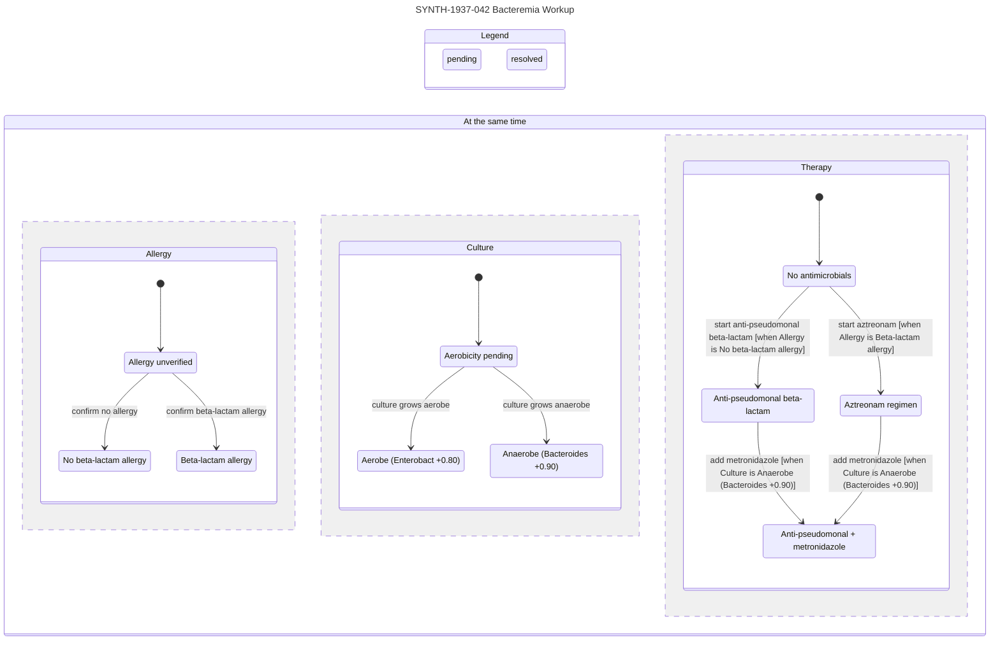
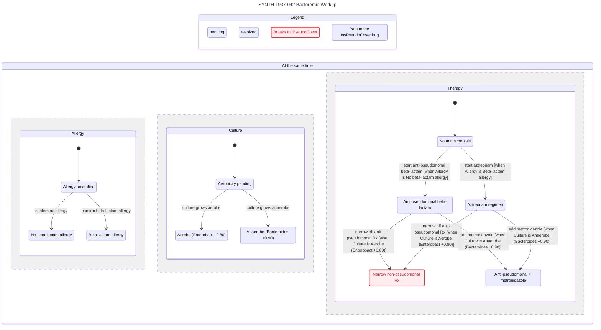

# `.med` — Biomedical Graph-Logic Meta-Specification

**Media Type:** `text/vnd.med+markdown` · **Extension:** `.med` · **Version:** `1.0.0`

`.med` (**medfile**) is an agent-native file format and formal model specification for biomedical workups. It unifies three orthogonal substrates into a single strict superset of CommonMark Markdown:

1. **Agent Context & Verification (`[1]`)** — [Cursor Statechart](https://github.com/cursor/plugins/tree/main/pstack/skills/statechart): bounded, model-checked TLA+ transition specifications projected into clinician-legible Mermaid `stateDiagram-v2` and Pele SVG statecharts.
2. **Knowledge Graph Traversal (`[2]`)** — [OpenGigantic ObjectGraph (`arXiv:2604.27820v1`)](https://arxiv.org/html/2604.27820v1): typed, role-scoped, progressively disclosed directed knowledge graphs queried via two-primitive \(O(1)\) index routing rather than full-document context injection.
3. **Epistemic Workup Calculus (`seed`)** — [MYCIN (`cl-aip/mycin`)](https://github.com/cl-aip/mycin): hierarchical context instantiation, goal-directed backward-chaining (`find-out`), signed Certainty Factor (\(\text{CF} \in [-1, +1]\)) propagation, and introspective justification (`WHY` / `HOW`), generalized from infectious bacteremia to arbitrary biomedical reasoning.

> **Research & Safety Boundary.** `.med` is a formal knowledge-and-workup representation for research and verification. Examples use synthetic identifiers (`SYNTH-`) and invented timelines (`1937`). A `.med` artifact is not a medical device, prescription, or autonomous clinical order; clinical action requires review and signature by a licensed clinician.

---

## 1. Pipeline Contract & Design Axioms

```plaintext
INPUT:   clinical case --natural-language
PROCESS: agent.workup { CRAWLS [2] }
OUTPUT:  graph.logic --fileformat .med { RENDERS [1] }
```

To achieve **minimum complexity** and **maximum clinical utility and cross-domain generality**, `.med` enforces four axioms:

1. **Markdown Superset & Homoiconic Closure.** Every valid CommonMark `.md` or ObjectGraph `.og` file is a valid `.med` document (unindexed Markdown parses as a single `::full` prose block with fallback full-read semantics). Reference biomedical knowledge bases crawled during `agent.workup` and case-specific workup graphs emitted as `.med` outputs share one schema and compose across files via URI-qualified edge pointers (`<uri>#<node-id>`).
2. **Traversal Over Injection (`CRAWLS [2]`).** Biomedical corpora are never injected wholesale into an agent context window. Agents read the lightweight `::index` manifest (\(\approx 30 + 6k\) tokens), select relevant nodes via LLM-as-Router, auto-traverse `:requires` dependencies, enforce `scope` access control at Pass 1, deduplicate session reads (`skip-if-known`), and treat `::warning` blocks as non-skippable at every disclosure depth.
3. **Signed Epistemic Tri-Separation (`Mycin`).** Affirmation (\(\text{cf} > 0\)), explicit negation (\(\text{cf} < 0\)), and ignorance or pending workup (\(\text{cf} = 0\)) remain algebraically distinct. Unmentioned history or pending assays bind `0.00` (`value: unknown`, never coerced to negative), while hedged clinical prose (`"possible"`, `"?"`) binds intermediate certainty in \((+0.20, +0.70]\) (never promoted to `+1.00`).
4. **Confluent Deduction / Explicit Transition Split (`RENDERS [1]`).** Deductive `rule` nodes compile to pure, order-independent state-level operators, whereas external clinical `action` nodes (diagnostic observations, therapeutic interventions, escalations) compile to named disjuncts of `Next`. This eliminates rule-interleaving state explosion and keeps rendered `[1]` statecharts within TLC's 500-state chart budget and \(\lesssim 20\) arrows.

---

## 2. Formal Model

A `.med` specification denotes a unified structure \(\mathcal{M} = (G, \mathcal{E}, \mathcal{A})\) over a single typed node-and-edge graph.

### 2.1 Graph Layer \(G = (V, E, \tau_V, \lambda_E, \rho)\)

\(G\) specializes the OpenGigantic ObjectGraph tuple with a closed kernel of **6 domain node types** (plus `.og` `meta` nodes) and **7 directed edge labels**.

| Node Type \(\tau_V(v)\) | Epistemic Role (`Mycin`) | Graph Role (`[2]`) | Statechart Role (`[1]`) |
|---|---|---|---|
| `context` | Entity instance (`defcontext`, `goals`) | Subgraph container | State variable owner & `terminal` scope |
| `finding` | Observable parameter (`ask-first`) | Source-grounded leaf (`src`) | `VARIABLE` (if `cf = 0.00` + `:resolves`) or constant |
| `hypothesis` | Inferred goal parameter (`infer-first`) | Derived epistemic node | State-level operator `CfHyp...` |
| `rule` | Production `IF P THEN w Q` (`defrule`) | Deductive hyperedge | Pure operator term `Rule...` |
| `action` | Diagnostic inquiry or intervention | Procedural step | Named action disjunct in `Next` |
| `invariant` | Clinical safety or liveness constraint | Executable `::assertion` | `INVARIANT` or temporal `PROPERTY` |
| `meta` | View projection & provenance delta | `__view`, `__changelog` | `view.mjs` exports (`state`, `step`, `group`, `colors`, `title`) |

| Edge Label \(\lambda_E(u, v)\) | Syntax | Traversal (`[2]`) | Epistemic / Automaton Contract (`Mycin` + `[1]`) |
|---|---|---|---|
| `:contains` | `->[:contains] v` | Structural | Instantiates child `context` \(v\) inside parent `context` \(u\) |
| `:requires` | `->[:requires] v` | **Auto-traversed** | Declares premise/guard/check dependency of `rule`, `action`, or `invariant` |
| `:supports` | `->[:supports cf=+w] v` | Forward trace | Positive rule attenuation \(+w \in (0, +1.0]\) toward `hypothesis` \(v\) |
| `:contradicts` | `->[:contradicts cf=-w] v` | Conflict trace | Negative rule attenuation \(-w \in [-1.0, 0)\) against `hypothesis` \(v\) |
| `:resolves` | `->[:resolves] v` | Inquiry link | Observation `action` \(u\) resolves unknown `finding` \(v\) (`cf = 0.00`) |
| `:transitions` | `->[:transitions] v` | Sequential | Clinical workflow sequencing from `action` \(u\) to downstream `action` \(v\) |
| `:supersedes` | `->[:supersedes] v` | Lineage / Federation | Links case node \(u\) to prior node or federated KB target `uri#id` |

Role scope \(\rho: V \to \mathcal{S}\) restricts index and node visibility over \(\mathcal{S} = \{\texttt{all}, \texttt{clinician}, \texttt{orchestrator}, \texttt{worker}, \texttt{patient}\}\) (extensible in `::schema`). A consumer with role \(r\) observes \(v\) iff \(\rho(v) \in \{\texttt{all}, r\}\).

### 2.2 Epistemic Layer \(\mathcal{E} = (\mathcal{C}, \Pi, \mathcal{R}, \mu, \kappa, \tau_+, \tau_-)\)

Let \(\Pi = V_{\text{finding}} \cup V_{\text{hypothesis}}\) be the set of parameters scoped to context instances \(c \in \mathcal{C}\). Each \(p \in \Pi\) has finite or numeric domain \(\text{Dom}(p)\), cardinality \(\kappa(p) \in \{\texttt{single}, \texttt{multi}\}\) (default `single` for mutually exclusive values; `multi` for concurrent values such as polymicrobial isolates), and valuation \(\mu_p: \text{Dom}(p) \to [-1.0, +1.0]\) with `0.0` denoting `unknown`. The acyclic `:requires` / `:supports` / `:contradicts` dependency graph stratifies derived hypotheses.

1. **Canonical Bipolar Evidence Combination (\(\oplus\)).** Given a finite multiset \(E\) of signed certainty contributions in \([-1.0, +1.0]\), partition \(E^+ = \{e \in E \mid e > 0\}\) and \(E^- = \{e \in E \mid e < 0\}\), with \(\bigoplus \emptyset = 0.0\):

\[
c_+ = 1 - \prod_{e \in E^+} (1 - e), \qquad c_- = -1 + \prod_{e \in E^-} (1 + e)
\]

\[
\bigoplus E = \begin{cases}
\bot_{\text{conflict}} & \text{if } c_+ = +1.0 \land c_- = -1.0 \\
\dfrac{c_+ + c_-}{1 - \min(c_+,\, |c_-|)} & \text{otherwise}
\end{cases}
\]

For \(|E| = 2\), \(\bigoplus \{a, b\}\) equals classical MYCIN `cf-or(a, b)`. For \(|E| \ge 3\) with mixed signs, bipolar partitioning eliminates sequential order dependence, making \(\bigoplus\) **strictly commutative, associative, and confluent** across arbitrary crawl orders. Simultaneous certain affirmation and negation (\(c_+ = +1.0 \land c_- = -1.0\)) yields \(\bot_{\text{conflict}}\), violating the implicit `NoHardConflict` invariant rather than silently cancelling to `0.0`.

2. **Activation & Pruning Cutoffs.** With default EMYCIN thresholds \((\tau_+, \tau_-) = (+0.20, -0.80)\) (configurable via `cf-thresholds` in `::schema`):

\[
\text{true?}(c) \iff c > \tau_+, \qquad \text{false?}(c) \iff c < \tau_-
\]

3. **Atomic Condition Evaluation.** For condition \(\phi = (p, \text{op}, X)\) over \(\text{op} \in \{\texttt{is}, \texttt{!=}, \texttt{in}, \texttt{>}, \texttt{>=}, \texttt{<}, \texttt{<=}\}\):

\[
E_{\text{match}}(\phi) = \{\mu_p(v) \mid v \in \text{Dom}(p),\, \text{op}(v, X),\, \mu_p(v) \ne 0\}
\]

\[
E_{\text{excl}}(\phi) = \begin{cases}
\{-\mu_p(v) \mid v \in \text{Dom}(p),\, \lnot\text{op}(v, X),\, \mu_p(v) > 0\} & \text{if } \kappa(p) = \texttt{single} \\
\emptyset & \text{if } \kappa(p) = \texttt{multi}
\end{cases}
\]

\[
\text{eval}(\phi) = \bigoplus \big(E_{\text{match}}(\phi) \cup E_{\text{excl}}(\phi)\big)
\]

Under `cardinality: single`, a definite finding `gram = neg` (`+1.00`) yields \(\text{eval}(\texttt{gram is neg}) = +1.00\), \(\text{eval}(\texttt{gram is pos}) = -1.00 < \tau_-\), and \(\text{eval}(\texttt{aerobicity is aerobic}) = 0.00\) while `aerobicity` is `unknown`. For explicit threshold guards `cf(p, v) op k` (with shorthand `cf(p) op k` when \(\text{Dom}(p) = [\texttt{present}]\)), evaluation is crisp (`+1.00` if \(\mu_p(v)\ \text{op}\ k\) holds, else `-1.00`).

4. **Premise Combination, `reject-premise`, and Rule Firing.** For rule \(r\) with premises \(P_r = (\phi_1, \dots, \phi_m)\) and signed weight \(w_r \in [-1.0, +1.0] \setminus \{0\}\):
   - **Short-circuit rejection (`reject-premise`):** If any already-known component satisfies \(\text{false?}(\text{eval}(\phi_i))\), rule \(r\) aborts in \(O(1)\) without querying unknown findings.
   - **Boolean connectives:** \(\text{CF}(\alpha \land \beta) = \min(\text{CF}(\alpha), \text{CF}(\beta))\), \(\text{CF}(\alpha \lor \beta) = \max(\text{CF}(\alpha), \text{CF}(\beta))\), \(\text{CF}(\lnot \alpha) = -\text{CF}(\alpha)\), and \(\text{CF}(\alpha \Rightarrow \beta) = \max(-\text{CF}(\alpha), \text{CF}(\beta))\).
   - **Attenuation:** Rule \(r\) fires iff \(\text{true?}(\text{CF}(P_r))\), contributing \(e_r = \text{CF}(P_r) \cdot w_r\) to its concluded `(hypothesis, value)`.

### 2.3 Automaton & Projection Layer \(\mathcal{A} = (S, S_0, \Sigma, \Delta, \mathcal{I}, \mathcal{P}, \mathcal{V})\)

To verify all reachable workup trajectories and render `[1]`:

- **State Vector (`vars`):** One state variable per unresolved `finding` (\(f \in V_{\text{finding}}\) with initial \(\text{cf} = 0.00\) and an incoming `:resolves` edge) over `{"unknown"}` \(\cup \text{Dom}(f)\), plus one variable per mutable clinical `state:` field declared on a `context` node (e.g., `regimen`). Bound findings (`cf != 0.00` without `:resolves`) compile to constants.
- **Initial Predicate (`Init`):** Initializes unresolved findings to `"unknown"` and `context` `state:` variables to their declared `:=` initial values.
- **State-Level Epistemic Operators:** Stratified rules and hypotheses compile to deterministic integer centi-certainty operators (\(C = \text{round}(100 \cdot \text{cf}) \in -100..100\), with `-999` sentinel for \(\bot_{\text{conflict}}\)).
- **Named Transition Relation (`Next`):**

\[
\texttt{Next} \triangleq \Big(\bigvee_{(a, f) \in E_{\text{resolves}},\, x \in D_a} \texttt{Act\_}a\texttt{\_}x\Big) \;\lor\; \Big(\bigvee_{a \in V_{\text{action}} \setminus V_{\text{obs}}} \texttt{Act\_}a\Big) \;\lor\; \texttt{Done}
\]

where \(D_a \subseteq \text{Dom}(f)\) is the outcome set declared in `effect: f in D_a`, and `Done` stutters (`UNCHANGED vars`) solely when the conjunction of declared `context` `terminal:` predicates holds (if any `terminal:` is declared), so unintended dead ends fail `NoDeadlock` while valid clinical completions pass cleanly.
- **Invariants (\(\mathcal{I}\)) & Properties (\(\mathcal{P}\)):** `invariant` nodes with `kind: safety` compile to TLA+ `INVARIANT` entries (alongside `TypeOK` and `NoHardConflict`); `kind: liveness` (`always`, `eventually`, `~>`) compiles to `PROPERTY` entries.
- **Reader View (\(\mathcal{V}\)):** Projects `vars` via `(state, step, group, colors, title)` into clinician-readable labels, rendering orthogonal regions (`state "At the same time" as all`) unless cross-region reachability would be misrepresented (`regionsLie`), in which case `[1]` lifts automatically to hierarchical parent states.

---

## 3. Concrete Syntax & EBNF Grammar

A structured `.med` file opens with three manifest blocks (`::meta`, `::schema`, `::index`) followed by `::node` definitions. Every row in `::index` MUST correspond 1-to-1 in `id`, `type`, `scope`, and `cf` to a `::node` in the body. Standard Markdown outside `::` blocks is preserved verbatim.

### 3.1 Block Taxonomy

| Block | Scope | Requirement | Contract |
|---|---|---|---|
| `::meta` | File | Mandatory (indexed mode) | Document title, version, `case-id`, domain tags, SHA-256 provenance |
| `::schema` | File | Mandatory (indexed mode) | `node-types`, `edge-types`, `scope-levels`, and `cf-thresholds` |
| `::index` | File | Mandatory (indexed mode) | Routing table `id \| type \| scope \| cf \| keywords` read in \(O(1)\) |
| `::dense` | Node | Mandatory (first block) | Single-line pipe-delimited summary (\(\le 15\) tokens) for Pass 2 triage |
| `::full` | Node | Optional | Clinical prose, `WHY` / `HOW` explanation traces |
| `::logic` | Node | Domain-conditional | Formal context, parameter, rule, action, invariant, or view specification |
| `::warning` | Node | Safety-conditional | **Protocol-non-skippable** allergy, red flag, or contraindication |
| `::edges` | Node | Optional | Directed typed edges (`->[:label attrs] target` or `uri#target`) |
| `::code`.. | Node | Optional (`.og` compat) | Native ObjectGraph blocks (`::code`, `::steps`, `::list`, `::table`, `::note`, `::example`, `::reference`, `::summary`, `::assertion`, `::changelog`) |

### 3.2 Complete Grammar (EBNF)

```ebnf
med_file        = markdown_raw
                | manifest , { node_block | markdown_prose } ;

manifest        = meta_block , schema_block , index_block ;
meta_block      = "::meta" , NEWLINE , { kv_line } , "::end" , NEWLINE ;
schema_block    = "::schema" , NEWLINE , { kv_line } , "::end" , NEWLINE ;
index_block     = "::index" , NEWLINE , { comment_line | index_row } , "::end" , NEWLINE ;

kv_line         = id , ":" , WS , TEXT_LINE , NEWLINE ;
comment_line    = "#" , [ TEXT_LINE ] , NEWLINE ;
index_row       = id , [ WS ] , "|" , [ WS ] , node_type , [ WS ] , "|" , [ WS ] , scope ,
                  [ WS ] , "|" , [ WS ] , signed_cf , [ WS ] , "|" , [ WS ] , TEXT_LINE , NEWLINE ;

node_block      = "::node" , [ WS ] , "[" , attr_list , "]" , NEWLINE ,
                  dense_block ,
                  { full_block | logic_block | warning_block | edges_block | og_ext_block } ,
                  "::end" , [ WS , "#" , [ WS ] , id ] , NEWLINE ;

attr_list       = attr , { WS , attr } ;
attr            = id , "=" , ( id | STRING | signed_cf | BOOL ) ;
node_type       = "context" | "finding" | "hypothesis" | "rule" | "action" | "invariant" | "meta" ;
scope           = "all" | "clinician" | "orchestrator" | "worker" | "patient" | id ;
signed_cf       = [ "+" | "-" ] , ( "1.00" | "1.0" | "0." , DIGIT , { DIGIT } | "0" ) ;

dense_block     = "::dense" , NEWLINE , TEXT_LINE , NEWLINE , "::end" , NEWLINE ;
full_block      = "::full" , NEWLINE , VERBATIM_LINES , "::end" , NEWLINE ;
warning_block   = "::warning" , NEWLINE , VERBATIM_LINES , "::end" , NEWLINE ;
edges_block     = "::edges" , NEWLINE , { edge_decl } , "::end" , NEWLINE ;
og_ext_block    = "::" , og_tag , [ [ WS ] , "[" , attr_list , "]" ] , NEWLINE ,
                  VERBATIM_LINES , "::end" , NEWLINE ;
og_tag          = "code" | "steps" | "list" | "table" | "note"
                | "example" | "reference" | "summary" | "assertion" | "changelog" ;

edge_decl       = edge_dir , "[:" , edge_type , { WS , attr } , "]" , WS , edge_target , NEWLINE ;
edge_dir        = "->" | "<-" | "<>" ;
edge_type       = "contains" | "requires" | "supports" | "contradicts"
                | "resolves" | "transitions" | "supersedes" ;
edge_target     = [ URI_PATH , "#" ] , id ;

logic_block     = "::logic" , NEWLINE , logic_body , "::end" , NEWLINE ;
logic_body      = context_logic | param_logic | rule_logic | action_logic | inv_logic | view_logic ;

context_logic   = "entity:" , WS , id , NEWLINE ,
                  { state_decl | state_lbl_decl } ,
                  [ "initial:" , WS , val_list , NEWLINE ] ,
                  "goals:" , WS , val_list , NEWLINE ,
                  [ "terminal:" , WS , bool_expr , NEWLINE ] ;
state_decl      = "state:" , WS , id , WS , "in" , WS , val_list , WS , ":=" , WS , literal , NEWLINE ;
state_lbl_decl  = "state-labels:" , WS , id , WS , map_expr , NEWLINE ;

param_logic     = "domain:" , WS , val_list , NEWLINE ,
                  [ "cardinality:" , WS , ( "single" | "multi" ) , NEWLINE ] ,
                  [ "value:" , WS , literal , NEWLINE ] ,
                  [ "ask-first:" , WS , BOOL , NEWLINE ] ,
                  [ "src:" , WS , STRING , NEWLINE ] ,
                  [ "labels:" , WS , map_expr , NEWLINE ] ;

rule_logic      = "if:" , WS , bool_expr , NEWLINE ,
                  "then:" , WS , signed_cf , WS , assignment_list , NEWLINE ;

action_logic    = "kind:" , WS , ( "observe" | "intervene" | "escalate" ) , NEWLINE ,
                  "guard:" , WS , bool_expr , NEWLINE ,
                  "effect:" , WS , effect_expr , NEWLINE ,
                  [ ( "label:" , WS , STRING | "labels:" , WS , map_expr ) , NEWLINE ] ;

inv_logic       = "kind:" , WS , ( "safety" | "liveness" ) , NEWLINE ,
                  "check:" , WS , temporal_expr , NEWLINE ;

view_logic      = { ( ( "title:" | "done-label:" ) , WS , STRING
                    | ( "regions:" | "colors:" | "steps:" ) , WS , map_expr
                    | "groups:" , WS , group_list ) , NEWLINE } ;
group_list      = "[" , [ WS ] , group_clause , { "," , [ WS ] , group_clause } , [ WS ] , "]" ;
group_clause    = "when" , WS , bool_expr , WS , "->" , WS , id
                | "default" , WS , "->" , WS , id ;

temporal_expr   = [ ( "always" | "eventually" ) , WS ] , bool_expr , [ WS , "~>" , WS , bool_expr ] ;
bool_expr       = impl_term , [ WS , "=>" , WS , bool_expr ] ;
impl_term       = bool_term , { WS , ( "and" | "or" ) , WS , bool_term } ;
bool_term       = "not" , WS , bool_term | "(" , bool_expr , ")" | atom_cond ;
atom_cond       = id , WS , ( "is" | "!=" | ">" | ">=" | "<" | "<=" ) , WS , literal
                | id , WS , "in" , WS , val_list
                | "cf(" , id , [ "," , [ WS ] , literal ] , ")" , WS , ( ">" | ">=" | "<" | "<=" ) , WS , signed_cf ;

assignment_list = id , WS , "=" , WS , literal , { "," , [ WS ] , id , WS , "=" , WS , literal } ;
effect_expr     = id , WS , ":=" , WS , literal
                | id , WS , "in" , WS , val_list ;
val_list        = "[" , [ WS ] , [ literal , { "," , [ WS ] , literal } ] , [ WS ] , "]" ;
map_expr        = "{" , [ WS ] , [ map_entry , { "," , [ WS ] , map_entry } ] , [ WS ] , "}" ;
map_entry       = id , ":" , WS , ( id | STRING ) ;

literal         = BOOL | NUMBER | STRING | id ;
BOOL            = "true" | "false" ;
NUMBER          = [ "+" | "-" ] , DIGIT , { DIGIT } , [ "." , DIGIT , { DIGIT } ] ;
STRING          = '"' , { CHAR_NO_QUOTE_NL | "\\" , ( '"' | "\\" | "n" | "t" | "r" | "f" ) } , '"' ;
URI_PATH        = ( LETTER | DIGIT | "_" | "." | "/" | "-" ) , { LETTER | DIGIT | "_" | "." | "/" | "-" } ;
id              = ( LETTER | "_" ) , { LETTER | DIGIT | "_" | "-" } ;
```

---

## 4. Execution Semantics: `agent.workup { CRAWLS [2] }`

### 4.1 Two-Primitive Graph Crawl Interface

`agent.workup` traverses external biomedical ObjectGraphs (`*.og` and reference `*.med` repositories) solely via the two ObjectGraph query primitives:

1. **`search_index(uri, role)`** \(\to\) Parses and returns `::meta`, `::schema`, and only those `::index` rows with `scope` \(\in \{\texttt{all}, \text{role}\}\) in \(O(1)\) reads (\(\approx 30 + 6k\) tokens). Nodes outside the caller's role scope are invisible at Pass 1.
2. **`resolve_context(uri, node_ids, depth, role, session)`** \(\to\) Deduplicates `node_ids` against `session.visited` for nodes annotated `skip-if-known=true`, transitively follows all `:requires` edges (including federated `uri#id` targets), enforces `scope`, and returns `::dense` at `depth="dense"` or `::full` + `::logic` + `::edges` at `depth="full"`. **Safety Override:** Any resolved node containing `::warning` unconditionally includes its full `::warning` block at every `depth`.

### 4.2 Goal-Directed Workup Algorithm

Given natural-language clinical case text \(T_{\text{case}}\), agent role \(r\), and knowledge graph corpus \(\mathcal{K}\):

1. **Case Grounding (`INPUT`).**
   - Instantiate active `context` node(s) (e.g., `ctx-patient`, `ctx-culture`, `ctx-organism`) and bind observable `finding` nodes from \(T_{\text{case}}\) with verbatim line provenance `src`:
     - Confirmed present finding \(\to \text{cf} = +1.00\)
     - Confirmed negated finding (`"denies"`, `"no"`, `"ruled out"`) \(\to \text{cf} = -1.00\)
     - Hedged clinical statement (`"possible"`, `"?"`, `"cannot exclude"`) \(\to \text{cf} \in (+0.20, +0.70]\)
     - Unmentioned history or pending assay \(\to \text{cf} = 0.00\), `value: unknown`
2. **Index-Routed Knowledge Crawl (`CRAWLS [2]`).**
   - Call `search_index(kb, r)` across candidate domain graphs in \(\mathcal{K}\).
   - Route via LLM-as-Router over `::index` rows to select candidate `hypothesis`, `rule`, `action`, and `invariant` IDs; screen at `depth="dense"` and resolve surviving subgraphs (with automatic `:requires` closure) at `depth="full"`.
3. **Backward-Chaining & Frontier Construction (`find-out`).**
   - Traverse active `context` instances depth-first along `:contains`. For each `hypothesis` \(h\) in `goals:`:
     - Collect incoming `:supports` and `:contradicts` rules \(R(h)\).
     - Apply `reject-premise` (`§2.2`): prune in \(O(1)\) any rule with an already-bound premise evaluating `< \tau_-` (`-0.80`).
     - Recursively resolve remaining premises (`ask-first: true` inspects case findings first; `ask-first: false` / hypotheses evaluate upstream rules first) and combine active rule outputs via \(\bigoplus\) to set \(\mu_h\).
   - Collect every `finding` \(f\) with `cf = 0.00` referenced via `:requires` on unpruned goal rules, candidate `action` guards, or active `invariant` checks, and attach matching observation actions (`->[:resolves] f`) to form the pending diagnostic frontier.
4. **Introspective Provenance (`WHY` / `HOW`) & Emission (`OUTPUT`).**
   - Record `WHY` rationale inside pending `finding` `::full` blocks (partitioning downstream rule premises into established `knowns` vs. discriminating `unknowns`) and `HOW` derivation traces inside inferred `hypothesis` `::full` blocks, preserving federated lineage via `->[:supersedes] kb#id`.
   - Emit the `.med` file and execute `[1]` statechart verification (`§5`).

---

## 5. Verification & Rendering Semantics: `{ RENDERS [1] }`

Every `.med` workup graph compiles deterministically into `(SPEC.tla, SPEC.cfg, view.mjs)` for Cursor's statechart verifier and renderer:

```sh
statechart SPEC.tla --config SPEC.cfg --view view.mjs --out SPEC-chart
```

### 5.1 Deterministic Lowering Rules (`.med` \(\to\) TLA+ & `view.mjs`)

Identifier hygiene maps kebab-case IDs to `snake_case` for TLA+ variables (`find-aerobicity` \(\to\) `find_aerobicity`) and `PascalCase` for TLA+ operators (`rule-052` \(\to\) `Rule052`, `inv-pseudo-cover` \(\to\) `InvPseudoCover`).

| `.med` Construct | Lowered `SPEC.tla` / `SPEC.cfg` / `view.mjs` Artifact |
|---|---|
| Centi-CF Preamble | Integer operators over `-100..100` (`EXTENDS Integers`): `CfScale(a,b)` (nearest-integer `(a*b)/100`), `CfFire(p,w) == IF p > TauPos THEN CfScale(p,w) ELSE 0`, `CfPos(a,b) == a + b - CfScale(a,b)`, `CfNeg(a,b) == a + b + CfScale(-a,-b)`, and `CfBipolar(cp,cn)` returning `-999` iff `cp = 100 /\ cn = -100` |
| Bound `finding` (`cf != 0.00`, no `:resolves`) | Constant valuation folded into atomic condition evaluation (`Eval_<id>_<op>`) |
| Unresolved `finding` (`cf = 0.00` + `:resolves`) | `VARIABLE <snake_id>` with `TypeOK` `<snake_id> \in {"unknown"} \cup Dom` and `Init` `<snake_id> = "unknown"` |
| `context` `state: s in D := v0` | `VARIABLE <snake_s>` with `TypeOK` `<snake_s> \in D` and `Init` `<snake_s> = "v0"` |
| `rule` + `hypothesis` | Stratified state-level operators `Rule<Id>` and `CfHyp<Id> == CfBipolar(CfPos(...), CfNeg(...))` |
| `action` (`kind: observe`, `effect: f in D`) | One action per \(x \in D\): `Act<Id>_<x> == guard /\ <snake_f>' = "x" /\ UNCHANGED other_vars` |
| `action` (`intervene` / `escalate`, `s := v`) | Named action `Act<Id> == guard /\ <snake_s>' = "v" /\ UNCHANGED other_vars` |
| `context` `terminal:` predicates | Conjoined into `Done == (<terminal_conj>) /\ UNCHANGED vars` in `Next`; if no `terminal:` is declared, `SPEC.cfg` emits `CHECK_DEADLOCK FALSE` |
| `invariant` (`kind: safety`) | State predicate listed under `INVARIANT` in `SPEC.cfg` alongside `TypeOK` and `NoHardConflict` (`CfHyp<Id> /= -999`) |
| `invariant` (`kind: liveness`) | Temporal formula (`always P` \(\to\) `[](P)`, `eventually P` \(\to\) `<>(P)`, `P ~> Q` \(\to\) `(P) ~> (Q)`) listed under `PROPERTY` in `SPEC.cfg` |
| `node[id=__view type=meta]` | ES module `view.mjs` exporting only `title`, `colors` (restricted to `blue`, `orange`, `purple`, `yellow`, `teal`, `tan`, `pink`), `state(v)` mapping each `regions: { R: ref }` entry via `labels:` / `state-labels:` lookup on `v.<snake_ref>`, `group(v)` evaluating `groups:` clauses in order, and `step(action)` mapping action names via `label:` / `labels:` / `steps:` (with `Done` mapped to `done-label`, default `"workup complete"`, never `null`) |

### 5.2 Visual Semantics & Safety Marks

`statechart` invokes SANY and TLC (`tla2tools.jar`) and emits `report.md` plus `chart.mmd`, rendered to light/dark adaptive SVG via `pele@1.9.0` (`{ limit: 1_000_000, outputLimit: 8_000_000, maxEdges: 10_000 }`):

- **`breaks` (`#ffecee` / stroke `#e72e3b`):** Every underlying model state projected to this chart state violates a clinical `INVARIANT`.
- **`mayBreak` (`#fff3e6` / stroke `#e8730c`):** Label coarsening merged safe and unsafe states; `state(v)` MUST split the label until every invariant violation renders distinctly as `breaks`.
- **`bugPath` (stroke `#1680f3`):** Highlights TLC's shortest counterexample trace from `Init` to the violated rule.
- **`repeats` (dashed stroke `#9b35d6`):** Highlights a stuttering or cyclic lasso violating a temporal `PROPERTY` (e.g., diagnostic loop never reaching disposition).

---

## 6. Canonical End-to-End Instantiation

### 6.1 `INPUT`: Natural-Language Clinical Case

```text
Case SYNTH-1937-042 (1937-05-14):
58-year-old male admitted with serious thermal burn injuries and acute rigor/fever (39.2 C).
Peripheral blood culture (CULTURE-1, obtained 24h ago) preliminary Gram stain shows
Gram-negative rods; culture aerobicity and genus identity remain pending.
History significant for neutropenia (immunocompromised host). Beta-lactam allergy status is
undocumented (patient obtunded; next-of-kin en route). No antimicrobials started yet.
```

### 6.2 `PROCESS`: `agent.workup { CRAWLS [2] }` Trace

1. **Index Crawl:** `search_index("kb/bacteremia.med", role="clinician")` reads 12 index rows (~102 tokens vs. full-guideline context injection).
2. **Pruning & Resolution:** LLM-as-Router selects Gram-negative bacteremia rules (`rule-052`, `rule-073`, `rule-075`, `rule-107`) and antimicrobial safety invariants (`inv-allergy-gate`, `inv-pseudo-cover`, `inv-anaerobe-cover`). Gram-positive cocci rules (`rule-071`, `rule-165`) abort via `reject-premise` in \(O(1)\) because single-valued `find-gram-rod = gram_neg_rod` (`+1.00`) evaluates `find-gram-rod is gram_pos_coccus` to \(-1.00 < -0.80\).
3. **Epistemic Closure at Intake:**
   - `rule-052` (`find-gram-rod is gram_neg_rod /\ find-burn is serious`) fires with \(w = +0.40\) toward `hyp-pseudomonas`.
   - `rule-075` (`find-gram-rod is gram_neg_rod /\ find-compromised is yes`) fires with \(w = +0.60\) toward `hyp-pseudomonas`.
   - Canonical bipolar combination yields:

\[
\text{CF}(\texttt{hyp-pseudomonas}) = 0.40 \oplus 0.60 = 0.40 + 0.60 - (0.40)(0.60) = +0.76 > +0.20
\]

   - `hyp-enterobact` (`rule-107`, \(w = +0.80\)) and `hyp-bacteroides` (`rule-073`, \(w = +0.90\)) remain at `0.00` pending `find-aerobicity`.
   - `find-allergy-blactam` remains `0.00` (`value: unknown`), while `resolve_context` surfaces its non-skippable `::warning`, gating \(\beta\)-lactam initiation until `act-verify-allergy` observes it.

### 6.3 `OUTPUT`: `.med` Graph-Logic Specification (`synth-1937-042.med`)

```markdown
::meta
title: SYNTH-1937-042 Burn Bacteremia Workup
version: 1.0.0
updated: 1937-05-14
case-id: SYNTH-1937-042
domain: infectious-disease|bacteremia|critical-care
scope: all
checksum: sha256:7d4e9b1c2a0f8831
::end

::schema
node-types: [context, finding, hypothesis, rule, action, invariant, meta]
edge-types: [contains, requires, supports, contradicts, resolves, transitions, supersedes]
scope-levels: [all, clinician, orchestrator, worker, patient]
cf-thresholds: [0.20, -0.80]
::end

::index
# id                 | type       | scope     | cf    | keywords
ctx-patient          | context    | all       | +1.00 | patient, host, burn, neutropenia, regimen
ctx-culture          | context    | all       | +1.00 | blood, culture, specimen, venipuncture
ctx-organism         | context    | all       | +1.00 | organism, isolate, pathogen, identity
find-burn            | finding    | all       | +1.00 | thermal, burn, serious, skin
find-compromised     | finding    | all       | +1.00 | neutropenia, immunocompromised, host
find-gram-rod        | finding    | all       | +1.00 | blood, gram-negative, rod, stain
find-aerobicity      | finding    | all       |  0.00 | aerobicity, aerobic, anaerobic, pending
find-allergy-blactam | finding    | all       |  0.00 | allergy, beta-lactam, penicillin, unverified
hyp-pseudomonas      | hypothesis | clinician | +0.76 | pseudomonas, bacteremia, opportunistic
hyp-enterobact       | hypothesis | clinician |  0.00 | enterobacteriaceae, aerobic, rod
hyp-bacteroides      | hypothesis | clinician |  0.00 | bacteroides, anaerobic, rod
rule-052             | rule       | clinician | +0.40 | mycin-52, burn, blood, gram-neg-rod
rule-075             | rule       | clinician | +0.60 | mycin-75, compromised, gram-neg-rod
rule-107             | rule       | clinician | +0.80 | mycin-107, aerobic, enterobacteriaceae
rule-073             | rule       | clinician | +0.90 | mycin-73, anaerobic, bacteroides
act-verify-allergy   | action     | all       | +1.00 | allergy, history, family, verify
act-await-aerobicity | action     | all       | +1.00 | culture, incubation, aerobicity, lab
act-start-blactam    | action     | clinician | +1.00 | cefepime, piperacillin, beta-lactam, empiric
act-start-aztreonam  | action     | clinician | +1.00 | aztreonam, allergy-safe, anti-pseudomonal
act-add-anaerobe     | action     | clinician | +1.00 | metronidazole, anaerobic, bacteroides
inv-allergy-gate     | invariant  | all       | +1.00 | safety, allergy, beta-lactam, gate
inv-pseudo-cover     | invariant  | clinician | +1.00 | safety, pseudomonas, premature-narrowing
inv-anaerobe-cover   | invariant  | clinician | +1.00 | safety, bacteroides, anaerobic, coverage
__view               | meta       | all       | +1.00 | statechart, regions, mermaid, pele
::end

::node [id=ctx-patient type=context cf=+1.00 scope=all]
::dense
SYNTH-1937-042|male|58y|burn=serious|compromised=yes
::end
::logic
entity: PATIENT
state: regimen in [none, empiric_blactam, empiric_aztreonam, targeted_combo, narrow_nonpseudo] := none
state-labels: regimen { none: "No antimicrobials", empiric_blactam: "Anti-pseudomonal beta-lactam", empiric_aztreonam: "Aztreonam regimen", targeted_combo: "Anti-pseudomonal + metronidazole", narrow_nonpseudo: "Narrow non-pseudomonal Rx" }
initial: [find-burn, find-compromised, find-allergy-blactam]
goals: []
terminal: (find-aerobicity is aerobic and regimen in [empiric_blactam, empiric_aztreonam]) or (find-aerobicity is anaerobic and regimen is targeted_combo)
::end
::edges
->[:contains] ctx-culture
::end
::end # ctx-patient

::node [id=ctx-culture type=context cf=+1.00 scope=all]
::dense
CULTURE-1|site=blood|age=24h|preliminary-stain
::end
::logic
entity: CULTURE
initial: [find-gram-rod]
goals: []
::end
::edges
->[:contains] ctx-organism
::end
::end # ctx-culture

::node [id=ctx-organism type=context cf=+1.00 scope=all]
::dense
ORGANISM-1|blood-isolate|identity-goal
::end
::logic
entity: ORGANISM
initial: [find-gram-rod, find-aerobicity]
goals: [hyp-pseudomonas, hyp-enterobact, hyp-bacteroides]
::end
::end # ctx-organism

::node [id=find-burn type=finding cf=+1.00 scope=all context=ctx-patient]
::dense
burn=serious|cf=+1.00|case-line-1
::end
::logic
domain: [no, mild, serious]
cardinality: single
value: serious
ask-first: true
src: "L1: admitted with serious thermal burn injuries"
::end
::end # find-burn

::node [id=find-compromised type=finding cf=+1.00 scope=all context=ctx-patient]
::dense
compromised-host=yes|neutropenia|cf=+1.00|case-line-4
::end
::logic
domain: [yes, no]
cardinality: single
value: yes
ask-first: true
src: "L4: History significant for neutropenia (immunocompromised host)"
::end
::end # find-compromised

::node [id=find-gram-rod type=finding cf=+1.00 scope=all context=ctx-organism]
::dense
site=blood|gram=neg|morphology=rod|cf=+1.00
::end
::logic
domain: [gram_neg_rod, gram_pos_coccus, other]
cardinality: single
value: gram_neg_rod
ask-first: true
src: "L2-L3: Peripheral blood culture ... preliminary Gram stain shows Gram-negative rods"
::end
::end # find-gram-rod

::node [id=find-aerobicity type=finding cf=0.00 scope=all context=ctx-organism]
::dense
aerobicity=unknown|pending-subculture|discriminates-R107-R073
::end
::full
WHY needed: find-gram-rod (+1.00) is established; resolving aerobicity discriminates
hyp-enterobact (rule-107, +0.80) from hyp-bacteroides (rule-073, +0.90).
::end
::logic
domain: [aerobic, anaerobic]
cardinality: single
value: unknown
ask-first: true
labels: { unknown: "Aerobicity pending", aerobic: "Aerobe (Enterobact +0.80)", anaerobic: "Anaerobe (Bacteroides +0.90)" }
::end
::end # find-aerobicity

::node [id=find-allergy-blactam type=finding cf=0.00 scope=all context=ctx-patient]
::dense
beta-lactam-allergy=unknown|obtunded-patient|blocks-blactam
::end
::warning
Beta-lactam allergy status is UNVERIFIED (cf=0.00). Do not read undocumented status as
negative; beta-lactam administration is blocked until confirmed negative.
::end
::logic
domain: [pos, neg]
cardinality: single
value: unknown
ask-first: true
src: "L4-L5: Beta-lactam allergy status is undocumented (patient obtunded)"
labels: { unknown: "Allergy unverified", neg: "No beta-lactam allergy", pos: "Beta-lactam allergy" }
::end
::end # find-allergy-blactam

::node [id=rule-052 type=rule cf=+0.40 scope=clinician]
::dense
MYCIN-R052|blood+gram-neg-rod+serious-burn->pseudomonas(+0.40)
::end
::logic
if: find-gram-rod is gram_neg_rod and find-burn is serious
then: +0.40 hyp-pseudomonas = present
::end
::edges
->[:requires] find-gram-rod
->[:requires] find-burn
->[:supports cf=+0.40] hyp-pseudomonas
->[:supersedes] kb/mycin.med#rule-052
::end
::end # rule-052

::node [id=rule-075 type=rule cf=+0.60 scope=clinician]
::dense
MYCIN-R075|gram-neg-rod+compromised-host->pseudomonas(+0.60)
::end
::logic
if: find-gram-rod is gram_neg_rod and find-compromised is yes
then: +0.60 hyp-pseudomonas = present
::end
::edges
->[:requires] find-gram-rod
->[:requires] find-compromised
->[:supports cf=+0.60] hyp-pseudomonas
->[:supersedes] kb/mycin.med#rule-075
::end
::end # rule-075

::node [id=rule-107 type=rule cf=+0.80 scope=clinician]
::dense
MYCIN-R107|gram-neg-rod+aerobic->enterobacteriaceae(+0.80)
::end
::logic
if: find-gram-rod is gram_neg_rod and find-aerobicity is aerobic
then: +0.80 hyp-enterobact = present
::end
::edges
->[:requires] find-gram-rod
->[:requires] find-aerobicity
->[:supports cf=+0.80] hyp-enterobact
->[:supersedes] kb/mycin.med#rule-107
::end
::end # rule-107

::node [id=rule-073 type=rule cf=+0.90 scope=clinician]
::dense
MYCIN-R073|blood+gram-neg-rod+anaerobic->bacteroides(+0.90)
::end
::logic
if: find-gram-rod is gram_neg_rod and find-aerobicity is anaerobic
then: +0.90 hyp-bacteroides = present
::end
::edges
->[:requires] find-gram-rod
->[:requires] find-aerobicity
->[:supports cf=+0.90] hyp-bacteroides
->[:supersedes] kb/mycin.med#rule-073
::end
::end # rule-073

::node [id=hyp-pseudomonas type=hypothesis cf=+0.76 scope=clinician context=ctx-organism]
::dense
pseudomonas|cf=+0.76|R052(+0.40)+R075(+0.60)|active
::end
::full
HOW derived: rule-052 (+0.40) combined with rule-075 (+0.60) via MYCIN bipolar
disjunction yields 0.40 + 0.60 - 0.24 = +0.76 (strongly suggestive).
::end
::logic
domain: [present]
value: present
::end
::end # hyp-pseudomonas

::node [id=hyp-enterobact type=hypothesis cf=0.00 scope=clinician context=ctx-organism]
::dense
enterobacteriaceae|cf=0.00|pending-aerobicity=aerobic(+0.80)
::end
::logic
domain: [present]
value: unknown
::end
::end # hyp-enterobact

::node [id=hyp-bacteroides type=hypothesis cf=0.00 scope=clinician context=ctx-organism]
::dense
bacteroides|cf=0.00|pending-aerobicity=anaerobic(+0.90)
::end
::logic
domain: [present]
value: unknown
::end
::end # hyp-bacteroides

::node [id=act-verify-allergy type=action cf=+1.00 scope=all]
::dense
observe|verify-beta-lactam-allergy|next-of-kin-or-ehrcard
::end
::logic
kind: observe
guard: find-allergy-blactam is unknown
effect: find-allergy-blactam in [neg, pos]
labels: { neg: "confirm no allergy", pos: "confirm beta-lactam allergy" }
::end
::edges
->[:resolves] find-allergy-blactam
->[:transitions] act-start-blactam
->[:transitions] act-start-aztreonam
::end
::end # act-verify-allergy

::node [id=act-await-aerobicity type=action cf=+1.00 scope=all]
::dense
observe|subculture-aerobicity|aerobic-vs-anaerobic
::end
::logic
kind: observe
guard: find-aerobicity is unknown
effect: find-aerobicity in [aerobic, anaerobic]
labels: { aerobic: "culture grows aerobe", anaerobic: "culture grows anaerobe" }
::end
::edges
->[:resolves] find-aerobicity
->[:transitions] act-add-anaerobe
::end
::end # act-await-aerobicity

::node [id=act-start-blactam type=action cf=+1.00 scope=clinician]
::dense
intervene|empiric-antipseudomonal-blactam|requires-allergy=neg
::end
::logic
kind: intervene
guard: regimen is none and find-allergy-blactam is neg and cf(hyp-pseudomonas) > +0.20
effect: regimen := empiric_blactam
label: "start anti-pseudomonal beta-lactam"
::end
::edges
->[:requires] find-allergy-blactam
->[:requires] hyp-pseudomonas
::end
::end # act-start-blactam

::node [id=act-start-aztreonam type=action cf=+1.00 scope=clinician]
::dense
intervene|empiric-aztreonam|requires-allergy=pos
::end
::logic
kind: intervene
guard: regimen is none and find-allergy-blactam is pos and cf(hyp-pseudomonas) > +0.20
effect: regimen := empiric_aztreonam
label: "start aztreonam"
::end
::edges
->[:requires] find-allergy-blactam
->[:requires] hyp-pseudomonas
::end
::end # act-start-aztreonam

::node [id=act-add-anaerobe type=action cf=+1.00 scope=clinician]
::dense
intervene|add-metronidazole|when-bacteroides-cf>0.20
::end
::logic
kind: intervene
guard: regimen in [empiric_blactam, empiric_aztreonam] and cf(hyp-bacteroides) > +0.20
effect: regimen := targeted_combo
label: "add metronidazole"
::end
::edges
->[:requires] hyp-bacteroides
::end
::end # act-add-anaerobe

::node [id=inv-allergy-gate type=invariant cf=+1.00 scope=all]
::dense
safety|never-give-blactam-without-confirmed-neg-allergy
::end
::logic
kind: safety
check: regimen is empiric_blactam => find-allergy-blactam is neg
::end
::edges
->[:requires] find-allergy-blactam
::end
::end # inv-allergy-gate

::node [id=inv-pseudo-cover type=invariant cf=+1.00 scope=clinician]
::dense
safety|retain-antipseudomonal-coverage-while-cf>0.20
::end
::warning
Even if aerobic subculture raises Enterobacteriaceae to CF +0.80 (> Pseudomonas +0.76),
anti-pseudomonal coverage MUST NOT be dropped while CF(Pseudomonas) > +0.20.
::end
::logic
kind: safety
check: cf(hyp-pseudomonas) > +0.20 => regimen != narrow_nonpseudo
::end
::edges
->[:requires] hyp-pseudomonas
::end
::end # inv-pseudo-cover

::node [id=inv-anaerobe-cover type=invariant cf=+1.00 scope=clinician]
::dense
safety|anaerobic-isolate-requires-anaerobic-coverage-at-disposition
::end
::logic
kind: safety
check: (find-aerobicity is anaerobic and not (regimen in [none, empiric_blactam, empiric_aztreonam])) => regimen is targeted_combo
::end
::edges
->[:requires] find-aerobicity
::end
::end # inv-anaerobe-cover

::node [id=__view type=meta cf=+1.00 scope=all]
::dense
statechart-view|3-regions|Allergy-Culture-Therapy|yellow-teal
::end
::logic
title: "SYNTH-1937-042 Bacteremia Workup"
regions: { Allergy: find-allergy-blactam, Culture: find-aerobicity, Therapy: regimen }
colors: { pending: "yellow", resolved: "teal" }
groups: [ when regimen is none or find-aerobicity is unknown -> pending, default -> resolved ]
done-label: "workup complete"
::end
::end # __view
```

### 6.4 `RENDERS [1]`: TLC-Verified Statechart & Counterexample Detection

#### A. Verified Guarded Workup (`exit 0`: 17 model states, 28 steps \(\to\) 10 chart states, 8 arrows)

All six invariants (`TypeOK`, `NoHardConflict`, `InvAllergyGate`, `InvPseudoCover`, `InvAnaerobeCover`, `NoDeadlock`) hold across every reachable diagnostic ordering:



#### B. Pre-Execution Catch of Naive Argmax Narrowing (`exit 1`: `InvPseudoCover` Breaks)

If an agent adds a naive argmax de-escalation action (`act-naive-narrow`, narrowing off anti-pseudomonal coverage once aerobic growth pushes `hyp-enterobact` to `+0.80` above `hyp-pseudomonas` `+0.76`), `[1]` isolates the exact 4-step clinical failure trajectory, marking `s9` with `breaks` and the shortest path with `bugPath`:



Shortest counterexample emitted in `report.md`:

```text
## InvPseudoCover breaks
The shortest path has 4 steps:
0. Allergy Allergy unverified, Culture Aerobicity pending, Therapy No antimicrobials
1. culture grows aerobe: Allergy Allergy unverified, Culture Aerobe (Enterobact +0.80), Therapy No antimicrobials
2. confirm no allergy: Allergy No beta-lactam allergy, Culture Aerobe (Enterobact +0.80), Therapy No antimicrobials
3. start anti-pseudomonal beta-lactam: Allergy No beta-lactam allergy, Culture Aerobe (Enterobact +0.80), Therapy Anti-pseudomonal beta-lactam
4. narrow off anti-pseudomonal Rx: Allergy No beta-lactam allergy, Culture Aerobe (Enterobact +0.80), Therapy Narrow non-pseudomonal Rx
```

---

## 7. Cross-Domain Generality Matrix

The 6-node, 7-edge `.med` kernel requires zero schema extensions to express arbitrary biomedical workups beyond its MYCIN seed:

| Domain | `context` Hierarchy | `finding` (`cf`) | `hypothesis` (\(\bigoplus\)) | `action` (`Next`) | `invariant` (`INVARIANT`) |
|---|---|---|---|---|---|
| **Infectious Disease** *(seed)* | `PATIENT -> CULTURE -> ORGANISM` | Stain, site, host status, allergy | Pathogen identity (`+0.76`) | Subculture, empiric/targeted Rx | `InvAllergyGate`, `InvPseudoCover` |
| **Acute Chest Pain Triage** | `PATIENT -> ENCOUNTER -> ISCHEMIA` | ECG ST-shift, 0h/2h troponin, pain | NSTEMI, PE, aortic dissection | Serial troponin, CTA, heparin | `NoAnticoagBeforeDissectionExcluded` |
| **Molecular Oncology** | `PATIENT -> TUMOR -> VARIANT` | VAF, MSI/TMB, prior lines, ECOG | Actionable driver, resistance | Liquid biopsy, targeted inhibitor | `CompanionDxConfirmed`, `QTcGate` |
| **Trial Eligibility** | `TRIAL -> CANDIDATE -> CRITERION` | Labs, washout days, consent | Inclusion / exclusion stratum | Washout wait, screening lab | `ZeroExclusionViolations`, `SignedConsent` |
| **Pharmacovigilance** | `CASE -> EXPOSURE -> EVENT` | Dechallenge, rechallenge, timing | Drug causality (Naranjo/MYCIN) | Hold suspect agent, antidote | `NoRechallengeAfterAnaphylaxis` |
| **Biologic / Wet-Lab Cleanroom** | `CONSTRUCT -> ASSAY -> CLONE` | Off-target hits, titer, endotoxin | Sequence fitness, developability | Orthogonal screen, kill-gate | `EndotoxinBelowReleaseLimit` |

---

## References

1. **Statechart (`[1]`):** Cursor Plugins — `pstack/skills/statechart`. [https://github.com/cursor/plugins/tree/main/pstack/skills/statechart](https://github.com/cursor/plugins/tree/main/pstack/skills/statechart)
2. **ObjectGraph (`[2]`):** M. Dubey. *ObjectGraph: From Document Injection to Knowledge Traversal — A Native File Format for the Agentic Era*. Open Gigantic, 2026. [https://arxiv.org/html/2604.27820v1](https://arxiv.org/html/2604.27820v1)
3. **MYCIN (`seed`):** P. Norvig. *Paradigms of Artificial Intelligence Programming*, Ch. 16 (`cl-aip/mycin`), after E. H. Shortliffe & B. G. Buchanan (1975). [https://github.com/cl-aip/mycin](https://github.com/cl-aip/mycin)

## License

MIT — see [LICENSE](LICENSE).
