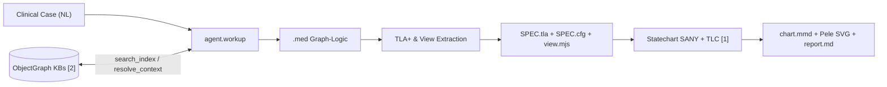
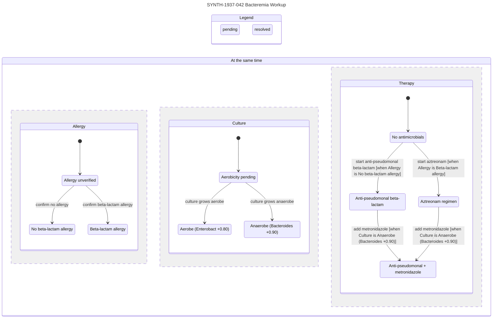
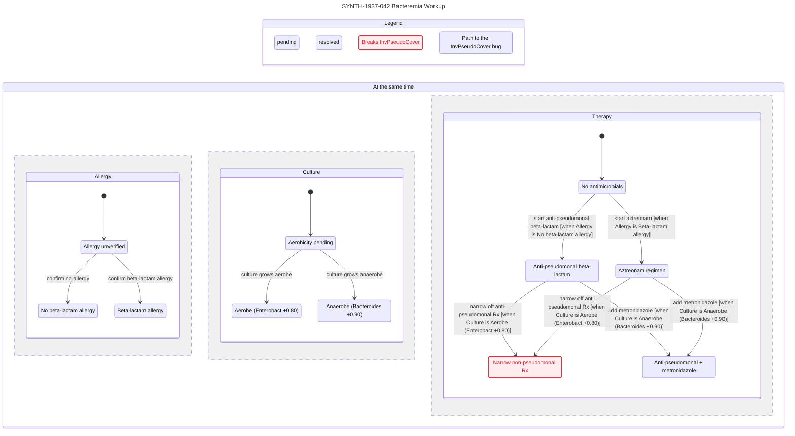

# `.med` — Biomedical Graph-Logic Meta-Specification

```toml
[med]
media_type = "text/vnd.med+markdown"
extension  = ".med"
version    = "1.0.0"

[substrates]
context = { id = "[1]", ref = "cursor/plugins/pstack/skills/statechart", logic = "tla" }
graph   = { id = "[2]", ref = "arXiv:2604.27820v1", container = ".og / ~ebnf" }
workup  = { id = "seed", ref = "cl-aip/mycin", math = "lean" }

[pipeline]
input   = "clinical case --natural-language"
process = "agent.workup { CRAWLS [2] }"
output  = "graph.logic --fileformat .med { RENDERS [1] }"

[aims]
minimum = ["complexity"]
maximum = ["utility", "generality"]
```

> **Research & Safety Boundary.** `.med` is a formal knowledge-and-workup representation for research and verification. Examples use synthetic identifiers (`SYNTH-`) and invented timelines (`1937`). A `.med` artifact is not a medical device, prescription, or autonomous clinical order; clinical action requires review and signature by a licensed clinician.

---

## 1. Pipeline & Design Axioms



1. **Markdown & ObjectGraph Superset.** Every CommonMark `.md` or OpenGigantic `.og` file is a valid `.med` file. Reference knowledge bases crawled during `agent.workup` and case workups emitted as `.med` share one schema and federate across files via `uri#id` edge targets.
2. **Traversal Over Injection (`CRAWLS [2]`).** Agents never inject whole corpora; they read `::index`, route node IDs semantically, auto-traverse `:requires`, enforce `scope` at Pass 1, deduplicate `skip-if-known` nodes, and never skip `::warning` blocks.
3. **Signed Epistemic Tri-Separation (`Mycin`).** Affirmation (`cf > 0`), disconfirmation (`cf < 0`), and ignorance (`cf = 0`) stay distinct. Unmentioned or pending findings bind `0.00` (`"unknown"`), never negative; hedged prose binds intermediate certainty, never `+1.00`.
4. **Pure Deduction / Explicit Transition Split (`RENDERS [1]`).** Deductive `rule` and `hypothesis` nodes evaluate as pure state-level TLA+ operators, while clinical `action` nodes form the named disjuncts of `Next`, keeping charts inside TLC's 500-state budget and ~20-arrow legibility target.

---

## 2. Graph Ontology & Token Cost (`[2]`)

| Node Type | MYCIN Role (`seed`) | ObjectGraph Role (`[2]`) | Statechart Role (`[1]`) |
|---|---|---|---|
| `context` | Entity instance (`entity`, `goals`) | Subgraph container | `VARIABLE` owner & `Done` scope |
| `finding` | Observable parameter (`ask-first`) | Source-grounded leaf | `VARIABLE` (if `cf = 0.00` + `:resolves`) or constant |
| `hypothesis` | Goal parameter (`infer-first`) | Derived epistemic node | State operator `CfHyp...` |
| `rule` | Production `IF P THEN w Q` | Deductive hyperedge | State operator `Rule...` |
| `action` | Diagnostic inquiry or therapy | Procedural step | Named disjunct(s) in `Next` |
| `invariant` | Safety or liveness rule | Executable assertion | `INVARIANT` or `PROPERTY` |
| `meta` | View projection & delta log | `__view`, `__changelog` | `view.mjs` module exports |

| Edge | Syntax | Crawl (`[2]`) | Semantics (`Mycin` + `[1]`) |
|---|---|---|---|
| `:contains` | `->[:contains] v` | Structural | Scopes child `context`, `finding`, or `hypothesis` `v` under `context` |
| `:requires` | `->[:requires] v` | **Auto-loaded** | Premise, guard, or invariant dependency on `v` |
| `:supports` | `->[:supports cf=+w] v` | Forward trace | Positive rule weight `+w` toward `hypothesis` `v` |
| `:contradicts` | `->[:contradicts cf=-w] v` | Conflict trace | Negative rule weight `-w` against `hypothesis` `v` |
| `:resolves` | `->[:resolves] v` | Inquiry link | Observation `action` binds unknown `finding` `v` (`cf = 0.00`) |
| `:transitions` | `->[:transitions] v` | Sequential | Clinical workflow ordering between `action` nodes |
| `:supersedes` | `->[:supersedes] v` | Lineage / URI | Revises prior node or links to federated `uri#id` |

```lean
inductive NodeType | context | finding | hypothesis | rule | action | invariant | meta
  deriving DecidableEq, Repr

inductive EdgeType | contains | requires | supports | contradicts | resolves | transitions | supersedes
  deriving DecidableEq, Repr

inductive Scope | all | clinician | orchestrator | worker | patient | custom (s : String)
  deriving DecidableEq, Repr

structure Edge (Id : Type) where
  src  : Id
  dst  : Id
  kind : EdgeType
  cf   : Option Int := none

structure MedGraph (Id : Type) where
  nodes : List Id
  edges : List (Edge Id)
  kind  : Id → NodeType
  scope : Id → Scope

def canObserve (caller nodeScope : Scope) : Bool :=
  nodeScope == .all || nodeScope == caller

-- Progressive-disclosure token cost (arXiv:2604.27820v1, §4.5 & App. B)
def indexCost (k : Nat) : Nat := 30 + 6 * k
def queryCost (k denseMatched fullResolved : Nat) : Nat :=
  indexCost k + 15 * denseMatched + 180 * fullResolved

theorem crawl_beats_full_injection : queryCost 12 4 2 < 1800 := by decide
```

---

## 3. Epistemic Certainty Calculus (`seed`)

| Clinical Prose Signal | Bound `cf` | Representation |
|---|---|---|
| Confirmed present | `+1.00` | Definite value |
| Confirmed absent (`"denies"`, `"no"`, `"ruled out"`) | `-1.00` | Definite negation |
| Hedged (`"possible"`, `"?"`, `"cannot exclude"`) | `(+0.20, +0.70]` | Attenuated value; never promoted to `+1.00` |
| Unmentioned or pending assay | `0.00` | `"unknown"`; eligible for `:resolves` |

Bipolar evidence combination partitions positive and negative rule contributions before normalization, making aggregation commutative and associative across arbitrary crawl orders while flagging `+1.00` vs. `-1.00` contradictions as `.conflict`:

```lean
structure Q where
  num : Int
  den : Int
  deriving DecidableEq, Repr

namespace Q
def norm (q : Q) : Q :=
  let g : Int := Int.gcd q.num q.den
  let s : Int := if q.den < 0 then -1 else 1
  { num := s * (q.num / g), den := s * (q.den / g) }

def ofCenti (c : Int) : Q := norm ⟨c, 100⟩
def zero : Q := ⟨0, 1⟩
def one  : Q := ⟨1, 1⟩
def neg  (a : Q) : Q := ⟨-a.num, a.den⟩
def abs  (a : Q) : Q := ⟨Int.natAbs a.num, a.den⟩
def add  (a b : Q) : Q := norm ⟨a.num * b.den + b.num * a.den, a.den * b.den⟩
def sub  (a b : Q) : Q := add a (neg b)
def mul  (a b : Q) : Q := norm ⟨a.num * b.num, a.den * b.den⟩
def div  (a b : Q) : Q := norm ⟨a.num * b.den, a.den * b.num⟩
def lt   (a b : Q) : Bool := a.num * b.den < b.num * a.den
def min  (a b : Q) : Q := if lt a b then a else b
def max  (a b : Q) : Q := if lt a b then b else a
end Q

inductive Card | single | multi deriving DecidableEq, Repr
inductive Cf   | val (q : Q) | conflict deriving DecidableEq, Repr

def cfCombine (es : List Q) : Cf :=
  let pos  := es.filter (fun e => Q.lt Q.zero e)
  let neg  := es.filter (fun e => Q.lt e Q.zero)
  let cPos := Q.sub Q.one (pos.foldl (fun acc e => Q.mul acc (Q.sub Q.one e)) Q.one)
  let cNeg := Q.add (Q.neg Q.one) (neg.foldl (fun acc e => Q.mul acc (Q.add Q.one e)) Q.one)
  if cPos == Q.one && cNeg == Q.neg Q.one then .conflict
  else .val (Q.div (Q.add cPos cNeg) (Q.sub Q.one (Q.min cPos (Q.abs cNeg))))

def tauPos : Q := Q.ofCenti 20
def tauNeg : Q := Q.ofCenti (-80)

def trueP : Cf → Bool
  | .val q    => Q.lt tauPos q
  | .conflict => false

def falseP : Cf → Bool
  | .val q    => Q.lt q tauNeg
  | .conflict => false

def evalAtom [BEq α] (κ : Card) (dom : List α) (μ : α → Q) (pred : α → Bool) : Cf :=
  let m := (dom.filter pred).filterMap (fun v => let c := μ v; if c == Q.zero then none else some c)
  let x := match κ with
    | .multi  => []
    | .single => (dom.filter (fun v => !pred v)).filterMap
        (fun v => let c := μ v; if Q.lt Q.zero c then some (Q.neg c) else none)
  cfCombine (m ++ x)

def fireRule (premiseCf : Cf) (weight : Q) : Option Q :=
  match premiseCf with
  | .val p    => if Q.lt tauPos p then some (Q.mul p weight) else none
  | .conflict => none

theorem pseudomonas_r052_r075 :
    cfCombine [Q.ofCenti 40, Q.ofCenti 60] = .val (Q.ofCenti 76) := by decide

theorem bipolar_order_independent :
    cfCombine [Q.ofCenti 40, Q.ofCenti 60, Q.ofCenti (-20)] =
    cfCombine [Q.ofCenti (-20), Q.ofCenti 60, Q.ofCenti 40] := by decide

theorem hard_conflict_detected :
    cfCombine [Q.one, Q.neg Q.one] = .conflict := by decide

theorem single_valued_exclusion_prunes_gram_pos :
    let dom := ["gram_neg_rod", "gram_pos_coccus", "other"]
    let μ   := fun v => if v == "gram_neg_rod" then Q.one else Q.zero
    falseP (evalAtom .single dom μ (· == "gram_pos_coccus")) = true := by decide
```

---

## 4. `.med` Graph-Container Grammar (`~EBNF`)

`.med` preserves full OpenGigantic `.og` block compatibility while allowing single-line `::dense` summaries, direct node-level edge lines, and native CommonMark fenced codeblocks (`tla`, `lean`, `js`). Every `::index` row bijects 1-to-1 with a `::node` on `(id, type, scope, cf)`.

```ebnf
med_file      = markdown_raw
              | manifest , { node_block | markdown_prose } ;

manifest      = "::meta"   , NL , { kv_line } , "::end" , NL ,
                "::schema" , NL , { kv_line } , "::end" , NL ,
                "::index"  , NL , { comment_line | index_row } , "::end" , NL ;

kv_line       = id , ":" , WS , TEXT_LINE , NL ;
comment_line  = "#" , [ TEXT_LINE ] , NL ;
index_row     = id , [ WS ] , "|" , [ WS ] , node_type , [ WS ] , "|" , [ WS ] , scope ,
                [ WS ] , "|" , [ WS ] , signed_cf , [ WS ] , "|" , [ WS ] , TEXT_LINE , NL ;

node_block    = "::node" , [ WS ] , "[" , attr , { WS , attr } , "]" , NL ,
                dense_spec ,
                { edge_decl | edges_block | fenced_code | colon_block } ,
                "::end" , NL ;

attr          = id , "=" , ( id | STRING | signed_cf | "true" | "false" ) ;
node_type     = "context" | "finding" | "hypothesis" | "rule" | "action" | "invariant" | "meta" ;
scope         = "all" | "clinician" | "orchestrator" | "worker" | "patient" | id ;
signed_cf     = [ "+" | "-" ] , ( "1.00" | "1.0" | "0." , DIGIT , { DIGIT } | "0" ) ;

dense_spec    = "::dense" , WS , TEXT_LINE , NL
              | "::dense" , NL , TEXT_LINE , NL , "::end" , NL ;
fenced_code   = "```" , ( "tla" | "lean" | "js" | id ) , NL , VERBATIM , "```" , NL ;
colon_block   = "::" , ( "full" | "warning" | "reference" | "steps" | "list" | "table"
                       | "note" | "example" | "summary" | "assertion" | "changelog" | "code" ) ,
                [ [ WS ] , "[" , attr , { WS , attr } , "]" ] , NL , VERBATIM , "::end" , NL ;

edges_block   = "::edges" , NL , { edge_decl } , "::end" , NL ;
edge_decl     = ( "->" | "<-" | "<>" ) , "[:" , edge_type , { WS , attr } , "]" ,
                WS , target , { "," , [ WS ] , target } , NL ;
edge_type     = "contains" | "requires" | "supports" | "contradicts"
              | "resolves" | "transitions" | "supersedes" ;
target        = [ URI_PATH , "#" ] , id ;
id            = ( LETTER | "_" ) , { LETTER | DIGIT | "_" | "-" } ;
```

---

## 5. Workup Crawl & Lowering Logic (`tla`)

### 5.1 Crawl & Backward-Chaining Protocol (`agent.workup { CRAWLS [2] }`)

`agent.workup` queries external graphs exclusively via `search_index(uri, role)` and `resolve_context(uri, ids, depth, role, session)`, enforcing non-skippable `::warning` reads and single-step `reject-premise` pruning before assembling the pending diagnostic frontier:

```tla
---- MODULE AgentWorkup ----
EXTENDS FiniteSets

Nodes           == {"find_gram", "find_allergy", "rule_052", "rule_071", "hyp_pseudo"}
ScopedVisible   == {"find_gram", "find_allergy", "rule_052", "rule_071", "hyp_pseudo"}
HasWarning      == {"find_allergy"}
Requires(n)     == CASE n = "rule_052" -> {"find_gram"}
                     [] n = "rule_071" -> {"find_gram"}
                     [] OTHER          -> {}
PremiseFalse(r) == r = "rule_071"
UnknownFindings == {"find_allergy"}

VARIABLES phase, resolved, warningsRead, pruned, frontier
vars == <<phase, resolved, warningsRead, pruned, frontier>>

Init ==
  /\ phase = "index" /\ resolved = {} /\ warningsRead = {}
  /\ pruned = {} /\ frontier = {}

ResolveContext ==
  /\ phase = "index"
  /\ LET sel  == {"rule_052", "rule_071", "find_allergy"} \cap ScopedVisible
         full == sel \cup UNION {Requires(n) : n \in sel}
     IN /\ resolved' = full
        /\ warningsRead' = full \cap HasWarning
        /\ phase' = "chain"
        /\ UNCHANGED <<pruned, frontier>>

BackwardChain ==
  /\ phase = "chain"
  /\ pruned' = {r \in resolved : PremiseFalse(r)}
  /\ frontier' = resolved \cap UnknownFindings
  /\ phase' = "done"
  /\ UNCHANGED <<resolved, warningsRead>>

Done == phase = "done" /\ UNCHANGED vars
Next == ResolveContext \/ BackwardChain \/ Done
Spec == Init /\ [][Next]_vars

WarningsNeverSkipped == (resolved \cap HasWarning) \subseteq warningsRead
FalseRulesPruned     == (phase = "done") => ("rule_071" \in pruned /\ "rule_052" \notin pruned)
====
```

### 5.2 Deterministic Statechart Lowering (`{ RENDERS [1] }`)

Extracting the `tla` fences from active `.med` nodes and prepending the integer centi-CF preamble (`round(100 * cf)` in `-100..100`, scaling `cf-thresholds: [+0.20, -0.80]` to `TauPos == 20`, `TauNeg == -80`, with `-999` for `.conflict`) yields `(SPEC.tla, SPEC.cfg, view.mjs)` directly for Cursor's `statechart` CLI:

```sh
statechart SPEC.tla --config SPEC.cfg --view view.mjs --out SPEC-chart
```

- **`context` / unresolved `finding` with `var=<v> init=<v0>`:** Declares `VARIABLE <v>`, `Init` conjunct `<v> = "<v0>"`, and `TypeOK` conjunct `<v> \in <Pascal(v)>Dom`.
- **`rule` & `hypothesis` `tla` fences:** Pure state-level operators evaluated over `vars` via `CfFire`, `CfPos`, `CfNeg`, and `CfBipolar`.
- **`action` & `Done` `tla` fences:** Disjuncts of `Next`. If no `context` defines `Done`, `SPEC.cfg` sets `CHECK_DEADLOCK FALSE`.
- **`invariant` `tla` fences:** `kind=safety` registers under `INVARIANT` (with `TypeOK` and `NoHardConflict`); `kind=liveness` registers under `PROPERTY`.
- **`__view` `js` fence:** Written verbatim to `view.mjs` (`title`, `colors`, `state`, `group`, `step`).

```tla
---- MODULE MedCentiCfPreamble ----
EXTENDS Integers

TauPos == 20
TauNeg == -80

CfAnd(a, b) == IF a <= b THEN a ELSE b
CfOr(a, b)  == IF a >= b THEN a ELSE b
CfNot(a)    == -a
CfScale(a, b) ==
  IF a * b >= 0 THEN (a * b + 50) \div 100
  ELSE -(((-(a * b)) + 50) \div 100)
CfFire(p, w) == IF p > TauPos THEN CfScale(p, w) ELSE 0
CfPos(a, b)  == a + b - CfScale(a, b)
CfNeg(a, b)  == a + b + CfScale(-a, -b)
CfBipolar(cp, cn) ==
  IF cp = 100 /\ cn = -100 THEN -999
  ELSE LET m   == IF cp <= (-cn) THEN cp ELSE (-cn)
           num == (cp + cn) * 100
           den == 100 - m
       IN IF num >= 0 THEN (num + (den \div 2)) \div den
          ELSE -(((-num) + (den \div 2)) \div den)
EvalEq(v, target) == IF v = target THEN 100 ELSE IF v = "unknown" THEN 0 ELSE -100
====
```

| Statechart Mark | CSS / Mermaid Style | Verification Meaning |
|---|---|---|
| `breaks` | `fill:#ffecee,stroke:#e72e3b` | Every model state in this chart label violates an `INVARIANT` |
| `mayBreak` | `fill:#fff3e6,stroke:#e8730c` | Coarsened label merges safe & unsafe states; split `state(v)` |
| `bugPath` | `stroke:#1680f3` | Shortest TLC counterexample path from `Init` to violation |
| `repeats` | `stroke:#9b35d6,dasharray:6 3` | Stuttering or cyclic lasso violating a temporal `PROPERTY` |

---

## 6. Canonical End-to-End Instantiation (`SYNTH-1937-042`)

### 6.1 `INPUT`: Natural-Language Clinical Case

```text
Case SYNTH-1937-042 (1937-05-14):
58-year-old male admitted with serious thermal burn injuries and acute rigor/fever (39.2 C).
Peripheral blood culture (CULTURE-1, obtained 24h ago) preliminary Gram stain shows
Gram-negative rods; culture aerobicity and genus identity remain pending.
History significant for neutropenia (immunocompromised host). Beta-lactam allergy status is
undocumented (patient obtunded; next-of-kin en route). No antimicrobials started yet.
```

### 6.2 `OUTPUT`: `.med` Graph-Logic Specification (`synth-1937-042.med`)

````markdown
::meta
title: SYNTH-1937-042 Burn Bacteremia Workup
version: 1.0.0
updated: 1937-05-14
case-id: SYNTH-1937-042
domain: infectious-disease|bacteremia|critical-care
scope: all
checksum: sha256:7d4e9b1c2a0f8831
::end

::schema
node-types: [context, finding, hypothesis, rule, action, invariant, meta]
edge-types: [contains, requires, supports, contradicts, resolves, transitions, supersedes]
scope-levels: [all, clinician, orchestrator, worker, patient]
cf-thresholds: [+0.20, -0.80]
::end

::index
# id | type | scope | cf | keywords
ctx-patient | context | all | +1.00 | patient, host, burn, neutropenia, regimen
ctx-culture | context | all | +1.00 | blood, culture, specimen, venipuncture
ctx-organism | context | all | +1.00 | organism, isolate, pathogen, identity
find-burn | finding | all | +1.00 | thermal, burn, serious, skin
find-compromised | finding | all | +1.00 | neutropenia, immunocompromised, host
find-gram-rod | finding | all | +1.00 | blood, gram-negative, rod, stain
find-aerobicity | finding | all | 0.00 | aerobicity, aerobic, anaerobic, pending
find-allergy | finding | all | 0.00 | allergy, beta-lactam, penicillin, unverified
rule-052 | rule | clinician | +0.40 | mycin-52, burn, blood, gram-neg-rod
rule-075 | rule | clinician | +0.60 | mycin-75, compromised, gram-neg-rod
rule-107 | rule | clinician | +0.80 | mycin-107, aerobic, enterobacteriaceae
rule-073 | rule | clinician | +0.90 | mycin-73, anaerobic, bacteroides
hyp-pseudomonas | hypothesis | clinician | +0.76 | pseudomonas, bacteremia, opportunistic
hyp-enterobact | hypothesis | clinician | 0.00 | enterobacteriaceae, aerobic, rod
hyp-bacteroides | hypothesis | clinician | 0.00 | bacteroides, anaerobic, rod
act-verify-allergy | action | all | +1.00 | allergy, history, family, verify
act-await-aerobicity | action | all | +1.00 | culture, incubation, aerobicity, lab
act-start-blactam | action | clinician | +1.00 | cefepime, piperacillin, beta-lactam, empiric
act-start-aztreonam | action | clinician | +1.00 | aztreonam, allergy-safe, anti-pseudomonal
act-add-anaerobe | action | clinician | +1.00 | metronidazole, anaerobic, bacteroides
inv-allergy-gate | invariant | all | +1.00 | safety, allergy, beta-lactam, gate
inv-pseudo-cover | invariant | clinician | +1.00 | safety, pseudomonas, premature-narrowing
inv-anaerobe-cover | invariant | clinician | +1.00 | safety, bacteroides, anaerobic, coverage
__view | meta | all | +1.00 | statechart, regions, mermaid, pele
::end

::node [id=ctx-patient type=context cf=+1.00 scope=all entity=PATIENT var=regimen init=none]
::dense SYNTH-1937-042|male|58y|burn=serious|compromised=yes|regimen=none
->[:contains] ctx-culture
```tla
RegimenDom == {"none", "empiric_blactam", "empiric_aztreonam", "targeted_combo", "narrow_nonpseudo"}
Done ==
  /\ \/ (aerobicity = "aerobic" /\ regimen \in {"empiric_blactam", "empiric_aztreonam"})
     \/ (aerobicity = "anaerobic" /\ regimen = "targeted_combo")
  /\ UNCHANGED vars
```
::end

::node [id=ctx-culture type=context cf=+1.00 scope=all entity=CULTURE]
::dense CULTURE-1|site=blood|age=24h|preliminary-stain
->[:contains] ctx-organism
::end

::node [id=ctx-organism type=context cf=+1.00 scope=all entity=ORGANISM goals="hyp-pseudomonas,hyp-enterobact,hyp-bacteroides"]
::dense ORGANISM-1|blood-isolate|identity-goals
->[:contains] find-gram-rod, find-aerobicity, hyp-pseudomonas, hyp-enterobact, hyp-bacteroides
::end

::node [id=find-burn type=finding cf=+1.00 scope=all src="L1: serious thermal burn injuries"]
::dense burn=serious|cf=+1.00|src=L1
```tla
Burn == "serious"
```
::end

::node [id=find-compromised type=finding cf=+1.00 scope=all src="L4: neutropenia (immunocompromised host)"]
::dense compromised=yes|neutropenia|cf=+1.00|src=L4
```tla
Compromised == "yes"
```
::end

::node [id=find-gram-rod type=finding cf=+1.00 scope=all src="L2-L3: blood culture Gram-negative rods"]
::dense site=blood|gram=neg|morphology=rod|cf=+1.00|src=L2-L3
```tla
GramStain == "gram_neg_rod"
```
::end

::node [id=find-aerobicity type=finding cf=0.00 scope=all var=aerobicity init=unknown]
::dense aerobicity=unknown|pending-subculture|discriminates-R107-R073
::full
WHY: GramStain = gram_neg_rod (+1.00) is established; aerobicity discriminates
hyp-enterobact (rule-107, +0.80) from hyp-bacteroides (rule-073, +0.90).
::end
```tla
AerobicityDom == {"unknown", "aerobic", "anaerobic"}
```
::end

::node [id=find-allergy type=finding cf=0.00 scope=all var=allergy init=unknown src="L4-L5: allergy undocumented"]
::dense allergy=unknown|obtunded-patient|blocks-blactam|src=L4-L5
::warning
Beta-lactam allergy is UNVERIFIED (cf=0.00). Never treat undocumented allergy
as negative; beta-lactam administration is blocked until allergy = "neg".
::end
```tla
AllergyDom == {"unknown", "neg", "pos"}
```
::end

::node [id=rule-052 type=rule cf=+0.40 scope=clinician]
::dense MYCIN-R052|blood+gram-neg-rod+serious-burn->pseudomonas(+0.40)
->[:requires] find-gram-rod, find-burn
->[:supports cf=+0.40] hyp-pseudomonas
->[:supersedes] kb/mycin.med#rule-052
```tla
Rule052 == CfFire(CfAnd(EvalEq(GramStain, "gram_neg_rod"), EvalEq(Burn, "serious")), 40)
```
::end

::node [id=rule-075 type=rule cf=+0.60 scope=clinician]
::dense MYCIN-R075|gram-neg-rod+compromised-host->pseudomonas(+0.60)
->[:requires] find-gram-rod, find-compromised
->[:supports cf=+0.60] hyp-pseudomonas
->[:supersedes] kb/mycin.med#rule-075
```tla
Rule075 == CfFire(CfAnd(EvalEq(GramStain, "gram_neg_rod"), EvalEq(Compromised, "yes")), 60)
```
::end

::node [id=rule-107 type=rule cf=+0.80 scope=clinician]
::dense MYCIN-R107|gram-neg-rod+aerobic->enterobacteriaceae(+0.80)
->[:requires] find-gram-rod, find-aerobicity
->[:supports cf=+0.80] hyp-enterobact
->[:supersedes] kb/mycin.med#rule-107
```tla
Rule107 == CfFire(CfAnd(EvalEq(GramStain, "gram_neg_rod"), EvalEq(aerobicity, "aerobic")), 80)
```
::end

::node [id=rule-073 type=rule cf=+0.90 scope=clinician]
::dense MYCIN-R073|blood+gram-neg-rod+anaerobic->bacteroides(+0.90)
->[:requires] find-gram-rod, find-aerobicity
->[:supports cf=+0.90] hyp-bacteroides
->[:supersedes] kb/mycin.med#rule-073
```tla
Rule073 == CfFire(CfAnd(EvalEq(GramStain, "gram_neg_rod"), EvalEq(aerobicity, "anaerobic")), 90)
```
::end

::node [id=hyp-pseudomonas type=hypothesis cf=+0.76 scope=clinician]
::dense pseudomonas|cf=+0.76|R052(+0.40)+R075(+0.60)|active
::full
HOW: rule-052 (+0.40) and rule-075 (+0.60) combine via CfPos to +0.76.
::end
```tla
CfHypPseudomonas == CfBipolar(CfPos(Rule052, Rule075), 0)
```
::end

::node [id=hyp-enterobact type=hypothesis cf=0.00 scope=clinician]
::dense enterobacteriaceae|cf=0.00|pending-aerobicity=aerobic(+0.80)
```tla
CfHypEnterobact == CfBipolar(Rule107, 0)
```
::end

::node [id=hyp-bacteroides type=hypothesis cf=0.00 scope=clinician]
::dense bacteroides|cf=0.00|pending-aerobicity=anaerobic(+0.90)
```tla
CfHypBacteroides == CfBipolar(Rule073, 0)
```
::end

::node [id=act-verify-allergy type=action cf=+1.00 scope=all]
::dense observe|verify-beta-lactam-allergy|neg-or-pos
->[:resolves] find-allergy
->[:transitions] act-start-blactam, act-start-aztreonam
```tla
ActVerifyAllergyNeg ==
  /\ allergy = "unknown" /\ allergy' = "neg" /\ UNCHANGED <<regimen, aerobicity>>
ActVerifyAllergyPos ==
  /\ allergy = "unknown" /\ allergy' = "pos" /\ UNCHANGED <<regimen, aerobicity>>
```
::end

::node [id=act-await-aerobicity type=action cf=+1.00 scope=all]
::dense observe|subculture-aerobicity|aerobic-or-anaerobic
->[:resolves] find-aerobicity
->[:transitions] act-add-anaerobe
```tla
ActAerobicityAer ==
  /\ aerobicity = "unknown" /\ aerobicity' = "aerobic" /\ UNCHANGED <<regimen, allergy>>
ActAerobicityAna ==
  /\ aerobicity = "unknown" /\ aerobicity' = "anaerobic" /\ UNCHANGED <<regimen, allergy>>
```
::end

::node [id=act-start-blactam type=action cf=+1.00 scope=clinician]
::dense intervene|empiric-antipseudomonal-blactam|requires-allergy=neg
->[:requires] find-allergy, hyp-pseudomonas
```tla
ActStartBlactam ==
  /\ regimen = "none" /\ allergy = "neg" /\ CfHypPseudomonas > 20
  /\ regimen' = "empiric_blactam" /\ UNCHANGED <<allergy, aerobicity>>
```
::end

::node [id=act-start-aztreonam type=action cf=+1.00 scope=clinician]
::dense intervene|empiric-aztreonam|requires-allergy=pos
->[:requires] find-allergy, hyp-pseudomonas
```tla
ActStartAztreonam ==
  /\ regimen = "none" /\ allergy = "pos" /\ CfHypPseudomonas > 20
  /\ regimen' = "empiric_aztreonam" /\ UNCHANGED <<allergy, aerobicity>>
```
::end

::node [id=act-add-anaerobe type=action cf=+1.00 scope=clinician]
::dense intervene|add-metronidazole|when-bacteroides-cf>0.20
->[:requires] hyp-bacteroides
```tla
ActAddAnaerobe ==
  /\ regimen \in {"empiric_blactam", "empiric_aztreonam"} /\ CfHypBacteroides > 20
  /\ regimen' = "targeted_combo" /\ UNCHANGED <<allergy, aerobicity>>
```
::end

::node [id=inv-allergy-gate type=invariant cf=+1.00 scope=all kind=safety]
::dense safety|never-give-blactam-without-confirmed-neg-allergy
->[:requires] find-allergy
```tla
InvAllergyGate == (regimen = "empiric_blactam") => (allergy = "neg")
```
::end

::node [id=inv-pseudo-cover type=invariant cf=+1.00 scope=clinician kind=safety]
::dense safety|retain-antipseudomonal-coverage-while-cf>0.20
->[:requires] hyp-pseudomonas
::warning
Even if aerobic subculture raises Enterobacteriaceae to CF +0.80 (> Pseudomonas +0.76),
anti-pseudomonal coverage MUST NOT be dropped while CF(Pseudomonas) > +0.20.
::end
```tla
InvPseudoCover == (CfHypPseudomonas > 20) => (regimen /= "narrow_nonpseudo")
```
::end

::node [id=inv-anaerobe-cover type=invariant cf=+1.00 scope=clinician kind=safety]
::dense safety|anaerobic-isolate-requires-anaerobic-coverage-at-disposition
->[:requires] find-aerobicity
```tla
InvAnaerobeCover ==
  (aerobicity = "anaerobic" /\ regimen \notin {"none", "empiric_blactam", "empiric_aztreonam"})
    => (regimen = "targeted_combo")
```
::end

::node [id=__view type=meta cf=+1.00 scope=all]
::dense statechart-view|3-regions|Allergy-Culture-Therapy|yellow-teal
```js
export const title = "SYNTH-1937-042 Bacteremia Workup";
export const colors = { pending: "yellow", resolved: "teal" };
export const state = (v) => ({
  Allergy: {
    unknown: "Allergy unverified",
    neg: "No beta-lactam allergy",
    pos: "Beta-lactam allergy",
  }[v.allergy],
  Culture: {
    unknown: "Aerobicity pending",
    aerobic: "Aerobe (Enterobact +0.80)",
    anaerobic: "Anaerobe (Bacteroides +0.90)",
  }[v.aerobicity],
  Therapy: {
    none: "No antimicrobials",
    empiric_blactam: "Anti-pseudomonal beta-lactam",
    empiric_aztreonam: "Aztreonam regimen",
    targeted_combo: "Anti-pseudomonal + metronidazole",
    narrow_nonpseudo: "Narrow non-pseudomonal Rx",
  }[v.regimen],
});
export const group = (v) =>
  v.regimen === "none" || v.aerobicity === "unknown" ? "pending" : "resolved";
export const step = (a) => ({
  ActVerifyAllergyNeg: "confirm no allergy",
  ActVerifyAllergyPos: "confirm beta-lactam allergy",
  ActAerobicityAer: "culture grows aerobe",
  ActAerobicityAna: "culture grows anaerobe",
  ActStartBlactam: "start anti-pseudomonal beta-lactam",
  ActStartAztreonam: "start aztreonam",
  ActAddAnaerobe: "add metronidazole",
  ActNaiveNarrow: "narrow off anti-pseudomonal Rx",
  Done: "workup complete",
}[a] ?? a);
```
::end
````

### 6.3 `RENDERS [1]`: TLC-Verified Statecharts

#### A. Guarded Workup (`exit 0`: 17 states, 28 steps -> 10 chart states, 8 arrows)

`TypeOK`, `NoHardConflict`, `InvAllergyGate`, `InvPseudoCover`, `InvAnaerobeCover`, and `NoDeadlock` hold across every diagnostic ordering:



#### B. Counterexample Detection (`exit 1`: `InvPseudoCover` Breaks on Naive Argmax Narrowing)

Adding `ActNaiveNarrow` (narrowing off anti-pseudomonal therapy once `CfHypEnterobact = 80 > CfHypPseudomonas = 76`) triggers `breaks` on `s9` and highlights the 4-step `bugPath`:



```text
InvPseudoCover breaks — shortest path (4 steps):
0. Allergy Allergy unverified, Culture Aerobicity pending, Therapy No antimicrobials
1. culture grows aerobe: Allergy Allergy unverified, Culture Aerobe (Enterobact +0.80), Therapy No antimicrobials
2. confirm no allergy: Allergy No beta-lactam allergy, Culture Aerobe (Enterobact +0.80), Therapy No antimicrobials
3. start anti-pseudomonal beta-lactam: Allergy No beta-lactam allergy, Culture Aerobe (Enterobact +0.80), Therapy Anti-pseudomonal beta-lactam
4. narrow off anti-pseudomonal Rx: Allergy No beta-lactam allergy, Culture Aerobe (Enterobact +0.80), Therapy Narrow non-pseudomonal Rx
```

---

## 7. Cross-Domain Generality

| Domain | `context` DAG | `finding` (`cf`) | `hypothesis` (`CfBipolar`) | `action` (`Next`) | `invariant` (`INVARIANT`) |
|---|---|---|---|---|---|
| **Infectious Disease** | `PATIENT -> CULTURE -> ORGANISM` | Stain, site, host, allergy | Pathogen identity (`+0.76`) | Subculture, empiric/targeted Rx | `InvAllergyGate`, `InvPseudoCover` |
| **Chest Pain Triage** | `PATIENT -> ENCOUNTER -> ISCHEMIA` | ECG ST-shift, 0h/2h troponin | NSTEMI, PE, dissection | Serial troponin, CTA, heparin | `NoAnticoagBeforeDissectionExcluded` |
| **Molecular Oncology** | `PATIENT -> TUMOR -> VARIANT` | VAF, MSI/TMB, ECOG | Driver vs. resistance clone | Liquid biopsy, targeted TKI | `CompanionDxConfirmed`, `QTcGate` |
| **Trial Eligibility** | `TRIAL -> CANDIDATE -> CRITERION` | Labs, washout days, consent | Inclusion / exclusion fit | Washout wait, screening assay | `ZeroExclusions`, `SignedConsent` |
| **Pharmacovigilance** | `CASE -> EXPOSURE -> EVENT` | Dechallenge, rechallenge | Drug causality | Hold culprit drug, antidote | `NoRechallengeAfterAnaphylaxis` |
| **Biologic Cleanroom** | `CONSTRUCT -> ASSAY -> CLONE` | Off-target hits, endotoxin | Sequence developability | Orthogonal screen, kill-gate | `EndotoxinBelowReleaseLimit` |

---

## References

1. **Statechart (`[1]`):** [Cursor `pstack/skills/statechart`](https://github.com/cursor/plugins/tree/main/pstack/skills/statechart)
2. **ObjectGraph (`[2]`):** M. Dubey, [*ObjectGraph: From Document Injection to Knowledge Traversal*](https://arxiv.org/html/2604.27820v1), Open Gigantic, 2026.
3. **MYCIN (`seed`):** P. Norvig, [*PAIP* Ch. 16 (`cl-aip/mycin`)](https://github.com/cl-aip/mycin), after E. H. Shortliffe & B. G. Buchanan (1975).

## License

MIT — see [LICENSE](LICENSE).
