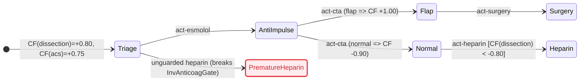

# `.med`

```toml
[med]
media_type = "text/vnd.med+markdown"
extension  = ".med"
version    = "1.0.0"

[pipeline]
input   = "clinical case --natural-language"
process = "workup { CRAWLS ::index, :requires }"
output  = "graph.logic --fileformat .med { RENDERS mermaid }"
```

## 1. Axioms

1. **Superset.** Every CommonMark `.md` or OpenGigantic `.og` file is a valid `.med` file. Files compose across `uri#id` edges.
2. **Graph read.** Entry is `::index`. `:requires` loads dependencies. `::warning` is never skipped. `scope` gates visibility.
3. **Signed certainty.** Affirmation (`cf > 0`), negation (`cf < 0`), and ignorance (`cf = 0`) stay distinct. Unknown is `0.00`; hedged prose stays in `(+0.20, +0.70]`.
4. **Domain invariance.** Core syntax, math, and logic hold no specialty tokens. Specialty enters only through `::meta`, `scale`, and `uri#id` targets.
5. **Unified chart (`mermaid`).** `rule` and `hypothesis` nodes are pure state operators; `action` nodes are transitions. `__view` renders the graph as any `mermaid` diagram (`stateDiagram-v2`, `flowchart`, `sequenceDiagram`, `timeline`, `gantt`, `xychart-beta`, `sankey-beta`, `erDiagram`, `requirementDiagram`, `quadrantChart`, `mindmap`), either directly or checked by TLC from `tla` fences.

## 2. Ontology & Epistemic Calculus (`lean`)

| Node | Role | Edge | Role |
|---|---|---|---|
| `context` | Entity container (`entity`, `goals`) | `:contains` | Child scope (`context`, `finding`, `hypothesis`) |
| `finding` | Observation (`scale`, `src`, `var`) | `:requires` | Premise, guard, or check dependency |
| `hypothesis` | Inferred target (`cf`) | `:supports` | Positive rule weight (`cf=+w`) |
| `rule` | Production (`if` -> `cf`) | `:contradicts` | Negative rule weight (`cf=-w`) |
| `action` | Inquiry or intervention (`Next`) | `:resolves` | Inquiry binding unknown `finding` (`cf = 0.00`) |
| `invariant` | Safety or liveness check | `:transitions` | Action order |
| `meta` | `__view`, `__changelog` | `:supersedes` | Revision or `uri#id` link |

```lean
inductive NodeType | context | finding | hypothesis | rule | action | invariant | meta
  deriving DecidableEq, Repr
inductive EdgeType | contains | requires | supports | contradicts | resolves | transitions | supersedes
  deriving DecidableEq, Repr
inductive Scale    | nominal | ordinal | quantitative | temporal
  deriving DecidableEq, Repr
inductive Card     | single | multi
  deriving DecidableEq, Repr
inductive EpistemicClass | affirmed | negated | unknown | breaks
  deriving DecidableEq, Repr

structure Q where
  num : Int
  den : Int
  deriving DecidableEq, Repr

namespace Q
def norm (q : Q) : Q :=
  let g : Int := Int.gcd q.num q.den
  let s : Int := if q.den < 0 then -1 else 1
  ⟨s * (q.num / g), s * (q.den / g)⟩
def centi (c : Int) : Q := norm ⟨c, 100⟩
def zero : Q := ⟨0, 1⟩
def one  : Q := ⟨1, 1⟩
def neg (a : Q) : Q := ⟨-a.num, a.den⟩
def abs (a : Q) : Q := ⟨Int.natAbs a.num, a.den⟩
def add (a b : Q) : Q := norm ⟨a.num * b.den + b.num * a.den, a.den * b.den⟩
def sub (a b : Q) : Q := add a (neg b)
def mul (a b : Q) : Q := norm ⟨a.num * b.num, a.den * b.den⟩
def div (a b : Q) : Q := norm ⟨a.num * b.den, a.den * b.num⟩
def lt  (a b : Q) : Bool := a.num * b.den < b.num * a.den
def min (a b : Q) : Q := if lt a b then a else b
end Q

inductive Cf | val (q : Q) | conflict deriving DecidableEq, Repr

def cfCombine (es : List Q) : Cf :=
  let pos  := es.filter (Q.lt Q.zero ·)
  let neg  := es.filter (Q.lt · Q.zero)
  let cPos := Q.sub Q.one (pos.foldl (fun a e => Q.mul a (Q.sub Q.one e)) Q.one)
  let cNeg := Q.add (Q.neg Q.one) (neg.foldl (fun a e => Q.mul a (Q.add Q.one e)) Q.one)
  if cPos == Q.one && cNeg == Q.neg Q.one then .conflict
  else .val (Q.div (Q.add cPos cNeg) (Q.sub Q.one (Q.min cPos (Q.abs cNeg))))

def trueP : Cf → Bool | .val q => Q.lt (Q.centi 20) q | .conflict => false
def falseP : Cf → Bool | .val q => Q.lt q (Q.centi (-80)) | .conflict => false

def evalAtom {α : Type} (κ : Card) (dom : List α) (μ : α → Q) (p : α → Bool) : Cf :=
  let m := (dom.filter p).filterMap (fun v => let c := μ v; if c == Q.zero then none else some c)
  let x := if κ == .single then
    (dom.filter (!p ·)).filterMap (fun v => let c := μ v; if Q.lt Q.zero c then some (Q.neg c) else none)
  else []
  cfCombine (m ++ x)

def validChart (proj : EpistemicClass → EpistemicClass) : Bool :=
  proj .breaks == .breaks &&
  proj .affirmed != proj .negated && proj .affirmed != proj .unknown && proj .negated != proj .unknown &&
  proj .affirmed != .breaks && proj .negated != .breaks && proj .unknown != .breaks

theorem cf_laws :
    cfCombine [Q.centi 40, Q.centi 60] = .val (Q.centi 76) ∧
    cfCombine [Q.centi 40, Q.centi 60, Q.centi (-20)] = cfCombine [Q.centi (-20), Q.centi 60, Q.centi 40] ∧
    falseP (cfCombine [Q.centi 50, Q.centi 60, Q.centi (-98)]) = true ∧
    cfCombine [Q.one, Q.neg Q.one] = .conflict ∧
    validChart id = true := by decide
```

## 3. Grammar (`~EBNF`)

```ebnf
med_file     = markdown_raw | manifest , { node_block | markdown_prose } ;
manifest     = "::meta"   , NL , { kv_line } , "::end" , NL ,
               "::schema" , NL , { kv_line } , "::end" , NL ,
               "::index"  , NL , { "#" , TEXT_LINE , NL | index_row } , "::end" , NL ;
kv_line      = id , ":" , WS , TEXT_LINE , NL ;
index_row    = id , "|" , node_type , "|" , scope , "|" , signed_cf , "|" , TEXT_LINE , NL ;
node_block   = "::node" , WS , "[" , attr , { WS , attr } , "]" , NL ,
               "::dense" , ( WS , TEXT_LINE , NL | NL , TEXT_LINE , NL , "::end" , NL ) ,
               { edge_decl | "::edges" , NL , { edge_decl } , "::end" , NL | fenced_code | colon_block } ,
               "::end" , NL ;
attr         = "scale=" , ( "nominal" | "ordinal" | "quantitative" | "temporal" )
             | id , "=" , ( id | STRING | NUMBER | signed_cf | "true" | "false" ) ;
node_type    = "context" | "finding" | "hypothesis" | "rule" | "action" | "invariant" | "meta" ;
scope        = "all" | "clinician" | "orchestrator" | "worker" | "patient" | id ;
signed_cf    = [ "+" | "-" ] , ( "1.00" | "1.0" | "0." , DIGIT , { DIGIT } | "0" ) ;
fenced_code  = "```" , ( "tla" | "lean" | "mermaid" | "js" | id ) , NL , VERBATIM , "```" , NL ;
colon_block  = "::" , id , [ WS , "[" , attr , { WS , attr } , "]" ] , NL , VERBATIM , "::end" , NL ;
edge_decl    = ( "->" | "<-" | "<>" ) , "[:" , edge_type , { WS , attr } , "]" ,
               WS , target , { "," , [ WS ] , target } , NL ;
edge_type    = "contains" | "requires" | "supports" | "contradicts" | "resolves" | "transitions" | "supersedes" ;
target       = [ URI_PATH , "#" ] , id ;
id           = ( LETTER | "_" ) , { LETTER | DIGIT | "_" | "-" } ;
```

## 4. Workup & Transition Logic (`tla`)

```tla
---- MODULE MedKernel ----
EXTENDS Integers, FiniteSets

TauPos == 20
TauNeg == -80

CfAnd(a, b)   == IF a <= b THEN a ELSE b
CfOr(a, b)    == IF a >= b THEN a ELSE b
CfNot(a)      == -a
CfScale(a, b) == IF a * b >= 0 THEN (a * b + 50) \div 100 ELSE -(((-(a * b)) + 50) \div 100)
CfFire(p, w)  == IF p > TauPos THEN CfScale(p, w) ELSE 0
CfPos(a, b)   == a + b - CfScale(a, b)
CfNeg(a, b)   == a + b + CfScale(-a, -b)
CfBipolar(cp, cn) ==
  IF cp = 100 /\ cn = -100 THEN -999
  ELSE LET m == IF cp <= (-cn) THEN cp ELSE (-cn)
           n == (cp + cn) * 100
           d == 100 - m
       IN IF n >= 0 THEN (n + (d \div 2)) \div d ELSE -(((-n) + (d \div 2)) \div d)
EvalEq(v, t)  == IF v = t THEN 100 ELSE IF v = "unknown" THEN 0 ELSE -100
====
```

## 5. Canonical Instantiation (`SYNTH-1937-108`)

`64F, tearing chest pain 45m, R-L brachial SBP delta 28 mmHg, lateral ST-depression, hs-cTnI 68 ng/L (ULN 14), CTA aorta pending, no anticoagulants.`

````markdown
::meta
title: SYNTH-1937-108 Acute Chest Pain & Aortic Dissection Workup
version: 1.0.0
case-id: SYNTH-1937-108
domain: cardiology|vascular-surgery|emergency-medicine
scope: all
::end

::schema
node-types: [context, finding, hypothesis, rule, action, invariant, meta]
edge-types: [contains, requires, supports, contradicts, resolves, transitions, supersedes]
scales: [nominal, ordinal, quantitative, temporal]
scope-levels: [all, clinician, orchestrator, worker, patient]
cf-thresholds: [+0.20, -0.80]
::end

::index
# id | type | scope | cf | keywords
ctx-encounter | context | all | +1.00 | ed, chest-pain, dissection, acs
find-pain | finding | all | +1.00 | tearing, interscapular, 45m
find-bp-delta | finding | all | +1.00 | sbp-delta, 28mmhg, pulse-deficit
find-troponin | finding | all | +1.00 | st-depression, hs-ctni, 68ng-l
find-cta | finding | all | 0.00 | cta-aorta, intimal-flap, pending
rule-acs | rule | clinician | +0.75 | nstemi, troponin
rule-tad-pain | rule | clinician | +0.50 | dissection, tearing-pain
rule-tad-bp | rule | clinician | +0.60 | dissection, sbp-delta-ge-20
rule-cta-pos | rule | clinician | +1.00 | cta-flap, dissection-confirmed
rule-cta-neg | rule | clinician | -0.98 | cta-normal, dissection-ruled-out
hyp-acs | hypothesis | clinician | +0.75 | acs, nstemi
hyp-dissection | hypothesis | clinician | +0.80 | stanford-type-a, dissection
act-esmolol | action | clinician | +1.00 | anti-impulse, beta-blockade
act-cta | action | all | +1.00 | gated-cta-aorta
act-surgery | action | clinician | +1.00 | open-aortic-repair
act-heparin | action | clinician | +1.00 | heparin, angiography
inv-anticoag-gate | invariant | all | +1.00 | safety, no-heparin-before-cta-ruleout
__view | meta | all | +1.00 | mermaid, stateDiagram-v2, flowchart
::end

::node [id=ctx-encounter type=context cf=+1.00 scope=all entity=ENCOUNTER var=plan init=triage goals="hyp-dissection,hyp-acs"]
::dense SYNTH-1937-108|64F|chest-pain-45m|plan=triage
->[:contains] find-pain, find-bp-delta, find-troponin, find-cta, hyp-dissection, hyp-acs
```tla
PlanDom == {"triage", "anti_impulse", "surgery", "heparin"}
Done == plan \in {"surgery", "heparin"} /\ UNCHANGED vars
```
::end

::node [id=find-pain type=finding cf=+1.00 scope=all scale=temporal src="L1: tearing chest pain 45m"]
::dense pain=tearing|onset_min=45|cf=+1.00
```tla
Pain == "tearing"
```
::end

::node [id=find-bp-delta type=finding cf=+1.00 scope=all scale=quantitative value=28 unit="mmHg" src="L1: SBP delta 28 mmHg"]
::dense sbp_delta_mmhg=28|cf=+1.00
```tla
BpDelta == 28
```
::end

::node [id=find-troponin type=finding cf=+1.00 scope=all scale=quantitative value=68 unit="ng/L" src="L1: hs-cTnI 68 ng/L"]
::dense hs_ctni_ng_l=68|uln=14|cf=+1.00
```tla
Troponin == 68
```
::end

::node [id=find-cta type=finding cf=0.00 scope=all scale=nominal var=cta init=unknown]
::dense cta=unknown|pending-gated-cta|gates-heparin
::warning
CTA aorta is PENDING (cf=0.00). Hold anticoagulation until dissection is excluded.
::end
```tla
CtaDom == {"unknown", "flap", "normal"}
```
::end

::node [id=rule-acs type=rule cf=+0.75 scope=clinician]
::dense troponin>14->hyp-acs(+0.75)
->[:requires] find-troponin
->[:supports cf=+0.75] hyp-acs
```tla
RuleAcs == CfFire(IF Troponin > 14 THEN 100 ELSE -100, 75)
```
::end

::node [id=rule-tad-pain type=rule cf=+0.50 scope=clinician]
::dense pain=tearing->hyp-dissection(+0.50)
->[:requires] find-pain
->[:supports cf=+0.50] hyp-dissection
```tla
RuleTadPain == CfFire(EvalEq(Pain, "tearing"), 50)
```
::end

::node [id=rule-tad-bp type=rule cf=+0.60 scope=clinician]
::dense sbp_delta>=20->hyp-dissection(+0.60)
->[:requires] find-bp-delta
->[:supports cf=+0.60] hyp-dissection
```tla
RuleTadBp == CfFire(IF BpDelta >= 20 THEN 100 ELSE -100, 60)
```
::end

::node [id=rule-cta-pos type=rule cf=+1.00 scope=clinician]
::dense cta=flap->hyp-dissection(+1.00)
->[:requires] find-cta
->[:supports cf=+1.00] hyp-dissection
```tla
RuleCtaPos == CfFire(EvalEq(cta, "flap"), 100)
```
::end

::node [id=rule-cta-neg type=rule cf=-0.98 scope=clinician]
::dense cta=normal->hyp-dissection(-0.98)
->[:requires] find-cta
->[:contradicts cf=-0.98] hyp-dissection
```tla
RuleCtaNeg == CfFire(EvalEq(cta, "normal"), -98)
```
::end

::node [id=hyp-acs type=hypothesis cf=+0.75 scope=clinician]
::dense acs-nstemi|cf=+0.75
```tla
CfHypAcs == CfBipolar(RuleAcs, 0)
```
::end

::node [id=hyp-dissection type=hypothesis cf=+0.80 scope=clinician]
::dense type-a-dissection|cf=+0.80|flap->+1.00|normal->-0.90
```tla
CfHypDissection == CfBipolar(CfPos(CfPos(RuleTadPain, RuleTadBp), RuleCtaPos), RuleCtaNeg)
```
::end

::node [id=act-esmolol type=action cf=+1.00 scope=clinician]
::dense intervene|iv-esmolol|when-dissection>0.20
->[:requires] hyp-dissection
->[:transitions] act-cta
```tla
ActEsmolol == /\ plan = "triage" /\ CfHypDissection > 20 /\ plan' = "anti_impulse" /\ UNCHANGED cta
```
::end

::node [id=act-cta type=action cf=+1.00 scope=all]
::dense observe|cta-aorta|flap-or-normal
->[:resolves] find-cta
->[:transitions] act-surgery, act-heparin
```tla
ActCtaFlap   == /\ plan = "anti_impulse" /\ cta = "unknown" /\ cta' = "flap"   /\ UNCHANGED plan
ActCtaNormal == /\ plan = "anti_impulse" /\ cta = "unknown" /\ cta' = "normal" /\ UNCHANGED plan
```
::end

::node [id=act-surgery type=action cf=+1.00 scope=clinician]
::dense intervene|open-aortic-repair|when-dissection=+1.00
->[:requires] find-cta, hyp-dissection
```tla
ActSurgery == /\ plan = "anti_impulse" /\ CfHypDissection = 100 /\ plan' = "surgery" /\ UNCHANGED cta
```
::end

::node [id=act-heparin type=action cf=+1.00 scope=clinician]
::dense intervene|heparin+cath|when-dissection<-0.80
->[:requires] find-cta, hyp-acs, hyp-dissection
```tla
ActHeparin == /\ plan = "anti_impulse" /\ CfHypAcs > 20 /\ CfHypDissection < -80 /\ plan' = "heparin" /\ UNCHANGED cta
```
::end

::node [id=inv-anticoag-gate type=invariant cf=+1.00 scope=all kind=safety]
::dense safety|heparin-requires-dissection-ruled-out
->[:requires] hyp-dissection, find-cta
```tla
InvAnticoagGate == (plan = "heparin") => (CfHypDissection < -80)
```
::end

::node [id=__view type=meta cf=+1.00 scope=all]
::dense mermaid|stateDiagram-v2+flowchart

::end
````


## References

1. [Cursor `statechart`](https://github.com/cursor/plugins/tree/main/pstack/skills/statechart)
2. M. Dubey, [*ObjectGraph* (`arXiv:2604.27820v1`)](https://arxiv.org/html/2604.27820v1), 2026.
3. P. Norvig, [*PAIP* Ch. 16 (`cl-aip/mycin`)](https://github.com/cl-aip/mycin), 1991.

## License

MIT — see [LICENSE](LICENSE).
