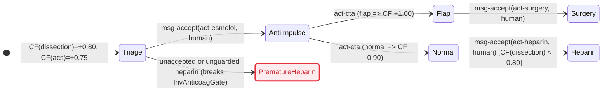
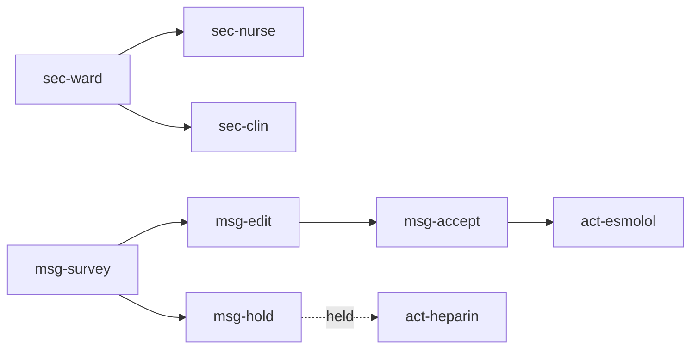

# `.chart`

`type: resource.reference` · **normative**

Specify the `.chart` (`text/vnd.chart+markdown`) biomedical graph-logic format, its intranet BLE mesh imprint, and its oracle-gated steering DAG. Folded templates, formal theories, and the `SYNTH-1937-108` fixture live inside this file so a frontier model can materialize a runtime or checker at test time.

## Specification

```json { type: notebook.cell }
{
  "id": "chart.md",
  "type": "resource.reference",
  "role": "normative .chart format, BLE mesh imprint, and oracle steering contract",
  "reads": ["DISCLAIMER", "clinical case or .chart graph", "local BLE packets", "vouched peer sections"],
  "writes": [".chart graph outside the repository"],
  "must": ["read DISCLAIMER first", "preserve ::warning blocks", "keep egress intranet", "apply a lens only on human oracle accept"],
  "check": ["cf_laws", "golomb_036", "rlnc_gen0", "sheaf_ward", "lens_oracle", "message_dag", "Ti"]
}
```

## Graph

- [DISCLAIMER](DISCLAIMER)
- [LICENSE](LICENSE)

## Composition

```toml { type: notebook.cell }
media_type = "text/vnd.chart+markdown"
extension = ".chart"
version = "1.1.0"
disclaimer = "DISCLAIMER"
licence = "LICENSE"
egress = "intranet"
radio = "ble"
replaces = "pager"
template = "bitchat"
ttl = 7
hitl = true
mode = "oracle"
structure = "DAG"
store = "rlnc"
query = "golomb-rice"
memory = "sheaf"
survey = "optic"
inspect = "lens"
edit = "lens"
fixture = "SYNTH-1937-108"
```

## Indications

| Task | Minimum read |
|---|---|
| Read or audit a `.chart` workup | `DISCLAIMER`, then `::index`, `:requires`, and every attached `::warning` |
| Parse or emit `.chart` bytes | `### 2. Grammar` and `### 7. Canonical instantiation` |
| Evaluate signed certainty or lower to `mermaid` | `### 1. Ontology and epistemic calculus` and `### 3. Workup and transition logic` |
| Imprint a chart on a local phone mesh | `### 4. Local BLE mesh imprint` and `### 5. Network coding, Golomb-Rice query, and sheaf recall` |
| Steer a chart by P2P pages under HITL oracle | `### 6. Category-theoretic steering` and `### 8. Organization and folded templates` |
| Red-team an implementation | `## Falsification` and the folded `attacks` manifest |

Stop at the first sufficient row. A file with no `::imprint` block is a `1.0.0` chart: one section covering `::index` and an empty message DAG.

## Contraindications

- A `.chart` file, a coded packet, a survey optic, a lens proposal, or an oracle-accept page is a research model, never a medical record, clinical order, or prescription; `DISCLAIMER` governs every read and emission.
- Unknown (`cf = 0.00`) means unrecorded, never negative and never permission to skip a safety gate.
- `egress = internet`, Nostr relays, public chat rooms, and cleartext broadcast of clinical bytes are non-conformant; the radio carrier is intranet BLE only.
- `replaces = pager` names the synchronous acknowledged page channel (`channel=page`, `ack=true`); the ontology has no pager hardware vertex.
- An agent or orchestrator peer (`AI2A`) may store packets, answer queries, emit `survey` optics, and propose `edit` lenses, and may never author `kind=accept`; `acceptWell` holds for `human` (`A2H`) only.
- A `survey` optic carries no `put` (`carriesPut = false`); a `lens` put updates its focus (`plan`) while leaving its residual (`cta` and `::warning` obligations) untouched.
- Storing or relaying a coded packet at a peer is transport, not acceptance; rank-deficient packets and clashing sheaf overlaps hold the prior plan.

## Algorithm

### Variables

```toml { type: notebook.cell }
objective = "imprint a clinical chart on an intranet BLE mesh and steer it under human oracle acceptance"

[independent]
case = "clinical observations and unknown frontier findings"
packets = "GF(2^8) random linear coded symbols and Golomb-Rice missing-id queries"
messages = "DAG-ordered survey optics, lens proposals, and oracle accepts"
principal = "human | agent"

[dependent]
section = "recalled sheaf section on the ward site, or empty glue on conflict"
cf = "bipolar rational certainty factor in [-1.00, +1.00] or conflict"
plan = "current clinical state after any admitted human accept"

[controlled]
egress = "intranet"
radio = "ble"
ttl_origin = 7
field_poly = 283
rice_k = 2
tau_pos = 20
tau_neg = -80
oracle = "human-only on kind=accept"
```

### Process

```csv { type: notebook.cell }
operator,law
controls,egress stays intranet over BLE with origin TTL 7 and polynomial 0x11b
design,separate pure rule and hypothesis certainty from lens proposals and human accepts
transport,flood or source-route sealed RLNC packets and page envelopes across vouched peers
stopping,apply a plan transition only on human oracle accept satisfying safety invariants
search,crawl ::index and :requires and request missing packet ids via Golomb-Rice gaps
filters,drop internet hops non-increasing queries rank cycles and unaccepted edits
recovery,hold the prior plan when rank is deficient sheaf glue clashes or an invariant fails
```





Symbolic reasoning. `type: sandbox.playground`.

```tla
---- MODULE ChartSteer ----
EXTENDS Integers
CONSTANTS kind, oracle, egress, cf_dissection
AdmitHeparin == kind = "accept" /\ oracle = "human" /\ egress = "intranet" /\ cf_dissection < -80
====
```

```lisp
(defun admit-heparin (kind oracle egress cf-dissection)
  (and (string= kind "accept")
       (string= oracle "human")
       (string= egress "intranet")
       (< cf-dissection -80)))
```

```lean
def lispAdmitSteer (kind oracle egress : String) (cfDissection : Int) : Bool :=
  decide (kind = "accept") &&
  decide (oracle = "human") &&
  decide (egress = "intranet") &&
  decide (cfDissection < -80)

theorem Ti :
    lispAdmitSteer "accept" "human" "intranet" (-90) = true ∧
    lispAdmitSteer "accept" "human" "intranet" (-80) = false ∧
    lispAdmitSteer "accept" "agent" "intranet" (-90) = false ∧
    lispAdmitSteer "edit" "human" "intranet" (-90) = false ∧
    lispAdmitSteer "accept" "human" "internet" (-90) = false := by
  decide
```

```bend
object Trace { name, holds }

def backward(ti_holds):
  if ti_holds:
    return Trace { name: "breakpoint", holds: 1 }
  else:
    return Trace { name: "refuse", holds: 0 }
```

### 0. Axioms

1. **Disclaimer.** Read [DISCLAIMER](DISCLAIMER) before any node. Every `::warning` on a visited or surveyed node is non-skippable.
2. **Superset.** Every CommonMark `.md` or OpenGigantic `.og` file is a valid `.chart` file. Files compose across `uri#id` edges; entry is `::index`, `:requires` loads dependencies, and `scope` gates visibility.
3. **Signed certainty.** Affirmation (`cf > 0`), negation (`cf < 0`), and ignorance (`cf = 0`) stay distinct. Unknown is `0.00`; hedged prose stays in `(+0.20, +0.70]`.
4. **Domain invariance.** Core syntax, math, and logic hold no specialty tokens. Specialty enters only through `::meta`, `scale`, and `uri#id` targets. `section` and `message` are infrastructure.
5. **Unified chart (`mermaid`).** `rule` and `hypothesis` nodes are pure state operators; `action` nodes are transitions. `__view` and `__steer` render the graph as any `mermaid` diagram (`stateDiagram-v2`, `flowchart`, `sequenceDiagram`, `timeline`, `gantt`, `xychart-beta`, `sankey-beta`, `erDiagram`, `requirementDiagram`, `quadrantChart`, `mindmap`), either directly or checked by TLC from `tla` fences.
6. **Imprint.** A chart imprints onto an intranet mesh of phones over Bluetooth Low Energy (`intranet=true`, `bluetooth=true`, `egress=intranet`, `radio=ble`, origin `ttl=7`), templated on the local BLE layer of `bitchat`.
7. **Page.** Near-mobile BLE messaging replaces the clinical pager (`replaces=pager`). A page is a `message` vertex with `channel=page` and `ack=true` carrying an optic or lens; there is no pager vertex.
8. **Oracle.** Every chart carrying a `message` runs in `hitl=true`, `mode=oracle`. Only `kind=accept` with `oracle=human` applies a lens put to clinical state.
9. **DAG.** Steering messages embed in the graph as a finite DAG: along `:requires`, every message parent has strictly smaller rank (`survey = 0 < edit = hold = 1 < accept = 2`).
10. **Store, query, and recall.** Peers store random linear combinations over \(\mathrm{GF}(2^8)\), query missing packet ids by Golomb-Rice gap coding, memorize peer-local presheaf sections, and recall global workup state by sheaf glue.
11. **Optic and lens.** `survey` is a read-only optic (`split`/`rejoin`, no `put`). `inspect` is the `get` of a well-behaved lens and `edit` is its `put`, preserving the unedited residual and safety invariants.

### 1. Ontology and epistemic calculus

| Node | Role | Edge | Role |
|---|---|---|---|
| `context` | Entity container (`entity`, `goals`) | `:contains` | Child scope (`context`, `finding`, `hypothesis`) |
| `finding` | Observation (`scale`, `src`, `var`) | `:requires` | Premise, guard, parent message, or check |
| `hypothesis` | Inferred target (`cf`) | `:supports` | Positive rule weight (`cf=+w`) |
| `rule` | Production (`if` -> `cf`) | `:contradicts` | Negative rule weight (`cf=-w`) |
| `action` | Inquiry or intervention (`Next`) | `:resolves` | Inquiry binding unknown `finding` (`cf = 0.00`) |
| `invariant` | Safety or liveness check | `:transitions` | Action order |
| `meta` | `__view`, `__steer`, `__changelog` | `:supersedes` | Revision or `uri#id` link |
| `section` | Peer-local presheaf section (`open`, `peer`) | `:restricts` | Larger open onto a smaller open |
| `message` | P2P steering envelope (`kind`, `channel`) | `:steers` | Message onto the clinical vertex it addresses |

The `cf` attribute on a `section` or `message` records presence of that vertex (`+1.00`). Clinical certainty lives exclusively on `finding`, `rule`, and `hypothesis` vertices, combined over exact rationals \(\mathbb{Q}\) by MYCIN bipolar combination (`cfCombine`), with positive firing gate `trueP` (`cf > +0.20`) and disconfirmation gate `falseP` (`cf < -0.80`).

### 2. Grammar

```text { type: notebook.cell }
chart        = markdown_raw | manifest , { node_block | markdown_prose } ;
manifest     = "::meta"   , NL , { kv_line } , "::end" , NL ,
               "::schema" , NL , { kv_line } , "::end" , NL ,
               "::index"  , NL , { "#" , TEXT_LINE , NL | index_row } , "::end" , NL ,
               [ "::imprint" , NL , { kv_line } , "::end" , NL ] ;
kv_line      = id , ":" , WS , TEXT_LINE , NL ;
index_row    = id , "|" , node_type , "|" , scope , "|" , signed_cf , "|" , TEXT_LINE , NL ;
node_block   = "::node" , WS , "[" , attr , { WS , attr } , "]" , NL ,
               "::dense" , ( WS , TEXT_LINE , NL | NL , TEXT_LINE , NL , "::end" , NL ) ,
               { edge_decl | "::edges" , NL , { edge_decl } , "::end" , NL | fenced_code | colon_block } ,
               "::end" , NL ;
attr         = "scale=" , ( "nominal" | "ordinal" | "quantitative" | "temporal" )
             | id , "=" , ( id | STRING | NUMBER | signed_cf | "true" | "false" ) ;
node_type    = "context" | "finding" | "hypothesis" | "rule" | "action" | "invariant" | "meta" | "section" | "message" ;
scope        = "all" | "clinician" | "orchestrator" | "worker" | "patient" | id ;
signed_cf    = [ "+" | "-" ] , ( "1.00" | "1.0" | "0." , DIGIT , { DIGIT } | "0" ) ;
fenced_code  = "```" , ( "tla" | "lean" | "mermaid" | "js" | id ) , NL , VERBATIM , "```" , NL ;
colon_block  = "::" , id , [ WS , "[" , attr , { WS , attr } , "]" ] , NL , VERBATIM , "::end" , NL ;
edge_decl    = ( "->" | "<-" | "<>" ) , "[:" , edge_type , { WS , attr } , "]" ,
               WS , target , { "," , [ WS ] , target } , NL ;
edge_type    = "contains" | "requires" | "supports" | "contradicts" | "resolves" | "transitions" | "supersedes" | "restricts" | "steers" ;
target       = [ URI_PATH , "#" ] , id ;
id           = ( LETTER | "_" ) , { LETTER | DIGIT | "_" | "-" } ;
```

Inside `colon_block`, `::optic` records a survey focus (`get`), `::lens` records `inspect`, `edit`, and `residual`, `::packet` records either a coded RLNC generation (`kind=coded`) or a Golomb-Rice missing-set request (`kind=query`), and `::warning` records a non-skippable clinical hazard.

### 3. Workup and transition logic

Integer centi-certainty (`round(100 * cf)` in `-100..100`, with `-999` for `.conflict`) couples deductive `rule` and `hypothesis` evaluation, intranet BLE hop bounds, and oracle-gated plan transitions inside `MedKernel`.

```tla { type: notebook.cell }
---- MODULE MedKernel ----
EXTENDS Integers, FiniteSets

TauPos == 20
TauNeg == -80
Egress == "intranet"
Hitl == TRUE
Mode == "oracle"
TtlOrigin == 7

CfAnd(a, b)   == IF a <= b THEN a ELSE b
CfOr(a, b)    == IF a >= b THEN a ELSE b
CfNot(a)      == -a
CfScale(a, b) == IF a * b >= 0 THEN (a * b + 50) \div 100 ELSE -(((-(a * b)) + 50) \div 100)
CfFire(p, w)  == IF p > TauPos THEN CfScale(p, w) ELSE 0
CfPos(a, b)   == a + b - CfScale(a, b)
CfNeg(a, b)   == a + b + CfScale(-a, -b)
CfBipolar(cp, cn) ==
  IF cp = 100 /\ cn = -100 THEN -999
  ELSE LET m == IF cp <= (-cn) THEN cp ELSE (-cn)
           n == (cp + cn) * 100
           d == 100 - m
       IN IF n >= 0 THEN (n + (d \div 2)) \div d ELSE -(((-n) + (d \div 2)) \div d)
EvalEq(v, t)  == IF v = t THEN 100 ELSE IF v = "unknown" THEN 0 ELSE -100

Relay(ttl) == IF ttl = 0 THEN 0 ELSE ttl - 1
Apply(kind, oracle, plan, target, cf) ==
  IF kind = "accept" /\ oracle /\ (target /= "heparin" \/ cf < TauNeg)
  THEN target
  ELSE plan
Rank == [survey |-> 0, edit |-> 1, hold |-> 1, accept |-> 2]
====
```

### 4. Local BLE mesh imprint

Each phone in the ward intranet operates simultaneously as a BLE GATT central and peripheral, templated on the local mesh layer of `bitchat` v2.0 (`Noise_XX_25519_ChaChaPoly_SHA256` live sessions, `Noise_X` offline courier envelopes, ~469-byte MTU fragments, LRU deduplication, degree-adaptive flood and BFS source routing, origin `ttl = 7`). Relays decrement `ttl` by 1 (`Relay(7) = 6`, `Relay(0) = 0`), may cache opaque sealed packets, and never evaluate or apply a lens.

| Template mechanism (`bitchat`) | `.chart` law |
|---|---|
| Dual-role BLE GATT mesh (`ttl = 7`, ~469 B fragments) | Adopted verbatim as the local radio carrier (`radio = ble`, `intranet = true`). |
| `Noise_XX` sessions and `Noise_X` courier seals | Mandatory ward-scoped sealing; clinical payloads never travel as cleartext broadcast. |
| Nostr internet relays, mailboxes, geohash rooms | Forbidden (`egress = intranet`); any `internet` hop is ill-formed (`hopOk = false`). |
| Unstructured chat text | Replaced by typed `message` vertices (`channel = page`, `ack = true`, `replaces = pager`). |
| Peer symmetry on state mutation | Asymmetric: any vouched peer may relay or propose; only `oracle = human` may `accept`. |
| GCS probabilistic history filter | Supplemented by exact Golomb-Rice gap queries (`rice-k = 2`) for missing RLNC packet ids. |

### 5. Network coding, Golomb-Rice query, and sheaf recall

**Store (`rlnc`).** A chart generation splits into \(k\) source symbols over \(\mathrm{GF}(2^8) = \mathrm{GF}(2)[x]/(x^8 + x^4 + x^3 + x + 1)\) (irreducible byte polynomial `0x11b`, integer `283`). A coded packet carries coefficient vector \((c_0, \dots, c_{k-1})\) and linear combination \(y = \bigoplus_{j=0}^{k-1} c_j \otimes s_j\); relays may re-encode in flight, and any \(k\) linearly independent rows invert to recover the generation. In generation `0` of `SYNTH-1937-108` (`k = 2`), `s0 = 0x00` (`find-cta` centi-CF `0`) and `s1 = 0x50` (`hyp-dissection` centi-CF `80`):

| Packet | Holder | Coefficients | Payload | Recovery |
|---|---|---|---|---|
| `id-1` | `peer-nurse` | `03 05` | `0x0b` | \(\det = (03 \otimes 02) \oplus (05 \otimes 01) = 06 \oplus 05 = 03\), \(03^{-1} = \text{f6}\) |
| `id-2` | `peer-orch` | `01 02` | `0xa0` | \(M^{-1} = [[\text{f7}, 03], [\text{f6}, 01]] \Rightarrow (00, 50)\) |

A rank-deficient row such as `01 00` yields `0x00` for both `(0x00, 0x50)` and `(0x00, 0x11)`, leaving `s1` undetermined.

**Query (`golomb-rice`).** A peer requests missing coded-packet ids as a strictly increasing natural-number list \(i_0 < i_1 < \dots < i_{m-1}\), mapped to non-negative gaps \(g_0 = i_0\) and \(g_r = i_r - i_{r-1} - 1\). Under Golomb-Rice parameter `k = 2` (modulus \(M = 4\)), gap \(g = 4q + r\) encodes as \(q\) ones, a `0` stop bit, and the 2-bit big-endian remainder \(r\). Missing set `{0, 3, 6}` has gaps `0, 2, 2`, encoding to the 9-bit stream `000010010` (`000` · `010` · `010`), while `{3, 0}` is rejected as non-increasing.

**Memorize and recall (`sheaf`).** Peers cover the ward site \(\text{none} \le \text{nurse} \le \text{both}\), \(\text{none} \le \text{clin} \le \text{both}\). The presheaf \(\mathcal{F}\) assigns each open its visible finding slots (`out` outside the open; `zero`, `pos`, or `neg` inside). Restriction \(\rho^U_V\) masks out-of-scope slots to `out` (`functorial = true` across all 64 slot triples). Sheaf `glue` reconciles `sec-nurse` (`pain = pos, cta = zero, trop = out`) and `sec-clin` (`pain = out, cta = zero, trop = pos`) on their overlap `cta = zero` to recall `sec-ward` (`reconstruct = true` across all 27 interior triples), and returns `none` whenever peers disagree on `cta`.

### 6. Category-theoretic steering

Messages embed inside the `.chart` graph with `:requires` parent edges and `:steers` target edges. Rank assignment `survey = 0`, `edit = 1`, `hold = 1`, `accept = 2` enforces a strict DAG (`rank parent < rank child`); clinical vertices never `:requires` a message.

- **Survey (`optic`).** A profunctor/concrete optic `opticSplit : St → Plan × SurveyFocus` and `opticRejoin : Plan × SurveyFocus → St` projects the clinical summary together with non-skippable `::warning` flags (`warnCta`) and carries no `put` (`carriesPut .survey = false`).
- **Inspect and edit (`lens`).** `inspect : St → Plan` and `edit : St → Plan → St` satisfy `GetPut`, `PutGet`, and `PutPut` while holding the residual (`cta` and `warnCta`) invariant (`opticLensOk = true`).
- **Oracle (`accept`).** `apply` mutates `plan` if and only if `kind = accept`, `oracle = human`, and—when targeting `heparin`—`cfDissection < -80` strictly (`-80` stays refused; `-90` after negative CTA passes).

| Kind | Principal | From | Target | `cfDissection` | Resulting `plan` |
|---|---|---|---|---|---|
| `survey` | `human` or `agent` | `triage` | `anti_impulse` | `+80` | `triage` |
| `inspect` | `human` or `agent` | `triage` | `anti_impulse` | `+80` | `triage` |
| `edit` | `agent` (`peer-orch`) | `triage` | `anti_impulse` | `+80` | `triage` |
| `accept` | `agent` | `triage` | `anti_impulse` | `+80` | `triage` (ill-formed) |
| `accept` | `human` (`peer-clinician`) | `triage` | `anti_impulse` | `+80` | `anti_impulse` |
| `accept` | `human` (`peer-clinician`) | `anti_impulse` | `heparin` | `+80` or `-80` | `anti_impulse` |
| `accept` | `human` (`peer-clinician`) | `anti_impulse` | `heparin` | `-90` | `heparin` |

All Lean 4.35 theories for §1, §5, and §6—`cf_laws`, `golomb_036`, `rlnc_gen0`, `sheaf_ward`, `lens_oracle`, and `message_dag`—are folded into the collapsible `chart theories` cell below. Expand that label to typecheck the whole specification in a single pass.

<details>
<summary>chart theories</summary>

```lean { type: notebook.cell }
inductive NodeType | context | finding | hypothesis | rule | action | invariant | «meta» | «section» | message
  deriving DecidableEq, Repr
inductive EdgeType | contains | requires | supports | contradicts | resolves | transitions | supersedes | restricts | steers
  deriving DecidableEq, Repr
inductive Scale    | nominal | ordinal | quantitative | temporal
  deriving DecidableEq, Repr
inductive Card     | single | multi
  deriving DecidableEq, Repr
inductive EpistemicClass | affirmed | negated | unknown | breaks
  deriving DecidableEq, Repr

structure Q where
  num : Int
  den : Int
  deriving DecidableEq, Repr

namespace Q
def norm (q : Q) : Q :=
  let g : Int := Int.gcd q.num q.den
  let s : Int := if q.den < 0 then -1 else 1
  ⟨s * (q.num / g), s * (q.den / g)⟩
def centi (c : Int) : Q := norm ⟨c, 100⟩
def zero : Q := ⟨0, 1⟩
def one  : Q := ⟨1, 1⟩
def neg (a : Q) : Q := ⟨-a.num, a.den⟩
def abs (a : Q) : Q := ⟨Int.natAbs a.num, a.den⟩
def add (a b : Q) : Q := norm ⟨a.num * b.den + b.num * a.den, a.den * b.den⟩
def sub (a b : Q) : Q := add a (neg b)
def mul (a b : Q) : Q := norm ⟨a.num * b.num, a.den * b.den⟩
def div (a b : Q) : Q := norm ⟨a.num * b.den, a.den * b.num⟩
def lt  (a b : Q) : Bool := a.num * b.den < b.num * a.den
def min (a b : Q) : Q := if lt a b then a else b
end Q

inductive Cf | val (q : Q) | conflict deriving DecidableEq, Repr

def cfCombine (es : List Q) : Cf :=
  let pos  := es.filter (Q.lt Q.zero ·)
  let neg  := es.filter (Q.lt · Q.zero)
  let cPos := Q.sub Q.one (pos.foldl (fun a e => Q.mul a (Q.sub Q.one e)) Q.one)
  let cNeg := Q.add (Q.neg Q.one) (neg.foldl (fun a e => Q.mul a (Q.add Q.one e)) Q.one)
  if cPos == Q.one && cNeg == Q.neg Q.one then .conflict
  else .val (Q.div (Q.add cPos cNeg) (Q.sub Q.one (Q.min cPos (Q.abs cNeg))))

def trueP : Cf → Bool | .val q => Q.lt (Q.centi 20) q | .conflict => false
def falseP : Cf → Bool | .val q => Q.lt q (Q.centi (-80)) | .conflict => false

def evalAtom {α : Type} (κ : Card) (dom : List α) (μ : α → Q) (p : α → Bool) : Cf :=
  let m := (dom.filter p).filterMap (fun v => let c := μ v; if c == Q.zero then none else some c)
  let x := if κ == .single then
    (dom.filter (!p ·)).filterMap (fun v => let c := μ v; if Q.lt Q.zero c then some (Q.neg c) else none)
  else []
  cfCombine (m ++ x)

def validChart (proj : EpistemicClass → EpistemicClass) : Bool :=
  proj .breaks == .breaks &&
  proj .affirmed != proj .negated && proj .affirmed != proj .unknown && proj .negated != proj .unknown &&
  proj .affirmed != .breaks && proj .negated != .breaks && proj .unknown != .breaks

theorem cf_laws :
    cfCombine [Q.centi 40, Q.centi 60] = .val (Q.centi 76) ∧
    cfCombine [Q.centi 40, Q.centi 60, Q.centi (-20)] = cfCombine [Q.centi (-20), Q.centi 60, Q.centi 40] ∧
    falseP (cfCombine [Q.centi 50, Q.centi 60, Q.centi (-98)]) = true ∧
    cfCombine [Q.one, Q.neg Q.one] = .conflict ∧
    validChart id = true := by decide

def rice2 (n : Nat) : List Bool :=
  let q := n / 4
  let r := n % 4
  List.replicate q true ++ [false, r / 2 == 1, r % 2 == 1]

def decodeRice2 : Nat → List Bool → Option (Nat × List Bool)
  | 0, _ => none
  | _fuel + 1, false :: b1 :: b0 :: rest =>
      some ((if b1 then 2 else 0) + (if b0 then 1 else 0), rest)
  | fuel + 1, true :: rest =>
      match decodeRice2 fuel rest with
      | some (n, rest2) => some (n + 4, rest2)
      | none => none
  | _, _ => none

def roundRice (n : Nat) : Bool :=
  match decodeRice2 (n + 2) (rice2 n) with
  | some (m, rest) => m == n && rest == []
  | none => false

def allRice : Bool := (List.range 32).all roundRice

def encodeSet (xs : List Nat) : List Bool :=
  (xs.foldl (fun (acc : Int × List Bool) x =>
      let g : Nat := ((Int.ofNat x) - (acc.1 + 1)).toNat
      (Int.ofNat x, acc.2 ++ rice2 g))
    ((-1 : Int), ([] : List Bool))).2

def decodeSet : Nat → Int → List Bool → Option (List Nat)
  | 0, _, _ => none
  | _, _, [] => some []
  | fuel + 1, prev, bs =>
      match decodeRice2 fuel bs with
      | some (g, rest) =>
          let x := prev + 1 + Int.ofNat g
          match decodeSet fuel x rest with
          | some xs => some (x.toNat :: xs)
          | none => none
      | none => none

def strictly : List Nat → Bool
  | [] => true
  | [_] => true
  | a :: b :: rest => a < b && strictly (b :: rest)

def bits036 : List Bool := encodeSet [0, 3, 6]

theorem golomb_036 :
    allRice = true ∧
    strictly [0, 3, 6] = true ∧
    bits036 = [false, false, false, false, true, false, false, true, false] ∧
    decodeSet 20 (-1) bits036 = some [0, 3, 6] ∧
    strictly [3, 0] = false := by decide

def gfMul (a b : Nat) : Nat :=
  let rec go : Nat → Nat → Nat → Nat → Nat
    | 0, _, _, p => p
    | i + 1, a, b, p =>
        let p := if b % 2 == 1 then p ^^^ a else p
        let hi := a / 128
        let a := (a * 2) % 256
        let a := if hi == 1 then a ^^^ 0x1b else a
        go i a (b / 2) p
  go 8 (a % 256) (b % 256) 0

def coded (c0 c1 s0 s1 : Nat) : Nat :=
  gfMul c0 s0 ^^^ gfMul c1 s1

def rec0 : Nat := gfMul 0xf7 0x0b ^^^ gfMul 0x03 0xa0
def rec1 : Nat := gfMul 0xf6 0x0b ^^^ gfMul 0x01 0xa0

theorem rlnc_gen0 :
    gfMul 0x03 0x02 = 0x06 ∧
    gfMul 0x05 0x01 = 0x05 ∧
    gfMul 0x03 0x02 ^^^ gfMul 0x05 0x01 = 0x03 ∧
    gfMul 0x03 0xf6 = 0x01 ∧
    gfMul 0xf6 0x02 = 0xf7 ∧
    gfMul 0xf6 0x05 = 0x03 ∧
    gfMul 0xf6 0x01 = 0xf6 ∧
    gfMul 0xf6 0x03 = 0x01 ∧
    coded 0x03 0x05 0x00 0x50 = 0x0b ∧
    coded 0x01 0x02 0x00 0x50 = 0xa0 ∧
    rec0 = 0x00 ∧
    rec1 = 0x50 ∧
    coded 0x01 0x00 0x00 0x50 = coded 0x01 0x00 0x00 0x11 ∧
    0x50 ≠ 0x11 := by decide

inductive Open | none | nurse | clin | both
  deriving DecidableEq, Repr

inductive Slot | out | zero | pos | neg
  deriving DecidableEq, Repr

structure Sec where
  pain : Slot
  cta : Slot
  trop : Slot
  deriving DecidableEq, Repr

def hasPain : Open → Bool | .nurse | .both => true | _ => false
def hasCta  : Open → Bool | .nurse | .clin | .both => true | _ => false
def hasTrop : Open → Bool | .clin | .both => true | _ => false

def restrict (v : Open) (s : Sec) : Sec :=
  { pain := if hasPain v then s.pain else .out
  , cta := if hasCta v then s.cta else .out
  , trop := if hasTrop v then s.trop else .out }

def glue (sn sc : Sec) : Option Sec :=
  if sn.cta != sc.cta || sn.cta == .out then none
  else if sn.trop != .out || sc.pain != .out then none
  else if sn.pain == .out || sc.trop == .out then none
  else some { pain := sn.pain, cta := sn.cta, trop := sc.trop }

def sWard : Sec := { pain := .pos, cta := .zero, trop := .pos }
def secNurse : Sec := { pain := .pos, cta := .zero, trop := .out }
def secClin : Sec := { pain := .out, cta := .zero, trop := .pos }
def secClash : Sec := { pain := .out, cta := .pos, trop := .pos }

def le : Open → Open → Bool
  | .none, _ => true
  | .nurse, .nurse => true
  | .nurse, .both => true
  | .clin, .clin => true
  | .clin, .both => true
  | .both, .both => true
  | _, _ => false

def slots : List Slot := [.out, .zero, .pos, .neg]
def inside : List Slot := [.zero, .pos, .neg]
def opens : List Open := [.none, .nurse, .clin, .both]

def functorial : Bool :=
  opens.all fun u => opens.all fun v => opens.all fun w =>
    slots.all fun a => slots.all fun b => slots.all fun c =>
      let s : Sec := { pain := a, cta := b, trop := c }
      (!(le w v && le v u) || restrict w (restrict v s) == restrict w s) &&
        restrict v (restrict v s) == restrict v s

def reconstruct : Bool :=
  inside.all fun a => inside.all fun b => inside.all fun c =>
    let s : Sec := { pain := a, cta := b, trop := c }
    glue (restrict .nurse s) (restrict .clin s) == some s

theorem sheaf_ward :
    restrict .nurse sWard = secNurse ∧
    restrict .clin sWard = secClin ∧
    glue secNurse secClin = some sWard ∧
    glue secNurse secClash = none ∧
    functorial = true ∧
    reconstruct = true := by decide

inductive Plan | triage | anti | surgery | heparin
  deriving DecidableEq, Repr

structure St where
  plan : Plan
  cta : Slot
  cfDissection : Int
  warnCta : Bool
  deriving DecidableEq, Repr

structure SurveyFocus where
  cta : Slot
  cfDissection : Int
  warnCta : Bool
  deriving DecidableEq, Repr

def opticSplit (s : St) : Plan × SurveyFocus :=
  (s.plan, { cta := s.cta, cfDissection := s.cfDissection, warnCta := s.warnCta })

def opticRejoin (p : Plan × SurveyFocus) : St :=
  { plan := p.1, cta := p.2.cta, cfDissection := p.2.cfDissection, warnCta := p.2.warnCta }

def inspect (s : St) : Plan := s.plan
def edit (s : St) (a : Plan) : St := { s with plan := a }

def plans : List Plan := [.triage, .anti, .surgery, .heparin]

def opticLensOk : Bool :=
  plans.all fun p0 => slots.all fun c => [false, true].all fun w =>
    plans.all fun a => plans.all fun b =>
      let s : St := { plan := p0, cta := c, cfDissection := 80, warnCta := w }
      opticRejoin (opticSplit s) == s &&
        (opticSplit s).2.warnCta == s.warnCta &&
        inspect (edit s a) == a &&
        edit s (inspect s) == s &&
        edit (edit s a) b == edit s b &&
        (edit s a).cta == s.cta &&
        (edit s a).warnCta == s.warnCta

inductive Kind | survey | inspect | edit | accept
  deriving DecidableEq, Repr

def carriesPut : Kind → Bool | .edit => true | _ => false

def apply (k : Kind) (oracle : Bool) (plan target : Plan) (cf : Int) : Plan :=
  if k == .accept && oracle && (target != .heparin || cf < -80) then target else plan

theorem lens_oracle :
    opticLensOk = true ∧
    carriesPut .survey = false ∧
    carriesPut .inspect = false ∧
    carriesPut .edit = true ∧
    apply .accept true .triage .anti 80 = .anti ∧
    apply .accept false .triage .anti 80 = .triage ∧
    apply .edit true .triage .anti 80 = .triage ∧
    apply .survey true .triage .anti 80 = .triage ∧
    apply .inspect true .triage .anti 80 = .triage ∧
    apply .accept true .anti .heparin 80 = .anti ∧
    apply .accept true .anti .heparin (-80) = .anti ∧
    apply .accept true .anti .heparin (-90) = .heparin := by decide

inductive Msg | survey | edit | hold | accept
  deriving DecidableEq, Repr

def rank : Msg → Nat | .survey => 0 | .edit => 1 | .hold => 1 | .accept => 2

def parents : Msg → List Msg
  | .survey => []
  | .edit => [.survey]
  | .hold => [.survey]
  | .accept => [.edit]

def msgs : List Msg := [.survey, .edit, .hold, .accept]

def dagOk (par : Msg → List Msg) : Bool :=
  msgs.all fun m => (par m).all fun p => rank p < rank m

def badParents : Msg → List Msg
  | .survey => [.accept]
  | .accept => [.survey]
  | m => parents m

def relay (ttl : Nat) : Nat :=
  if ttl = 0 then 0 else ttl - 1

inductive Egress | intranet | internet
  deriving DecidableEq, Repr

def hopOk : Egress → Bool | .intranet => true | .internet => false

inductive Principal | human | agent
  deriving DecidableEq, Repr

def acceptWell (p : Principal) : Bool := p == .human

theorem message_dag :
    dagOk parents = true ∧
    dagOk badParents = false ∧
    parents .accept = [.edit] ∧
    relay 7 = 6 ∧
    relay 0 = 0 ∧
    hopOk .intranet = true ∧
    hopOk .internet = false ∧
    acceptWell .human = true ∧
    acceptWell .agent = false := by decide
```
</details>

### 7. Canonical instantiation

`SYNTH-1937-108`: `64F, tearing chest pain 45m, R-L brachial SBP delta 28 mmHg, lateral ST-depression, hs-cTnI 68 ng/L (ULN 14), CTA aorta pending, no anticoagulants.` The fixture below is the complete `1.1.0` `.chart` file: clinical workup vertices plus ward sections, RLNC packets, Golomb-Rice query, and steering message DAG. Expand `fixture: synth-1937-108.chart` when parsing or checking bytes.

<details>
<summary>fixture: synth-1937-108.chart</summary>

```text { type: notebook.cell }
::meta
title: SYNTH-1937-108 Acute Chest Pain & Aortic Dissection Workup
version: 1.1.0
case-id: SYNTH-1937-108
domain: cardiology|vascular-surgery|emergency-medicine
scope: all
::end

::schema
node-types: [context, finding, hypothesis, rule, action, invariant, meta, section, message]
edge-types: [contains, requires, supports, contradicts, resolves, transitions, supersedes, restricts, steers]
scales: [nominal, ordinal, quantitative, temporal]
scope-levels: [all, clinician, orchestrator, worker, patient]
cf-thresholds: [+0.20, -0.80]
steer: [hitl, oracle, dag, rlnc, golomb-rice, sheaf, optic, lens]
::end

::index
# id | type | scope | cf | keywords
ctx-encounter | context | all | +1.00 | ed, chest-pain, dissection, acs
find-pain | finding | all | +1.00 | tearing, interscapular, 45m
find-bp-delta | finding | all | +1.00 | sbp-delta, 28mmhg, pulse-deficit
find-troponin | finding | all | +1.00 | st-depression, hs-ctni, 68ng-l
find-cta | finding | all | 0.00 | cta-aorta, intimal-flap, pending
rule-acs | rule | clinician | +0.75 | nstemi, troponin
rule-tad-pain | rule | clinician | +0.50 | dissection, tearing-pain
rule-tad-bp | rule | clinician | +0.60 | dissection, sbp-delta-ge-20
rule-cta-pos | rule | clinician | +1.00 | cta-flap, dissection-confirmed
rule-cta-neg | rule | clinician | -0.98 | cta-normal, dissection-ruled-out
hyp-acs | hypothesis | clinician | +0.75 | acs, nstemi
hyp-dissection | hypothesis | clinician | +0.80 | stanford-type-a, dissection
act-esmolol | action | clinician | +1.00 | anti-impulse, beta-blockade
act-cta | action | all | +1.00 | gated-cta-aorta
act-surgery | action | clinician | +1.00 | open-aortic-repair
act-heparin | action | clinician | +1.00 | heparin, angiography
inv-anticoag-gate | invariant | all | +1.00 | safety, no-heparin-before-cta-ruleout
sec-ward | section | all | +1.00 | glue, both, rlnc, golomb
sec-nurse | section | worker | +1.00 | peer-nurse, pain, cta
sec-clin | section | clinician | +1.00 | peer-clinician, cta, troponin
msg-survey | message | all | +1.00 | page, survey, optic, warning, peer-nurse
msg-edit | message | all | +1.00 | page, lens, esmolol, propose, peer-orch
msg-hold | message | all | +1.00 | page, heparin, no-accept, peer-orch
msg-accept | message | all | +1.00 | page, accept, human, anti-impulse, peer-clinician
__view | meta | all | +1.00 | mermaid, stateDiagram-v2
__steer | meta | all | +1.00 | mermaid, dag, flowchart
::end

::imprint
transport: ble-mesh
radio: ble
intranet: true
bluetooth: true
egress: intranet
replaces: pager
template: bitchat
hitl: true
mode: oracle
ttl: 7
field: gf256
poly: 0x11b
rice-k: 2
peers: peer-nurse, peer-clinician, peer-orch
oracle: peer-clinician
::end

::node [id=ctx-encounter type=context cf=+1.00 scope=all entity=ENCOUNTER var=plan init=triage goals="hyp-dissection,hyp-acs"]
::dense SYNTH-1937-108|64F|chest-pain-45m|plan=triage
->[:contains] find-pain, find-bp-delta, find-troponin, find-cta, hyp-dissection, hyp-acs
::end

::node [id=find-pain type=finding cf=+1.00 scope=all scale=temporal src="L1: tearing chest pain 45m"]
::dense pain=tearing|onset_min=45|cf=+1.00
::end

::node [id=find-bp-delta type=finding cf=+1.00 scope=all scale=quantitative value=28 unit="mmHg" src="L1: SBP delta 28 mmHg"]
::dense sbp_delta_mmhg=28|cf=+1.00
::end

::node [id=find-troponin type=finding cf=+1.00 scope=all scale=quantitative value=68 unit="ng/L" src="L1: hs-cTnI 68 ng/L"]
::dense hs_ctni_ng_l=68|uln=14|cf=+1.00
::end

::node [id=find-cta type=finding cf=0.00 scope=all scale=nominal var=cta init=unknown]
::dense cta=unknown|pending-gated-cta|gates-heparin
::warning
CTA aorta is PENDING (cf=0.00). Hold anticoagulation until dissection is excluded.
::end
::end

::node [id=rule-acs type=rule cf=+0.75 scope=clinician]
::dense troponin>14->hyp-acs(+0.75)
->[:requires] find-troponin
->[:supports cf=+0.75] hyp-acs
::end

::node [id=rule-tad-pain type=rule cf=+0.50 scope=clinician]
::dense pain=tearing->hyp-dissection(+0.50)
->[:requires] find-pain
->[:supports cf=+0.50] hyp-dissection
::end

::node [id=rule-tad-bp type=rule cf=+0.60 scope=clinician]
::dense sbp_delta>=20->hyp-dissection(+0.60)
->[:requires] find-bp-delta
->[:supports cf=+0.60] hyp-dissection
::end

::node [id=rule-cta-pos type=rule cf=+1.00 scope=clinician]
::dense cta=flap->hyp-dissection(+1.00)
->[:requires] find-cta
->[:supports cf=+1.00] hyp-dissection
::end

::node [id=rule-cta-neg type=rule cf=-0.98 scope=clinician]
::dense cta=normal->hyp-dissection(-0.98)
->[:requires] find-cta
->[:contradicts cf=-0.98] hyp-dissection
::end

::node [id=hyp-acs type=hypothesis cf=+0.75 scope=clinician]
::dense acs-nstemi|cf=+0.75
::end

::node [id=hyp-dissection type=hypothesis cf=+0.80 scope=clinician]
::dense type-a-dissection|cf=+0.80|flap->+1.00|normal->-0.90
::end

::node [id=act-esmolol type=action cf=+1.00 scope=clinician]
::dense intervene|iv-esmolol|when-dissection>0.20
->[:requires] hyp-dissection
->[:transitions] act-cta
::end

::node [id=act-cta type=action cf=+1.00 scope=all]
::dense observe|cta-aorta|flap-or-normal
->[:resolves] find-cta
->[:transitions] act-surgery, act-heparin
::end

::node [id=act-surgery type=action cf=+1.00 scope=clinician]
::dense intervene|open-aortic-repair|when-dissection=+1.00
->[:requires] find-cta, hyp-dissection
::end

::node [id=act-heparin type=action cf=+1.00 scope=clinician]
::dense intervene|heparin+cath|when-dissection<-0.80
->[:requires] find-cta, hyp-acs, hyp-dissection
::end

::node [id=inv-anticoag-gate type=invariant cf=+1.00 scope=all kind=safety]
::dense safety|heparin-requires-dissection-ruled-out
->[:requires] hyp-dissection, find-cta
::end

::node [id=sec-ward type=section cf=+1.00 scope=all open=both]
::dense glue|pain=+1.00|cta=0.00|troponin=+1.00
->[:restricts] sec-nurse, sec-clin
->[:contains] find-pain, find-cta, find-troponin
::packet [kind=coded generation=0 k=2 field=gf256]
s0: 00
s1: 50
id-1: peer-nurse 03 05 0b
id-2: peer-orch 01 02 a0
::end
::packet [kind=query coding=golomb-rice k=2]
missing: 0,3,6
gaps: 0,2,2
bits: 000010010
::end
::end

::node [id=sec-nurse type=section cf=+1.00 scope=worker peer=peer-nurse open=nurse]
::dense pain=+1.00|cta=0.00|troponin=out
->[:contains] find-pain, find-cta
::end

::node [id=sec-clin type=section cf=+1.00 scope=clinician peer=peer-clinician open=clin]
::dense pain=out|cta=0.00|troponin=+1.00
->[:contains] find-cta, find-troponin
::end

::node [id=msg-survey type=message cf=+1.00 scope=all channel=page ack=true kind=survey peer=peer-nurse]
::dense page|focus=hyp-dissection,find-cta|cf-dissection=+0.80|cf-cta=0.00
->[:steers] hyp-dissection, find-cta
::optic
get: hyp-dissection.cf, find-cta.cf
::end
::warning
CTA aorta is PENDING (cf=0.00). Hold anticoagulation until dissection is excluded.
::end
::end

::node [id=msg-edit type=message cf=+1.00 scope=all channel=page ack=true kind=edit parents=msg-survey peer=peer-orch]
::dense propose|inspect=plan|edit=anti_impulse|focus=act-esmolol
->[:requires] msg-survey, hyp-dissection
->[:steers] act-esmolol
::lens
inspect: plan
edit: plan=anti_impulse
residual: cta
::end
::end

::node [id=msg-hold type=message cf=+1.00 scope=all channel=page ack=true kind=edit parents=msg-survey peer=peer-orch]
::dense propose|edit=heparin|no-accept
->[:requires] msg-survey, inv-anticoag-gate
->[:steers] act-heparin
::warning
This edit has no accept. The plan stays. Heparin in the model needs dissection centi-certainty below -80.
::end
::end

::node [id=msg-accept type=message cf=+1.00 scope=all channel=page ack=true kind=accept parents=msg-edit oracle=human peer=peer-clinician]
::dense accept|plan=anti_impulse|human
->[:requires] msg-edit
->[:steers] act-esmolol
::end

::node [id=__view type=meta cf=+1.00 scope=all]
::dense mermaid|stateDiagram-v2
::end

::node [id=__steer type=meta cf=+1.00 scope=all]
::dense mermaid|flowchart
::end
```
</details>

### 8. Organization and folded templates

The expanded Prolog projection below fixes the blue-team ward mesh (`agent_fleet`): `nurse` originates observations, `relay` forwards coded BLE frames to `orch`, `nurse` and `orch` both feed `recall` (sheaf glue), `orch` and `recall` both feed `clinician` (human oracle), and `clinician` emits the accepted transition at `steer`. No executable scripts are committed to this repository; the collapsible cells below fold the cybernetics `AI2A`/`A2H` interface, the red-team falsifier swarm, the Python codec/sheaf/lens guide, the type-safe Rust organization, and the attack manifest into Markdown so a frontier model can materialize them at test time.

```prolog { type: notebook.cell }
image(agent_fleet).
shape(dag).
node(clinician).
node(nurse).
node(orch).
node(recall).
node(relay).
node(steer).
edge(clinician, steer).
edge(nurse, recall).
edge(nurse, relay).
edge(orch, clinician).
edge(orch, recall).
edge(recall, clinician).
edge(relay, orch).
```

<details>
<summary>cybernetics interface</summary>

```typescript { type: notebook.cell }
export type Channel = "AI2A" | "A2H";
export type MessageKind = "survey" | "inspect" | "edit" | "accept";
export type Principal = "human" | "agent";
export type Egress = "intranet";

export interface SurveyOptic<Focus> {
  readonly kind: "survey";
  readonly get: Focus;
  readonly warnings: readonly string[];
}

export interface PlanLens<State, Focus> {
  readonly inspect: (state: State) => Focus;
  readonly edit: (state: State, next: Focus) => State;
  readonly residual: readonly string[];
}

export interface FrontierTurn<Payload> {
  readonly channel: "AI2A";
  readonly egress: Egress;
  readonly radio: "ble";
  readonly ttl: 1 | 2 | 3 | 4 | 5 | 6 | 7;
  readonly parents: readonly string[];
  readonly kind: "survey" | "inspect" | "edit";
  readonly peer: string;
  readonly payload: Payload;
}

export interface OraclePage<Focus> {
  readonly channel: "A2H";
  readonly egress: Egress;
  readonly radio: "ble";
  readonly replaces: "pager";
  readonly ack: true;
  readonly parents: readonly [string, ...string[]];
  readonly kind: "accept";
  readonly oracle: "human";
  readonly peer: string;
  readonly accept: Focus;
}
```
</details>

<details>
<summary>template: prolog</summary>

```prolog { type: notebook.cell }
image(agent_swarm).
shape(dag).
node(decide).
node(grammar).
node(imprint).
node(oracle).
node(recall).
node(steer).
edge(decide, steer).
edge(grammar, decide).
edge(imprint, decide).
edge(oracle, decide).
edge(oracle, steer).
edge(recall, decide).
```
</details>

<details>
<summary>template: python</summary>

```python { type: notebook.cell }
from functools import reduce

def gf_mul(a: int, b: int) -> int:
    p, a, b = 0, a & 0xFF, b & 0xFF
    for _ in range(8):
        if b & 1:
            p ^= a
        hi = a & 0x80
        a = ((a << 1) & 0xFF) ^ (0x1B if hi else 0)
        b >>= 1
    return p

def gf_inv(a: int) -> int:
    if a == 0:
        raise ValueError("zero")
    r, base, exp = 1, a & 0xFF, 254
    while exp:
        if exp & 1:
            r = gf_mul(r, base)
        base, exp = gf_mul(base, base), exp >> 1
    return r

def rlnc_encode(symbols: list[int], coeffs: list[list[int]]) -> list[int]:
    return [reduce(lambda x, y: x ^ y, (gf_mul(c, s) for c, s in zip(row, symbols)), 0) for row in coeffs]

def rlnc_decode_2x2(rows: list[tuple[int, int]], payloads: list[int]) -> tuple[int, int] | None:
    (a, b), (c, d) = rows
    det = gf_mul(a, d) ^ gf_mul(b, c)
    if det == 0:
        return None
    inv = gf_inv(det)
    return (
        gf_mul(gf_mul(inv, d), payloads[0]) ^ gf_mul(gf_mul(inv, b), payloads[1]),
        gf_mul(gf_mul(inv, c), payloads[0]) ^ gf_mul(gf_mul(inv, a), payloads[1]),
    )

def rice_encode_set(ids: list[int], k: int = 2) -> str:
    if any(ids[i] >= ids[i + 1] for i in range(len(ids) - 1)):
        raise ValueError("non-increasing")
    m, prev, out = 1 << k, -1, []
    for idx in ids:
        q, r = divmod(idx - (prev + 1), m)
        out.append("1" * q + "0" + format(r, f"0{k}b"))
        prev = idx
    return "".join(out)

def glue_ward(nurse: dict[str, str], clin: dict[str, str]) -> dict[str, str] | None:
    if nurse.get("cta") != clin.get("cta") or nurse.get("cta") == "out":
        return None
    if nurse.get("trop") != "out" or clin.get("pain") != "out":
        return None
    if nurse.get("pain") == "out" or clin.get("trop") == "out":
        return None
    return {"pain": nurse["pain"], "cta": nurse["cta"], "trop": clin["trop"]}

def apply_steer(kind: str, oracle: str, egress: str, plan: str, target: str, cf_dissection: int) -> str:
    if egress != "intranet" or (kind == "accept" and oracle != "human"):
        raise ValueError("refused")
    if kind == "accept" and oracle == "human" and (target != "heparin" or cf_dissection < -80):
        return target
    return plan
```
</details>

<details>
<summary>template: rust</summary>

```rust { type: notebook.cell }
#[derive(Copy, Clone, Debug, Eq, PartialEq)]
pub enum AgentId {
    Clinician,
    Decide,
    Grammar,
    Imprint,
    Nurse,
    Oracle,
    Orch,
    Recall,
    Relay,
    Steer,
}

#[derive(Copy, Clone, Debug, Eq, PartialEq)]
pub enum Role {
    Peer,
    Worker,
    Join,
    Sink,
}

#[derive(Copy, Clone, Debug, Eq, PartialEq)]
pub enum Capability {
    BleFrame,
    CodedSymbol,
    RiceQuery,
    LocalSection,
    SurveyOptic,
    PlanLens,
    HumanAccept,
    Verdict,
    ChartState,
}

#[derive(Copy, Clone, Debug, Eq, PartialEq)]
pub enum ActionKind {
    Started,
    Surveyed,
    Queried,
    Glued,
    Proposed,
    Accepted,
    Refused,
    Completed,
}

pub struct Edge {
    pub from: AgentId,
    pub to: AgentId,
}

pub struct Organization {
    pub name: &'static str,
    pub sink: AgentId,
    pub edges: &'static [Edge],
}

pub const WARD_FLEET: Organization = Organization {
    name: "agent_fleet",
    sink: AgentId::Steer,
    edges: &[
        Edge { from: AgentId::Nurse, to: AgentId::Relay },
        Edge { from: AgentId::Nurse, to: AgentId::Recall },
        Edge { from: AgentId::Relay, to: AgentId::Orch },
        Edge { from: AgentId::Orch, to: AgentId::Recall },
        Edge { from: AgentId::Recall, to: AgentId::Clinician },
        Edge { from: AgentId::Orch, to: AgentId::Clinician },
        Edge { from: AgentId::Clinician, to: AgentId::Steer },
    ],
};

pub const CHART_SWARM: Organization = Organization {
    name: "agent_swarm",
    sink: AgentId::Steer,
    edges: &[
        Edge { from: AgentId::Grammar, to: AgentId::Decide },
        Edge { from: AgentId::Imprint, to: AgentId::Decide },
        Edge { from: AgentId::Recall, to: AgentId::Decide },
        Edge { from: AgentId::Oracle, to: AgentId::Decide },
        Edge { from: AgentId::Decide, to: AgentId::Steer },
        Edge { from: AgentId::Oracle, to: AgentId::Steer },
    ],
};
```
</details>

<details>
<summary>attacks</summary>

```json { type: notebook.cell }
{
  "attacks": [
    {"worker": "imprint", "id": "internet-egress", "premise": "egress is intranet only", "prediction": "hopOk .internet = false and file is refused"},
    {"worker": "imprint", "id": "nostr-relay-hop", "premise": "bitchat internet relays are excluded", "prediction": "non-BLE hop fails imprint admission"},
    {"worker": "imprint", "id": "ttl-zero-relay", "premise": "TTL 0 frames never relay", "prediction": "relay 0 = 0"},
    {"worker": "imprint", "id": "pager-vertex", "premise": "replaces=pager names a channel, not a node type", "prediction": "grammar rejects type=pager"},
    {"worker": "oracle", "id": "agent-accept", "premise": "only a human oracle may author kind=accept", "prediction": "acceptWell .agent = false"},
    {"worker": "oracle", "id": "unaccepted-edit", "premise": "an edit lens without human accept leaves plan unchanged", "prediction": "apply .edit true .triage .anti 80 = .triage"},
    {"worker": "oracle", "id": "boundary-heparin-minus-80", "premise": "heparin requires dissection centi-CF strictly below -80", "prediction": "apply .accept true .anti .heparin (-80) = .anti"},
    {"worker": "oracle", "id": "survey-carries-put", "premise": "a survey optic has no put", "prediction": "carriesPut .survey = false"},
    {"worker": "recall", "id": "rank-deficient-rlnc", "premise": "row 01 00 drops s1", "prediction": "coded 0x01 0x00 0x00 0x50 = coded 0x01 0x00 0x00 0x11"},
    {"worker": "recall", "id": "unsorted-golomb-set", "premise": "missing packet ids are strictly increasing", "prediction": "strictly [3, 0] = false"},
    {"worker": "recall", "id": "clashing-cta-glue", "premise": "disagreeing overlap slots refuse to glue", "prediction": "glue secNurse secClash = none"},
    {"worker": "recall", "id": "idempotent-restriction", "premise": "repeated restriction does not invent out-of-open findings", "prediction": "restrict .nurse (restrict .nurse sWard) = secNurse"},
    {"worker": "grammar", "id": "message-rank-cycle", "premise": "message :requires edges strictly increase rank", "prediction": "dagOk badParents = false"},
    {"worker": "grammar", "id": "skipped-survey-warning", "premise": "survey preserves attached ::warning flags", "prediction": "(opticSplit s).2.warnCta = s.warnCta"}
  ]
}
```
</details>

## Citations

| Pin | Supports |
|---|---|
| [CommonMark `0.31.2`](https://spec.commonmark.org/0.31.2/) | Markdown superset and heading/fence structure |
| [Cursor `statechart`](https://github.com/cursor/plugins/tree/main/pstack/skills/statechart) | Harel/TLA+ statechart verification and `.mermaid` projection |
| [M. Dubey, *ObjectGraph* (`arXiv:2604.27820v1`)](https://arxiv.org/html/2604.27820v1) | `::index`, `::dense`, `::warning`, and scoped graph traversal |
| [P. Norvig, *PAIP* Ch. 16 (`cl-aip/mycin`)](https://github.com/cl-aip/mycin) | Bipolar MYCIN certainty-factor algebra |
| [T. Ho et al., *IEEE Trans. Inf. Theory* 52(10), 2006](https://doi.org/10.1109/TIT.2006.881746) | Random linear network coding over finite fields |
| [S. W. Golomb, *IEEE Trans. Inf. Theory* 12(3), 1966](https://doi.org/10.1109/TIT.1966.1053907) | Run-length and geometric gap coding (with Rice \(M = 2^k\) specialization) |
| [S. Mac Lane & I. Moerdijk, *Sheaves in Geometry and Logic*, 1992](https://doi.org/10.1007/978-1-4612-0927-0) | Presheaf restriction and sheaf gluing over local opens |
| [M. Riley, *Categories of Optics* (`arXiv:1809.00738`)](https://arxiv.org/abs/1809.00738) | Concrete and profunctor optics (`split`/`rejoin`) for `survey` |
| [J. N. Foster et al., *ACM TOPLAS* 29(3), 2007](https://doi.org/10.1145/1232420.1232424) | Bidirectional lenses (`GetPut`, `PutGet`, `PutPut`) for `inspect`/`edit` |
| [*bitchat* Protocol Whitepaper v2.0](https://github.com/permissionlesstech/bitchat/blob/main/WHITEPAPER.md) | Intranet BLE GATT mesh, `Noise_XX`/`Noise_X` sealing, TTL flood/routing |
| [Pager (Wikipedia)](https://en.wikipedia.org/wiki/Pager) | Legacy one-way clinical paging channel superseded by BLE `channel=page` |

Retrieved 14 Nov 2026 (Australia/Sydney). Lean 4.35.0 discharged `Ti`, `cf_laws`, `golomb_036`, `rlnc_gen0`, `sheaf_ward`, `lens_oracle`, and `message_dag` the same day. Representation only.

## Falsification

| Challenge | Failure signal |
|---|---|
| Set `egress = internet` or route a frame through a Nostr relay | `hopOk .internet = false`; the file is refused |
| Author `kind = accept` with `oracle = agent` | `acceptWell .agent = false`; `Ti` refuses |
| Emit `msg-edit` or `msg-hold` with no human `msg-accept` | `plan` stays `triage` |
| Accept `heparin` at dissection centi-certainty `+80` or `-80` | `plan` stays `anti_impulse`; the bound `< -80` is strict |
| Treat the `-90` row as a clinical order to administer heparin | `DISCLAIMER` governs; the token is a state in a synthetic model |
| Decode generation `0` from rank-deficient row `01 00` | `s1` is undetermined (`0x00` matches both `0x50` and `0x11`) |
| Decode `000010010` to anything other than `{0, 3, 6}` or query `{3, 0}` | `golomb_036` pins `[0, 3, 6]`; `strictly [3, 0] = false` |
| Glue `sec-nurse` with a clinician section whose `cta` slot is `pos` | `glue secNurse secClash = none`; `plan` holds |
| Restrict `sec-ward` to `nurse` twice and expect `troponin` to reappear | restriction is idempotent; `troponin` stays `out` |
| Drop `::warning` from `msg-survey` or mutate `cta` during a `plan` lens `edit` | `opticLensOk` fails on residual preservation |
| Attach a `put` clause to a `survey` optic | `carriesPut .survey = false`; ill-formed survey |
| Add a `:requires` edge from `msg-survey` to `msg-accept` | `dagOk badParents = false`; rank cycle refused |
| Treat `peer-orch` storing coded packet `id-2` as an oracle accept | packet storage is transport, not `kind = accept` |
| Add a `pager` node type or commit standalone `.py`/`.rs` scripts to the repo | grammar refuses `type=pager`; all templates stay folded in `chart.md` |

## Licence

MIT
