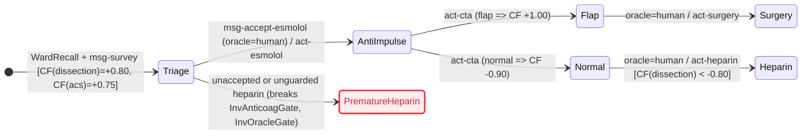
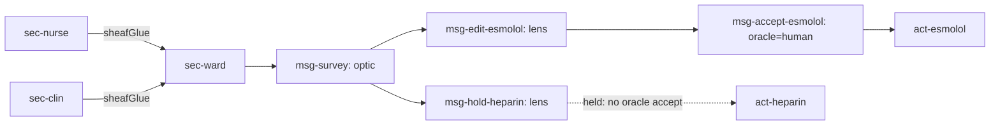

# `.chart`

```toml
[med]
media_type = "text/vnd.chart+markdown"
extension  = ".chart"
version    = "1.1.0"

[pipeline]
input   = "clinical case --natural-language"
process = "workup { CRAWLS ::index, :requires } -> imprint { BLE intranet, RLNC, Golomb, sheaf }"
output  = "graph.logic --fileformat .chart { STEERS DAG(optic, lens, oracle), RENDERS mermaid }"

[mesh]
intranet  = true
bluetooth = true
radio     = "ble"
replaces  = "pager"
template  = "bitchat"
ttl       = 7
hitl      = true
mode      = "oracle"
```

## 1. Axioms

1. **Superset.** Every CommonMark `.md` or OpenGigantic `.og` file is a valid `.chart` file. Entry is `::index`. `:requires` loads dependencies. `::warning` is never skipped. `scope` gates visibility. Graphs compose across local `uri#id` edges; a file without `::imprint` is a single-section chart with an empty message DAG.
2. **Signed certainty.** Affirmation (`cf > 0`), negation (`cf < 0`), and ignorance (`cf = 0`) stay distinct. Unknown is `0.00`; hedged prose stays in `(+0.20, +0.70]`.
3. **Domain invariance.** Core syntax, math, and logic hold no specialty tokens. Specialty enters only through `::meta`, `scale`, and `uri#id` targets; `section` and `message` are specialty-invariant infrastructure.
4. **Near-mobile BLE intranet (`bitchat` template, replaces pager).** Charts imprint onto an offline-capable ward intranet of mobile phones (`intranet = true`, `bluetooth = true`, `egress = intranet`, `radio = ble`), templated on the dual-role BLE GATT mesh of `bitchat` (origin `ttl = 7`, ~469 B MTU fragments, LRU deduplication, degree-adaptive flood and BFS source routing, ward-sealed `Noise_XX` live sessions and `Noise_X` courier envelopes). Internet or Nostr relays and cleartext clinical broadcasts are forbidden. Two-way acknowledged BLE pages (`channel = page`, `ack = true`) supersede one-way clinical pagers (`replaces = pager`); the ontology carries no pager vertex.
5. **Random linear network coding (`GF(2^8)^w`).** Each chart generation splits into `k` `w`-byte source symbols over `GF(2^8) = GF(2)[x]/(x^8 + x^4 + x^3 + x + 1)` (`poly = 0x11b`). Peers store and re-encode linear combinations `y = sum_{j=0..k-1} c_j * s_j` (`ttl |-> max(ttl - 1, 0)`); any `k` linearly independent rows invert by Gaussian elimination over `GF(2^8)` to recover the generation.
6. **Golomb-coded queries (`M >= 1`).** Peers request missing coded-packet indices `i_0 < i_1 < ... < i_{n-1}` as non-negative gaps `g_0 = i_0`, `g_r = i_r - i_{r-1} - 1` compressed by parametric Golomb coding of modulus `M >= 1` (unary quotient `1^(g div M) || 0` plus truncated-binary remainder of width `floor(log2 M)` or `ceil(log2 M)` bits, specializing at `M = 2^b` to `b`-bit Golomb-Rice coding).
7. **Presheaf memorization & sheaf recall.** Peers cover a finite ward site `(Open, <=)`. A peer at open `U` memorizes local section `s_U in F(U)` via functorial, idempotent restriction `rho^U_V`; global workup state is recalled iff peer sections agree on every overlap `U_i cap U_j` (unique sheaf `glue`), returning `none` on conflict.
8. **Embedded DAG steering (`optic`, `lens`, `oracle`).** P2P steering envelopes embed in the graph as `message` vertices whose `:requires` parent edges form a strict finite DAG (`survey < inspect/edit < accept`) and whose `:steers` edges target clinical vertices (`hitl = true`, `mode = oracle`). `survey` acts by a concrete optic (`split`/`rejoin`, carrying non-skippable `::warning` flags and no `put`); `inspect` and `edit` form the `get` and `put` of a well-behaved bidirectional lens (`GetPut`, `PutGet`, `PutPut`, residual-preserving); only `kind = accept` signed by `oracle = human` applies a lens `put` to clinical state under all `invariant` gates.
9. **Unified chart (`mermaid`).** `rule` and `hypothesis` nodes are pure state operators; `action` and human-accepted `message` nodes are guarded transitions. `__view` renders the clinical statechart and embedded steering DAG as any `mermaid` diagram (`stateDiagram-v2`, `flowchart`, `sequenceDiagram`, `timeline`, `gantt`, `xychart-beta`, `sankey-beta`, `erDiagram`, `requirementDiagram`, `quadrantChart`, `mindmap`), either directly or checked by SANY + TLC from `tla` fences.

## 2. Ontology, Epistemic & Mesh Algebra (`lean`)

| Node | Role | Edge | Role |
|---|---|---|---|
| `context` | Entity container (`entity`, `goals`, `var`) | `:contains` | Child scope (`context`, `finding`, `hypothesis`) |
| `finding` | Observation (`scale`, `src`, `var`) | `:requires` | Premise, guard, parent `message`, or check |
| `hypothesis` | Inferred target (`cf`) | `:supports` | Positive rule weight (`cf=+w`) |
| `rule` | Production (`if` -> `cf`) | `:contradicts` | Negative rule weight (`cf=-w`) |
| `action` | Inquiry or intervention (`Next`) | `:resolves` | Inquiry binding unknown `finding` (`cf = 0.00`) |
| `invariant` | Epistemic, mesh, or oracle safety check | `:transitions` | Action order |
| `section` | Peer-local presheaf section (`open`, `peer`) | `:restricts` | Restriction `rho^U_V` from `U` to `V <= U` |
| `message` | P2P steering envelope (`kind`, `channel=page`) | `:steers` | Steering target on `finding`, `hypothesis`, or `action` |
| `meta` | `__view`, `__changelog` | `:supersedes` | Revision or `uri#id` link |

```lean
inductive NodeType | context | finding | hypothesis | rule | action | invariant | «section» | message | «meta»
  deriving DecidableEq, Repr
inductive EdgeType | contains | requires | supports | contradicts | resolves | transitions | restricts | steers | supersedes
  deriving DecidableEq, Repr
inductive Scale    | nominal | ordinal | quantitative | temporal
  deriving DecidableEq, Repr
inductive Card     | single | multi
  deriving DecidableEq, Repr
inductive EpistemicClass | affirmed | negated | unknown | breaks
  deriving DecidableEq, Repr
inductive Egress   | intranet | internet
  deriving DecidableEq, Repr
inductive Radio    | ble | legacyPager | wan
  deriving DecidableEq, Repr
inductive Principal | human | agent
  deriving DecidableEq, Repr
inductive MsgKind  | survey | inspect | edit | accept
  deriving DecidableEq, Repr

structure Q where
  num : Int
  den : Int
  deriving DecidableEq, Repr

namespace Q
def norm (q : Q) : Q :=
  let g : Int := Int.gcd q.num q.den
  let s : Int := if q.den < 0 then -1 else 1
  ⟨s * (q.num / g), s * (q.den / g)⟩
def centi (c : Int) : Q := norm ⟨c, 100⟩
def zero : Q := ⟨0, 1⟩
def one  : Q := ⟨1, 1⟩
def neg (a : Q) : Q := ⟨-a.num, a.den⟩
def abs (a : Q) : Q := ⟨Int.natAbs a.num, a.den⟩
def add (a b : Q) : Q := norm ⟨a.num * b.den + b.num * a.den, a.den * b.den⟩
def sub (a b : Q) : Q := add a (neg b)
def mul (a b : Q) : Q := norm ⟨a.num * b.num, a.den * b.den⟩
def div (a b : Q) : Q := norm ⟨a.num * b.den, a.den * b.num⟩
def lt  (a b : Q) : Bool := a.num * b.den < b.num * a.den
def min (a b : Q) : Q := if lt a b then a else b
end Q

inductive Cf | val (q : Q) | conflict deriving DecidableEq, Repr

def cfCombine (es : List Q) : Cf :=
  let pos  := es.filter (Q.lt Q.zero ·)
  let neg  := es.filter (Q.lt · Q.zero)
  let cPos := Q.sub Q.one (pos.foldl (fun a e => Q.mul a (Q.sub Q.one e)) Q.one)
  let cNeg := Q.add (Q.neg Q.one) (neg.foldl (fun a e => Q.mul a (Q.add Q.one e)) Q.one)
  if cPos == Q.one && cNeg == Q.neg Q.one then .conflict
  else .val (Q.div (Q.add cPos cNeg) (Q.sub Q.one (Q.min cPos (Q.abs cNeg))))

def trueP  : Cf → Bool | .val q => Q.lt (Q.centi 20) q   | .conflict => false
def falseP : Cf → Bool | .val q => Q.lt q (Q.centi (-80)) | .conflict => false

def evalAtom {α : Type} (κ : Card) (dom : List α) (μ : α → Q) (p : α → Bool) : Cf :=
  let m := (dom.filter p).filterMap (fun v => let c := μ v; if c == Q.zero then none else some c)
  let x := if κ == .single then
    (dom.filter (!p ·)).filterMap (fun v => let c := μ v; if Q.lt Q.zero c then some (Q.neg c) else none)
  else []
  cfCombine (m ++ x)

def validChart (proj : EpistemicClass → EpistemicClass) : Bool :=
  proj .breaks == .breaks &&
  proj .affirmed != proj .negated && proj .affirmed != proj .unknown && proj .negated != proj .unknown &&
  proj .affirmed != .breaks && proj .negated != .breaks && proj .unknown != .breaks

def gfAdd (a b : Nat) : Nat := (a % 256) ^^^ (b % 256)

def gfMul (a b : Nat) : Nat :=
  let rec go : Nat → Nat → Nat → Nat → Nat
    | 0, _, _, p => p
    | i + 1, a, b, p =>
        let p  := if b % 2 == 1 then p ^^^ a else p
        let hi := a / 128
        let a  := (a * 2) % 256
        let a  := if hi == 1 then a ^^^ 0x1b else a
        go i a (b / 2) p
  go 8 (a % 256) (b % 256) 0

def gfSq (a : Nat) : Nat := gfMul a a

def gfInv (a : Nat) : Nat :=
  let a2  := gfSq a
  let a4  := gfSq a2
  let a8  := gfSq a4
  let a16 := gfSq a8
  let a32 := gfSq a16
  let a64 := gfSq a32
  let a128 := gfSq a64
  gfMul a128 (gfMul a64 (gfMul a32 (gfMul a16 (gfMul a8 (gfMul a4 a2)))))

def gfVecAdd (xs ys : List Nat) : List Nat := List.zipWith gfAdd xs ys
def gfVecScale (c : Nat) (xs : List Nat) : List Nat := xs.map (gfMul c)

structure CodedPkt where
  coeffs  : List Nat
  payload : List Nat
  deriving DecidableEq, Repr

def rlncEncode (src : List (List Nat)) (coeffs : List Nat) : CodedPkt :=
  let w := match src with | [] => 0 | s :: _ => s.length
  let z := List.replicate w 0
  let y := (List.zip coeffs src).foldl (fun acc (c, s) => gfVecAdd acc (gfVecScale c s)) z
  ⟨coeffs.map (· % 256), y⟩

def rlncRecode (weights : List Nat) (pkts : List CodedPkt) : CodedPkt :=
  let k := match pkts with | [] => 0 | p :: _ => p.coeffs.length
  let w := match pkts with | [] => 0 | p :: _ => p.payload.length
  (List.zip weights pkts).foldl
    (fun acc (α, p) =>
      ⟨gfVecAdd acc.coeffs (gfVecScale α p.coeffs), gfVecAdd acc.payload (gfVecScale α p.payload)⟩)
    ⟨List.replicate k 0, List.replicate w 0⟩

def elimStep (col : Nat) (rows : List CodedPkt) : Option (CodedPkt × List CodedPkt) :=
  match rows.find? (fun r => r.coeffs.getD col 0 != 0) with
  | none => none
  | some piv =>
      let rest := rows.erase piv
      let inv  := gfInv (piv.coeffs.getD col 0)
      let norm : CodedPkt := ⟨gfVecScale inv piv.coeffs, gfVecScale inv piv.payload⟩
      let next := rest.map (fun r =>
        let f := r.coeffs.getD col 0
        if f == 0 then r
        else ⟨gfVecAdd r.coeffs (gfVecScale f norm.coeffs), gfVecAdd r.payload (gfVecScale f norm.payload)⟩)
      some (norm, next)

def forwardElim : Nat → Nat → List CodedPkt → Option (List CodedPkt)
  | 0, _, _ => some []
  | rem + 1, col, rows =>
      match elimStep col rows with
      | none => none
      | some (piv, rest) =>
          match forwardElim rem (col + 1) rest with
          | none => none
          | some tail => some (piv :: tail)

def backSub : List CodedPkt → List (List Nat)
  | [] => []
  | piv :: tail =>
      let solved := backSub tail
      let k      := piv.coeffs.length
      let col    := k - 1 - solved.length
      let rhs    := (List.zip (piv.coeffs.drop (col + 1)) solved).foldl
        (fun acc (c, s) => gfVecAdd acc (gfVecScale c s)) piv.payload
      rhs :: solved

def rlncDecode (k : Nat) (pkts : List CodedPkt) : Option (List (List Nat)) :=
  if k == 0 || pkts.length < k then none
  else (forwardElim k 0 pkts).map backSub

def floorLog2 : Nat → Nat → Nat
  | 0, _ => 0
  | fuel + 1, n => if n <= 1 then 0 else 1 + floorLog2 fuel (n / 2)

def toBitsBE : Nat → Nat → List Bool
  | 0, _ => []
  | w + 1, n => toBitsBE w (n / 2) ++ [n % 2 == 1]

def fromBitsBE (bs : List Bool) : Nat :=
  bs.foldl (fun acc b => 2 * acc + (if b then 1 else 0)) 0

def golombEncode (m n : Nat) : List Bool :=
  if m <= 1 then List.replicate n true ++ [false]
  else
    let q := n / m
    let r := n % m
    let b := floorLog2 m m
    let c := 2 ^ (b + 1) - m
    let remBits := if r < c then toBitsBE b r else toBitsBE (b + 1) (r + c)
    List.replicate q true ++ [false] ++ remBits

def takeBits : Nat → List Bool → Option (List Bool × List Bool)
  | 0, bs => some ([], bs)
  | w + 1, b :: bs =>
      match takeBits w bs with
      | some (hd, tl) => some (b :: hd, tl)
      | none => none
  | _ + 1, [] => none

def golombDecodeOne (m : Nat) : Nat → List Bool → Option (Nat × List Bool)
  | 0, _ => none
  | _fuel + 1, false :: rest =>
      if m <= 1 then some (0, rest)
      else
        let b := floorLog2 m m
        let c := 2 ^ (b + 1) - m
        match takeBits b rest with
        | none => none
        | some (lo, rest1) =>
            let v := fromBitsBE lo
            if v < c then some (v, rest1)
            else match rest1 with
              | bit :: rest2 => some (2 * v + (if bit then 1 else 0) - c, rest2)
              | [] => none
  | fuel + 1, true :: rest =>
      match golombDecodeOne m fuel rest with
      | some (v, rest') => some (v + m, rest')
      | none => none
  | _, [] => none

def strictlyInc : List Nat → Bool
  | [] | [_] => true
  | a :: b :: rest => a < b && strictlyInc (b :: rest)

def golombEncodeSet (m : Nat) (xs : List Nat) : Option (List Bool) :=
  if !strictlyInc xs || m == 0 then none
  else
    some ((xs.foldl (fun (prev, acc) x =>
      let gap := (Int.ofNat x - (prev + 1)).toNat
      (Int.ofNat x, acc ++ golombEncode m gap)) ((-1 : Int), [])).2)

def golombDecodeSet (m : Nat) : Nat → Int → List Bool → Option (List Nat)
  | 0, _, _ => none
  | _, _, [] => some []
  | fuel + 1, prev, bs =>
      match golombDecodeOne m fuel bs with
      | none => none
      | some (gap, rest) =>
          let x := prev + 1 + Int.ofNat gap
          match golombDecodeSet m fuel x rest with
          | some xs => some (x.toNat :: xs)
          | none => none

inductive Open | none | nurse | clin | both deriving DecidableEq, Repr
inductive Slot | out | zero | pos | neg     deriving DecidableEq, Repr

structure Section3 where
  pain : Slot
  cta  : Slot
  trop : Slot
  deriving DecidableEq, Repr

def openLe : Open → Open → Bool
  | .none, _ | .nurse, .nurse | .nurse, .both | .clin, .clin | .clin, .both | .both, .both => true
  | _, _ => false

def restrictSec (v : Open) (s : Section3) : Section3 :=
  { pain := if openLe .nurse v then s.pain else .out
  , cta  := if openLe .nurse v || openLe .clin v then s.cta else .out
  , trop := if openLe .clin v then s.trop else .out }

def sheafGlue (sn sc : Section3) : Option Section3 :=
  if sn.cta != sc.cta || sn.cta == .out then none
  else if sn.trop != .out || sc.pain != .out || sn.pain == .out || sc.trop == .out then none
  else some ⟨sn.pain, sn.cta, sc.trop⟩

structure Optic (S A R : Type) where
  split  : S → R × A
  rejoin : R × A → S

def opticCompose {S A B R₁ R₂ : Type} (o₁ : Optic S A R₁) (o₂ : Optic A B R₂) : Optic S B (R₁ × R₂) :=
  { split  := fun s => let (r₁, a) := o₁.split s; let (r₂, b) := o₂.split a; ((r₁, r₂), b)
  , rejoin := fun ((r₁, r₂), b) => o₁.rejoin (r₁, o₂.rejoin (r₂, b)) }

structure Lens (S A : Type) where
  inspect : S → A
  edit    : S → A → S

def lensToOptic {S A : Type} (l : Lens S A) : Optic S A S :=
  { split := fun s => (s, l.inspect s), rejoin := fun (s, a) => l.edit s a }

inductive Plan | triage | antiImpulse | surgery | heparin deriving DecidableEq, Repr

structure ChartState where
  plan         : Plan
  cta          : Slot
  cfDissection : Int
  warnCta      : Bool
  deriving DecidableEq, Repr

structure SurveyFocus where
  cta          : Slot
  cfDissection : Int
  warnCta      : Bool
  deriving DecidableEq, Repr

def surveyOptic : Optic ChartState SurveyFocus Plan :=
  { split  := fun s => (s.plan, ⟨s.cta, s.cfDissection, s.warnCta⟩)
  , rejoin := fun (p, f) => ⟨p, f.cta, f.cfDissection, f.warnCta⟩ }

def warnOptic : Optic SurveyFocus Bool (Slot × Int) :=
  { split  := fun f => ((f.cta, f.cfDissection), f.warnCta)
  , rejoin := fun ((c, d), w) => ⟨c, d, w⟩ }

def planLens : Lens ChartState Plan :=
  { inspect := ChartState.plan
  , edit    := fun s p => { s with plan := p } }

def carriesPut : MsgKind → Bool | .edit => true | _ => false

def hopAdmitted (e : Egress) (r : Radio) (ttl : Nat) : Bool :=
  e == .intranet && r == .ble && ttl > 0 && ttl <= 7

def relayTtl (ttl : Nat) : Nat := if ttl == 0 then 0 else ttl - 1

def steerApply (k : MsgKind) (p : Principal) (e : Egress) (r : Radio)
    (recalled : Bool) (s : ChartState) (target : Plan) : ChartState :=
  let anticoagOk := target != .heparin || s.cfDissection < -80
  if k == .accept && p == .human && e == .intranet && r == .ble && recalled && anticoagOk then
    planLens.edit s target
  else s

def dagAcyclic {α : Type} [DecidableEq α] (nodes : List α) (rank : α → Nat) (parents : α → List α) : Bool :=
  nodes.all (fun n => (parents n).all (fun p => rank p < rank n))

theorem cf_laws :
    cfCombine [Q.centi 40, Q.centi 60] = .val (Q.centi 76) ∧
    cfCombine [Q.centi 40, Q.centi 60, Q.centi (-20)] = cfCombine [Q.centi (-20), Q.centi 60, Q.centi 40] ∧
    cfCombine [Q.centi 50, Q.centi 60] = .val (Q.centi 80) ∧
    falseP (cfCombine [Q.centi 50, Q.centi 60, Q.centi (-98)]) = true ∧
    cfCombine [Q.one, Q.neg Q.one] = .conflict ∧
    validChart id = true := by decide

def gen0Src : List (List Nat) := [[0x00, 0x2c], [0x50, 0x44]]
def pktNurse : CodedPkt := rlncEncode gen0Src [0x03, 0x05]
def pktOrch  : CodedPkt := rlncEncode gen0Src [0x01, 0x02]
def pktRelay : CodedPkt := rlncRecode [0x02, 0x07] [pktNurse, pktOrch]

theorem rlnc_laws :
    pktNurse = ⟨[0x03, 0x05], [0x0b, 0x3b]⟩ ∧
    pktOrch  = ⟨[0x01, 0x02], [0xa0, 0xa4]⟩ ∧
    pktRelay = ⟨[0x01, 0x04], [0x5b, 0x27]⟩ ∧
    rlncDecode 2 [pktNurse, pktOrch] = some gen0Src ∧
    rlncDecode 2 [pktNurse, pktRelay] = some gen0Src ∧
    rlncDecode 2 [⟨[0x01, 0x00], [0x00, 0x2c]⟩, ⟨[0x02, 0x00], [0x00, 0x58]⟩] = none := by decide

def golombRoundAll (m : Nat) : Bool :=
  (List.range 32).all (fun n => golombDecodeOne m (n + 4) (golombEncode m n) == some (n, []))

theorem golomb_laws :
    golombRoundAll 1 = true ∧
    golombRoundAll 3 = true ∧
    golombRoundAll 4 = true ∧
    golombRoundAll 5 = true ∧
    golombEncodeSet 4 [0, 3, 6] = some [false, false, false, false, true, false, false, true, false] ∧
    golombDecodeSet 4 20 (-1) [false, false, false, false, true, false, false, true, false] = some [0, 3, 6] ∧
    golombEncodeSet 3 [0, 3, 6] = some [false, false, false, true, true, false, true, true] ∧
    golombDecodeSet 3 20 (-1) [false, false, false, true, true, false, true, true] = some [0, 3, 6] ∧
    golombEncodeSet 4 [3, 0] = none := by decide

def allSlots : List Slot := [.out, .zero, .pos, .neg]
def inSlots  : List Slot := [.zero, .pos, .neg]
def allOpens : List Open := [.none, .nurse, .clin, .both]

def presheafFunctorial : Bool :=
  allOpens.all fun u => allOpens.all fun v => allOpens.all fun w =>
    allSlots.all fun a => allSlots.all fun b => allSlots.all fun c =>
      let s : Section3 := ⟨a, b, c⟩
      (!(openLe w v && openLe v u) || restrictSec w (restrictSec v s) == restrictSec w s) &&
      restrictSec v (restrictSec v s) == restrictSec v s

def sheafUniqueGlue : Bool :=
  inSlots.all fun a => inSlots.all fun b => inSlots.all fun c =>
    let s : Section3 := ⟨a, b, c⟩
    sheafGlue (restrictSec .nurse s) (restrictSec .clin s) == some s

def wardSec  : Section3 := ⟨.pos, .zero, .pos⟩
def nurseSec : Section3 := ⟨.pos, .zero, .out⟩
def clinSec  : Section3 := ⟨.out, .zero, .pos⟩

theorem sheaf_laws :
    presheafFunctorial = true ∧
    sheafUniqueGlue = true ∧
    restrictSec .nurse wardSec = nurseSec ∧
    restrictSec .clin wardSec = clinSec ∧
    sheafGlue nurseSec clinSec = some wardSec ∧
    sheafGlue nurseSec ⟨.out, .pos, .pos⟩ = none := by decide

def allPlans : List Plan := [.triage, .antiImpulse, .surgery, .heparin]

def opticLensWellBehaved : Bool :=
  allPlans.all fun p0 => allSlots.all fun c => [false, true].all fun w =>
    allPlans.all fun a => allPlans.all fun b =>
      let s : ChartState := ⟨p0, c, 80, w⟩
      let lo := lensToOptic planLens
      let co := opticCompose surveyOptic warnOptic
      surveyOptic.rejoin (surveyOptic.split s) == s &&
      co.rejoin (co.split s) == s &&
      (co.split s).2 == s.warnCta &&
      (surveyOptic.split s).2.warnCta == s.warnCta &&
      planLens.inspect (planLens.edit s a) == a &&
      planLens.edit s (planLens.inspect s) == s &&
      planLens.edit (planLens.edit s a) b == planLens.edit s b &&
      (planLens.edit s a).cta == s.cta &&
      (planLens.edit s a).warnCta == s.warnCta &&
      lo.rejoin (lo.split s) == s

inductive MsgId | mSurvey | mEditEsmolol | mHoldHeparin | mAcceptEsmolol deriving DecidableEq, Repr
def msgRank : MsgId → Nat | .mSurvey => 0 | .mEditEsmolol | .mHoldHeparin => 1 | .mAcceptEsmolol => 2
def msgParents : MsgId → List MsgId
  | .mSurvey => []
  | .mEditEsmolol | .mHoldHeparin => [.mSurvey]
  | .mAcceptEsmolol => [.mEditEsmolol]
def cyclicParents : MsgId → List MsgId
  | .mSurvey => [.mAcceptEsmolol]
  | m => msgParents m

def sInit : ChartState := ⟨.triage, .zero, 80, true⟩
def sAnti : ChartState := ⟨.antiImpulse, .zero, 80, true⟩
def sCleared : ChartState := ⟨.antiImpulse, .neg, -90, false⟩

theorem steering_laws :
    opticLensWellBehaved = true ∧
    carriesPut .survey = false ∧
    carriesPut .inspect = false ∧
    carriesPut .edit = true ∧
    hopAdmitted .intranet .ble 7 = true ∧
    hopAdmitted .internet .ble 7 = false ∧
    hopAdmitted .intranet .legacyPager 7 = false ∧
    hopAdmitted .intranet .ble 0 = false ∧
    relayTtl 7 = 6 ∧
    relayTtl 0 = 0 ∧
    dagAcyclic [.mSurvey, .mEditEsmolol, .mHoldHeparin, .mAcceptEsmolol] msgRank msgParents = true ∧
    dagAcyclic [.mSurvey, .mEditEsmolol, .mHoldHeparin, .mAcceptEsmolol] msgRank cyclicParents = false ∧
    steerApply .edit .agent .intranet .ble true sInit .antiImpulse = sInit ∧
    steerApply .accept .agent .intranet .ble true sInit .antiImpulse = sInit ∧
    steerApply .accept .human .internet .ble true sInit .antiImpulse = sInit ∧
    steerApply .accept .human .intranet .ble false sInit .antiImpulse = sInit ∧
    steerApply .accept .human .intranet .ble true sInit .antiImpulse = sAnti ∧
    steerApply .accept .human .intranet .ble true sAnti .heparin = sAnti ∧
    steerApply .accept .human .intranet .ble true { sAnti with cfDissection := -80 } .heparin =
      { sAnti with cfDissection := -80 } ∧
    steerApply .accept .human .intranet .ble true sCleared .heparin =
      { sCleared with plan := .heparin } := by decide
```

## 3. Grammar (`~EBNF`)

```ebnf
chart        = markdown_raw | manifest , { node_block | markdown_prose } ;
manifest     = "::meta"    , NL , { kv_line } , "::end" , NL ,
               "::schema"  , NL , { kv_line } , "::end" , NL ,
               "::index"   , NL , { "#" , TEXT_LINE , NL | index_row } , "::end" , NL ,
               [ "::imprint" , NL , { kv_line } , "::end" , NL ] ;
kv_line      = id , ":" , WS , TEXT_LINE , NL ;
index_row    = id , WS , "|" , WS , node_type , WS , "|" , WS , scope , WS , "|" , WS , signed_cf , WS , "|" , WS , TEXT_LINE , NL ;
node_block   = "::node" , WS , "[" , attr , { WS , attr } , "]" , NL ,
               "::dense" , ( WS , TEXT_LINE , NL | NL , TEXT_LINE , NL , "::end" , NL ) ,
               { edge_decl | "::edges" , NL , { edge_decl } , "::end" , NL | fenced_code | colon_block } ,
               "::end" , NL ;
attr         = "scale=" , ( "nominal" | "ordinal" | "quantitative" | "temporal" )
             | "egress=" , "intranet"
             | "radio=" , "ble"
             | "channel=" , "page"
             | "kind=" , ( "survey" | "inspect" | "edit" | "accept" | "safety" | "coded" | "query" )
             | "oracle=" , "human"
             | id , "=" , ( id_list | STRING | [ "-" ] , NUMBER | signed_cf | "true" | "false" ) ;
id_list      = id , { "," , id } ;
node_type    = "context" | "finding" | "hypothesis" | "rule" | "action" | "invariant" | "section" | "message" | "meta" ;
scope        = "all" | "clinician" | "orchestrator" | "worker" | "patient" | id ;
signed_cf    = [ "+" | "-" ] , ( "1.00" | "1.0" | "0." , DIGIT , { DIGIT } | "0" ) ;
fenced_code  = "```" , ( "tla" | "lean" | "mermaid" | "js" | id ) , NL , VERBATIM , "```" , NL ;
colon_block  = ( "::warning" | "::optic" | "::lens" | "::packet" | "::" , id ) ,
               [ WS , "[" , attr , { WS , attr } , "]" ] , NL , VERBATIM , "::end" , NL ;
edge_decl    = ( "->" | "<-" | "<>" ) , "[:" , edge_type , { WS , attr } , "]" ,
               WS , target , { "," , [ WS ] , target } , NL ;
edge_type    = "contains" | "requires" | "supports" | "contradicts" | "resolves" | "transitions" | "restricts" | "steers" | "supersedes" ;
target       = [ URI_PATH , "#" ] , id ;
id           = ( LETTER | "_" ) , { LETTER | DIGIT | "_" | "-" } ;
ble_frame    = ver_u8 , type_u8 , ttl_u8 , ts_u64 , flags_u8 , sender_b8 , [ recip_b8 ] , noise_sealed_payload , [ ed25519_sig ] ;
```

## 4. Workup, Imprint & Steering Logic (`tla`)

```tla
---- MODULE MedKernel ----
EXTENDS Integers, FiniteSets

TauPos    == 20
TauNeg    == -80
TtlOrigin == 7
Egress    == "intranet"
Radio     == "ble"
Hitl      == TRUE
Mode      == "oracle"

CfAnd(a, b)   == IF a <= b THEN a ELSE b
CfOr(a, b)    == IF a >= b THEN a ELSE b
CfNot(a)      == -a
CfScale(a, b) == IF a * b >= 0 THEN (a * b + 50) \div 100 ELSE -(((-(a * b)) + 50) \div 100)
CfFire(p, w)  == IF p > TauPos THEN CfScale(p, w) ELSE 0
CfPos(a, b)   == a + b - CfScale(a, b)
CfNeg(a, b)   == a + b + CfScale(-a, -b)
CfBipolar(cp, cn) ==
  IF cp = 100 /\ cn = -100 THEN -999
  ELSE LET m == IF cp <= (-cn) THEN cp ELSE (-cn)
           n == (cp + cn) * 100
           d == 100 - m
       IN IF n >= 0 THEN (n + (d \div 2)) \div d ELSE -(((-n) + (d \div 2)) \div d)
EvalEq(v, t)  == IF v = t THEN 100 ELSE IF v = "unknown" THEN 0 ELSE -100

RelayTtl(ttl)               == IF ttl <= 0 THEN 0 ELSE ttl - 1
HopOk(egress, radio, ttl)   == egress = Egress /\ radio = Radio /\ ttl \in 1..TtlOrigin
RlncFullRank(rank, k)       == k > 0 /\ rank >= k
SheafGlueOk(snCta, scCta)   == snCta = scCta /\ snCta /= "out"
DagEdgeOk(pRank, cRank)     == pRank < cRank
LensInspect(plan)           == plan
LensEdit(kind, principal, egress, radio, recalled, guardOk, curPlan, nextPlan) ==
  IF kind = "accept" /\ principal = "human" /\ egress = Egress /\ radio = Radio /\ recalled /\ guardOk
  THEN nextPlan
  ELSE curPlan
====
```

## 5. Canonical Instantiation (`SYNTH-1937-108`)

`64F, tearing chest pain 45m, R-L brachial SBP delta 28 mmHg, lateral ST-depression, hs-cTnI 68 ng/L (ULN 14), CTA aorta pending, no anticoagulants; imprinted across BLE intranet peers {peer-nurse, peer-clinician, peer-orch} with GF(2^8)^2 RLNC, Golomb (M=4) missing-set query, sheaf recall, and human-oracle DAG lens steering.`

````markdown
::meta
title: SYNTH-1937-108 Acute Chest Pain & Aortic Dissection Workup
version: 1.1.0
case-id: SYNTH-1937-108
domain: cardiology|vascular-surgery|emergency-medicine
scope: all
::end

::schema
node-types: [context, finding, hypothesis, rule, action, invariant, section, message, meta]
edge-types: [contains, requires, supports, contradicts, resolves, transitions, restricts, steers, supersedes]
scales: [nominal, ordinal, quantitative, temporal]
scope-levels: [all, clinician, orchestrator, worker, patient]
cf-thresholds: [+0.20, -0.80]
mesh: [intranet, ble, bitchat, rlnc-gf256, golomb, sheaf]
steering: [hitl, oracle, dag, optic, lens]
::end

::index
# id | type | scope | cf | keywords
ctx-encounter | context | all | +1.00 | ed, chest-pain, dissection, acs
find-pain | finding | all | +1.00 | tearing, interscapular, 45m
find-bp-delta | finding | all | +1.00 | sbp-delta, 28mmhg, pulse-deficit
find-troponin | finding | all | +1.00 | st-depression, hs-ctni, 68ng-l
find-cta | finding | all | 0.00 | cta-aorta, intimal-flap, pending
rule-acs | rule | clinician | +0.75 | nstemi, troponin
rule-tad-pain | rule | clinician | +0.50 | dissection, tearing-pain
rule-tad-bp | rule | clinician | +0.60 | dissection, sbp-delta-ge-20
rule-cta-pos | rule | clinician | +1.00 | cta-flap, dissection-confirmed
rule-cta-neg | rule | clinician | -0.98 | cta-normal, dissection-ruled-out
hyp-acs | hypothesis | clinician | +0.75 | acs, nstemi
hyp-dissection | hypothesis | clinician | +0.80 | stanford-type-a, dissection
sec-ward | section | all | +1.00 | both, sheaf-glue, rlnc-gen0, golomb-m4
sec-nurse | section | worker | +1.00 | peer-nurse, pain, cta
sec-clin | section | clinician | +1.00 | peer-clinician, cta, troponin
msg-survey | message | all | +1.00 | page, optic, survey, warning, peer-nurse
msg-edit-esmolol | message | all | +1.00 | page, lens, propose-anti-impulse, peer-orch
msg-hold-heparin | message | all | +1.00 | page, lens, held-heparin, peer-orch
msg-accept-esmolol | message | clinician | +1.00 | page, oracle-human, accept-anti-impulse, peer-clinician
msg-edit-post-cta | message | all | +1.00 | page, lens, post-cta-branch, peer-orch
act-esmolol | action | clinician | +1.00 | anti-impulse, beta-blockade
act-cta | action | all | +1.00 | gated-cta-aorta
act-surgery | action | clinician | +1.00 | open-aortic-repair, oracle-human
act-heparin | action | clinician | +1.00 | heparin, angiography, oracle-human
inv-anticoag-gate | invariant | all | +1.00 | safety, no-heparin-before-cta-ruleout
inv-mesh-oracle | invariant | all | +1.00 | safety, intranet-ble, sheaf-recall, dag-oracle
__view | meta | all | +1.00 | mermaid, stateDiagram-v2, flowchart
::end

::imprint
intranet: true
bluetooth: true
egress: intranet
radio: ble
replaces: pager
template: bitchat
ttl: 7
hitl: true
mode: oracle
structure: dag
store: rlnc-gf256
poly: 0x11b
query: golomb
modulus: 4
memory: sheaf
peers: peer-nurse,peer-clinician,peer-orch
oracle: peer-clinician
::end

::node [id=ctx-encounter type=context cf=+1.00 scope=all entity=ENCOUNTER var=plan init=triage goals="hyp-dissection,hyp-acs"]
::dense SYNTH-1937-108|64F|chest-pain-45m|plan=triage
->[:contains] find-pain, find-bp-delta, find-troponin, find-cta, hyp-dissection, hyp-acs
```tla
PlanDom == {"triage", "anti_impulse", "surgery", "heparin"}
Done == plan \in {"surgery", "heparin"} /\ UNCHANGED vars
```
::end

::node [id=find-pain type=finding cf=+1.00 scope=all scale=temporal src="L1: tearing chest pain 45m"]
::dense pain=tearing|onset_min=45|cf=+1.00
```tla
Pain == "tearing"
```
::end

::node [id=find-bp-delta type=finding cf=+1.00 scope=all scale=quantitative value=28 unit="mmHg" src="L1: SBP delta 28 mmHg"]
::dense sbp_delta_mmhg=28|cf=+1.00
```tla
BpDelta == 28
```
::end

::node [id=find-troponin type=finding cf=+1.00 scope=all scale=quantitative value=68 unit="ng/L" src="L1: hs-cTnI 68 ng/L"]
::dense hs_ctni_ng_l=68|uln=14|cf=+1.00
```tla
Troponin == 68
```
::end

::node [id=find-cta type=finding cf=0.00 scope=all scale=nominal var=cta init=unknown]
::dense cta=unknown|pending-gated-cta|gates-heparin
::warning
CTA aorta is PENDING (cf=0.00). Hold anticoagulation until dissection is excluded.
::end
```tla
CtaDom == {"unknown", "flap", "normal"}
```
::end

::node [id=rule-acs type=rule cf=+0.75 scope=clinician]
::dense troponin>14->hyp-acs(+0.75)
->[:requires] find-troponin
->[:supports cf=+0.75] hyp-acs
```tla
RuleAcs == CfFire(IF Troponin > 14 THEN 100 ELSE -100, 75)
```
::end

::node [id=rule-tad-pain type=rule cf=+0.50 scope=clinician]
::dense pain=tearing->hyp-dissection(+0.50)
->[:requires] find-pain
->[:supports cf=+0.50] hyp-dissection
```tla
RuleTadPain == CfFire(EvalEq(Pain, "tearing"), 50)
```
::end

::node [id=rule-tad-bp type=rule cf=+0.60 scope=clinician]
::dense sbp_delta>=20->hyp-dissection(+0.60)
->[:requires] find-bp-delta
->[:supports cf=+0.60] hyp-dissection
```tla
RuleTadBp == CfFire(IF BpDelta >= 20 THEN 100 ELSE -100, 60)
```
::end

::node [id=rule-cta-pos type=rule cf=+1.00 scope=clinician]
::dense cta=flap->hyp-dissection(+1.00)
->[:requires] find-cta
->[:supports cf=+1.00] hyp-dissection
```tla
RuleCtaPos == CfFire(EvalEq(cta, "flap"), 100)
```
::end

::node [id=rule-cta-neg type=rule cf=-0.98 scope=clinician]
::dense cta=normal->hyp-dissection(-0.98)
->[:requires] find-cta
->[:contradicts cf=-0.98] hyp-dissection
```tla
RuleCtaNeg == CfFire(EvalEq(cta, "normal"), -98)
```
::end

::node [id=hyp-acs type=hypothesis cf=+0.75 scope=clinician]
::dense acs-nstemi|cf=+0.75
```tla
CfHypAcs == CfBipolar(RuleAcs, 0)
```
::end

::node [id=hyp-dissection type=hypothesis cf=+0.80 scope=clinician]
::dense type-a-dissection|cf=+0.80|flap->+1.00|normal->-0.90
```tla
CfHypDissection == CfBipolar(CfPos(CfPos(RuleTadPain, RuleTadBp), RuleCtaPos), RuleCtaNeg)
```
::end

::node [id=sec-ward type=section cf=+1.00 scope=all open=both var=recalled init=false]
::dense glue|pain=+1.00|cta=0.00|troponin=+1.00|rlnc=gf256(k=2,w=2)|golomb=m4
->[:restricts] sec-nurse, sec-clin
->[:contains] find-pain, find-cta, find-troponin
::packet [kind=coded generation=0 k=2 w=2 poly=283]
s0: 00 2c
s1: 50 44
pkt-nurse: coeffs=03,05 payload=0b,3b ttl=7
pkt-orch: coeffs=01,02 payload=a0,a4 ttl=6
pkt-relay: recode=02,07 coeffs=01,04 payload=5b,27 ttl=5
::end
::packet [kind=query modulus=4]
missing: 0,3,6
gaps: 0,2,2
bits: 000010010
::end
```tla
WardRecall ==
  /\ recalled = FALSE
  /\ RlncFullRank(2, 2)
  /\ SheafGlueOk(cta, cta)
  /\ recalled' = TRUE
  /\ UNCHANGED <<plan, cta, dag>>
```
::end

::node [id=sec-nurse type=section cf=+1.00 scope=worker peer=peer-nurse open=nurse]
::dense pain=+1.00|cta=0.00|troponin=out
->[:contains] find-pain, find-cta
::end

::node [id=sec-clin type=section cf=+1.00 scope=clinician peer=peer-clinician open=clin]
::dense pain=out|cta=0.00|troponin=+1.00
->[:contains] find-cta, find-troponin
::end

::node [id=msg-survey type=message cf=+1.00 scope=all egress=intranet radio=ble channel=page ack=true kind=survey peer=peer-nurse var=dag init=empty]
::dense page|optic=survey|focus=hyp-dissection,find-cta|ttl=7
->[:requires] sec-ward
->[:steers] hyp-dissection, find-cta
::optic
split: plan | (cta, cf_dissection, warn_cta)
::end
::warning
CTA aorta is PENDING (cf=0.00). Hold anticoagulation until dissection is excluded.
::end
```tla
DagDom == {"survey", "edit_esmolol", "hold_heparin", "accept_esmolol", "edit_post_cta", "accept_post_cta"}
MsgSurvey ==
  /\ recalled = TRUE /\ dag = {}
  /\ HopOk("intranet", "ble", TtlOrigin)
  /\ dag' = dag \cup {"survey"}
  /\ UNCHANGED <<plan, cta, recalled>>
```
::end

::node [id=msg-edit-esmolol type=message cf=+1.00 scope=all egress=intranet radio=ble channel=page ack=true kind=edit peer=peer-orch]
::dense page|lens=plan|inspect=triage|edit=anti_impulse|propose-only
->[:requires] msg-survey, hyp-dissection
->[:steers] act-esmolol
::lens
inspect: plan
edit: plan=anti_impulse
residual: cta,warn_cta
::end
```tla
MsgEditEsmolol ==
  /\ "survey" \in dag /\ "edit_esmolol" \notin dag
  /\ DagEdgeOk(0, 1) /\ CfHypDissection > TauPos
  /\ plan' = LensEdit("edit", "agent", "intranet", "ble", recalled, TRUE, plan, "anti_impulse")
  /\ dag' = dag \cup {"edit_esmolol"}
  /\ UNCHANGED <<cta, recalled>>
```
::end

::node [id=msg-hold-heparin type=message cf=+1.00 scope=all egress=intranet radio=ble channel=page ack=true kind=edit peer=peer-orch]
::dense page|lens=plan|edit=heparin|unaccepted-held
->[:requires] msg-survey, inv-anticoag-gate
->[:steers] act-heparin
::lens
inspect: plan
edit: plan=heparin
residual: cta,warn_cta
::end
::warning
Premature heparin proposal has no human oracle accept and fails CfHypDissection < -0.80 while CTA is unknown.
::end
```tla
MsgHoldHeparin ==
  /\ "survey" \in dag /\ "hold_heparin" \notin dag
  /\ DagEdgeOk(0, 1)
  /\ plan' = LensEdit("edit", "agent", "intranet", "ble", recalled, CfHypDissection < TauNeg, plan, "heparin")
  /\ dag' = dag \cup {"hold_heparin"}
  /\ UNCHANGED <<cta, recalled>>
```
::end

::node [id=msg-accept-esmolol type=message cf=+1.00 scope=clinician egress=intranet radio=ble channel=page ack=true kind=accept oracle=human peer=peer-clinician]
::dense page|oracle=human|accept=anti_impulse|applies-lens
->[:requires] msg-edit-esmolol
->[:steers] act-esmolol
::end

::node [id=msg-edit-post-cta type=message cf=+1.00 scope=all egress=intranet radio=ble channel=page ack=true kind=edit peer=peer-orch]
::dense page|lens=plan|post-cta-proposal|awaits-oracle
->[:requires] msg-survey, find-cta
->[:steers] act-surgery, act-heparin
::lens
inspect: plan
edit: plan=surgery|heparin
residual: cta,warn_cta
::end
```tla
MsgEditPostCta ==
  /\ plan = "anti_impulse" /\ cta \in {"flap", "normal"} /\ "edit_post_cta" \notin dag
  /\ DagEdgeOk(0, 1)
  /\ dag' = dag \cup {"edit_post_cta"}
  /\ UNCHANGED <<plan, cta, recalled>>
```
::end

::node [id=act-esmolol type=action cf=+1.00 scope=clinician]
::dense intervene|iv-esmolol|when-dissection>0.20|oracle=human
->[:requires] hyp-dissection, msg-accept-esmolol
->[:transitions] act-cta
```tla
ActEsmolol ==
  /\ plan = "triage" /\ "edit_esmolol" \in dag /\ "accept_esmolol" \notin dag
  /\ DagEdgeOk(1, 2) /\ CfHypDissection > TauPos
  /\ plan' = LensEdit("accept", "human", "intranet", "ble", recalled, CfHypDissection > TauPos, plan, "anti_impulse")
  /\ dag' = dag \cup {"accept_esmolol"}
  /\ UNCHANGED <<cta, recalled>>
```
::end

::node [id=act-cta type=action cf=+1.00 scope=all]
::dense observe|cta-aorta|flap-or-normal
->[:resolves] find-cta
->[:transitions] act-surgery, act-heparin
```tla
ActCtaFlap   == /\ plan = "anti_impulse" /\ cta = "unknown" /\ cta' = "flap"   /\ UNCHANGED <<plan, recalled, dag>>
ActCtaNormal == /\ plan = "anti_impulse" /\ cta = "unknown" /\ cta' = "normal" /\ UNCHANGED <<plan, recalled, dag>>
```
::end

::node [id=act-surgery type=action cf=+1.00 scope=clinician]
::dense intervene|open-aortic-repair|when-dissection=+1.00|oracle=human
->[:requires] find-cta, hyp-dissection, msg-edit-post-cta
```tla
ActSurgery ==
  /\ plan = "anti_impulse" /\ "edit_post_cta" \in dag /\ CfHypDissection = 100
  /\ DagEdgeOk(1, 2)
  /\ plan' = LensEdit("accept", "human", "intranet", "ble", recalled, CfHypDissection = 100, plan, "surgery")
  /\ dag' = dag \cup {"accept_post_cta"}
  /\ UNCHANGED <<cta, recalled>>
```
::end

::node [id=act-heparin type=action cf=+1.00 scope=clinician]
::dense intervene|heparin+cath|when-dissection<-0.80|oracle=human
->[:requires] find-cta, hyp-acs, hyp-dissection, msg-edit-post-cta
```tla
ActHeparin ==
  /\ plan = "anti_impulse" /\ "edit_post_cta" \in dag /\ CfHypAcs > TauPos /\ CfHypDissection < TauNeg
  /\ DagEdgeOk(1, 2)
  /\ plan' = LensEdit("accept", "human", "intranet", "ble", recalled, CfHypDissection < TauNeg, plan, "heparin")
  /\ dag' = dag \cup {"accept_post_cta"}
  /\ UNCHANGED <<cta, recalled>>
```
::end

::node [id=inv-anticoag-gate type=invariant cf=+1.00 scope=all kind=safety]
::dense safety|heparin-requires-dissection-ruled-out
->[:requires] hyp-dissection, find-cta
```tla
InvAnticoagGate == (plan = "heparin") => (CfHypDissection < TauNeg)
```
::end

::node [id=inv-mesh-oracle type=invariant cf=+1.00 scope=all kind=safety]
::dense safety|intranet-ble|sheaf-recalled|dag-acyclic|human-oracle
->[:requires] sec-ward, msg-survey, msg-edit-esmolol, msg-accept-esmolol
```tla
InvOracleGate == (plan /= "triage") => (recalled = TRUE /\ "accept_esmolol" \in dag)
InvDagOrder   ==
  /\ ("edit_esmolol" \in dag => "survey" \in dag)
  /\ ("hold_heparin" \in dag => "survey" \in dag)
  /\ ("accept_esmolol" \in dag => "edit_esmolol" \in dag)
  /\ ("accept_post_cta" \in dag => "edit_post_cta" \in dag)
```
::end

::node [id=__view type=meta cf=+1.00 scope=all]
::dense mermaid|stateDiagram-v2+flowchart


::end
````


## 6. Falsification

Each row is a challenge. The failure signal is what a conforming read returns.

| Challenge | Failure signal |
|---|---|
| Set `egress = internet`, route over a Nostr relay, or transmit on `legacyPager` | Grammar rejects non-`intranet`/`ble` attributes; `hopAdmitted .internet .ble 7 = false` and `hopAdmitted .intranet .legacyPager 7 = false`. |
| Relay a BLE frame at `ttl = 0` or introduce a `type=pager` hardware node | `hopAdmitted .intranet .ble 0 = false` and `relayTtl 0 = 0`; grammar rejects `type=pager` (`replaces = pager` names the channel). |
| Decode RLNC generation `0` from rank-deficient rows `[01, 00]` and `[02, 00]`, or fail after in-flight relay recoding | `rlncDecode 2` returns `none` on collinear rows and recovers `[[0x00, 0x2c], [0x50, 0x44]]` from `[pktNurse, pktRelay]` (`pktRelay = rlncRecode [0x02, 0x07] [pktNurse, pktOrch]`). |
| Query unsorted missing packet ids `[3, 0]`, or confuse Golomb `M = 3` with Golomb-Rice `M = 4` on `[0, 3, 6]` | `golombEncodeSet 4 [3, 0] = none`; `[0, 3, 6]` encodes to 9-bit `000010010` at `M = 4` and 8-bit `00011011` at `M = 3`, with exact round-trip across `0..31`. |
| Glue `sec-nurse` (`cta = zero`) with a clashing clinician section (`cta = pos`), or restrict twice to recover `troponin` | `sheafGlue nurseSec ⟨.out, .pos, .pos⟩ = none`; `restrictSec .nurse` is idempotent (`troponin` stays `.out`). |
| Attach a `put` operation to `survey`, strip `::warning` during `opticCompose`, or mutate `cta` during a `plan` lens `edit` | `carriesPut .survey = false`; `opticLensWellBehaved` proves `GetPut`, `PutGet`, `PutPut`, and exact `cta`/`warnCta` preservation across all state pairs. |
| Add a `:requires` cycle (`msg-survey -> msg-accept-esmolol`) | `dagAcyclic` returns `false` on `cyclicParents`; TLC `InvDagOrder` rejects out-of-order delivery. |
| Author `kind = accept` with `oracle = agent`, or apply `msg-edit-esmolol` without human acceptance | Grammar restricts `oracle=` to `"human"`; `steerApply` with `.edit` or `.agent` leaves `plan = .triage`, and TLC `InvOracleGate` holds across all 20 reachable states. |
| Accept `act-heparin` at dissection centi-certainty `+80` or boundary `-80` | `steerApply` holds `plan = .antiImpulse` at `+80` and `-80` (`< -80` is strict) and admits `.heparin` only after negative CTA overturns `CfHypDissection` to `-90` (`InvAnticoagGate`). |
| Collapse unknown (`cf = 0.00`) into negation, or read an accepted model transition as a clinical order | `validChart` separates `.affirmed`, `.negated`, `.unknown`, and `.breaks`; `DISCLAIMER` governs every read and rendered output. |

`cf_laws`, `rlnc_laws`, `golomb_laws`, `sheaf_laws`, and `steering_laws` (`Lean 4.35.0`), together with `TypeOK`, `InvAnticoagGate`, `InvOracleGate`, and `InvDagOrder` (`SANY` + `TLC2`), are the discharged checks.

## References

1. [Cursor `statechart`](https://github.com/cursor/plugins/tree/main/pstack/skills/statechart)
2. M. Dubey, [*ObjectGraph* (`arXiv:2604.27820v1`)](https://arxiv.org/html/2604.27820v1), 2026.
3. P. Norvig, [*PAIP* Ch. 16 (`cl-aip/mycin`)](https://github.com/cl-aip/mycin), 1991.
4. permissionlesstech, [*bitchat Protocol Whitepaper* v2.0](https://github.com/permissionlesstech/bitchat/blob/main/WHITEPAPER.md), 2026; supersedes one-way [clinical paging](https://en.wikipedia.org/wiki/Pager).
5. T. Ho, M. Médard, R. Koetter, D. R. Karger, M. Effros, J. Shi, and B. Leong, ["A Random Linear Network Coding Approach to Multicast"](https://doi.org/10.1109/TIT.2006.881746), *IEEE Transactions on Information Theory* 52(10) (2006) 4413–4430.
6. S. W. Golomb, ["Run-Length Encodings"](https://doi.org/10.1109/TIT.1966.1053907), *IEEE Transactions on Information Theory* 12(3) (1966) 399–401; R. F. Rice, *Some Practical Universal Noiseless Coding Techniques*, JPL Publication 79-22, 1979.
7. S. Mac Lane and I. Moerdijk, [*Sheaves in Geometry and Logic*](https://doi.org/10.1007/978-1-4612-0927-0), Springer, 1992.
8. M. Riley, [*Categories of Optics* (`arXiv:1809.00738`)](https://arxiv.org/abs/1809.00738), 2018.
9. J. N. Foster, M. B. Greenwald, J. T. Moore, B. C. Pierce, and A. Schmitt, ["Combinators for Bidirectional Tree Transformations: A Linguistic Approach to the View-Update Problem"](https://doi.org/10.1145/1232420.1232424), *ACM TOPLAS* 29(3) (2007) Article 17.

## License

MIT — see [LICENSE](LICENSE).
