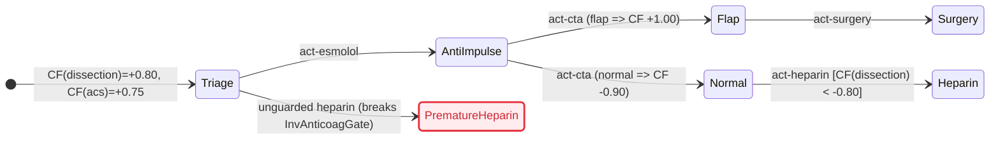
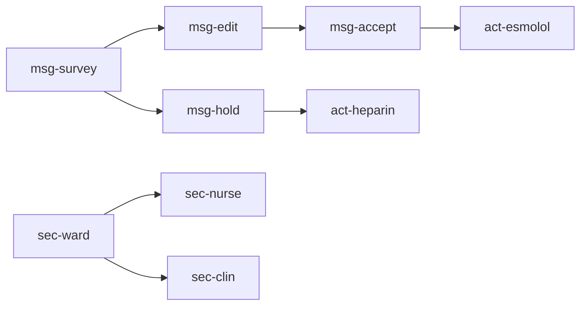

# `.chart`

```toml
[med]
media_type = "text/vnd.chart+markdown"
extension  = ".chart"
version    = "1.1.0"

[pipeline]
input   = "clinical case --natural-language"
process = "workup { CRAWLS ::index, :requires }"
output  = "graph.logic --fileformat .chart { RENDERS mermaid }"

[imprint]
intranet  = true
bluetooth = true
egress    = "intranet"
radio     = "ble"
replaces  = "pager"
template  = "bitchat"
ttl       = 7

[steer]
hitl      = true
mode      = "oracle"
structure = "DAG"
store     = "rlnc"
query     = "golomb-rice"
memory    = "sheaf"
survey    = "optic"
inspect   = "lens"
edit      = "lens"
```

Version 1.1.0 imprints a chart on an intranet of phones. The radio is Bluetooth Low Energy. A phone stores random linear combinations of a generation, compresses the packet ids it lacks with Golomb-Rice coding, memorizes a section of a presheaf, and recalls by sheaf glue. Steering messages are vertices of a DAG in the same file. A survey is an optic. Inspect is the get of a lens, and edit is its put. A human oracle accept is what applies the put. A page is that message. The model has no pager vertex.

A file with no `::imprint` block is a 1.0.0 chart: one section, the whole index, and an empty message DAG. Read [DISCLAIMER](DISCLAIMER) before any node.

## 1. Axioms

1. **Superset.** Every CommonMark `.md` or OpenGigantic `.og` file is a valid `.chart` file. Files compose across `uri#id` edges.
2. **Graph read.** Entry is `::index`. `:requires` loads dependencies. `::warning` is never skipped. `scope` gates visibility.
3. **Signed certainty.** Affirmation (`cf > 0`), negation (`cf < 0`), and ignorance (`cf = 0`) stay distinct. Unknown is `0.00`; hedged prose stays in `(+0.20, +0.70]`.
4. **Domain invariance.** Core syntax, math, and logic hold no specialty tokens. Specialty enters only through `::meta`, `scale`, and `uri#id` targets. `section` and `message` are infrastructure.
5. **Unified chart (`mermaid`).** `rule` and `hypothesis` nodes are pure state operators; `action` nodes are transitions. `__view` renders the graph as any `mermaid` diagram (`stateDiagram-v2`, `flowchart`, `sequenceDiagram`, `timeline`, `gantt`, `xychart-beta`, `sankey-beta`, `erDiagram`, `requirementDiagram`, `quadrantChart`, `mindmap`), either directly or checked by TLC from `tla` fences.
6. **Imprint.** A chart may be stored as random linear combinations on an intranet mesh of phones. The radio is Bluetooth Low Energy. Egress is `intranet`. Origin TTL is 7.
7. **Page.** A page is a `message` with `channel=page` and `ack=true`. Its body is a survey optic or a lens. The ontology has no pager vertex.
8. **Oracle.** A file that contains a `message` has `hitl=true` and `mode=oracle`. Only `kind=accept` with `oracle=human` applies a lens.
9. **DAG.** Along `:requires`, every message parent has a smaller rank. The ranks are `survey = 0`, `edit = 1`, `hold = 1`, `accept = 2`.
10. **Recall.** A peer memorizes a section. Recall glues sections on the ward site. Disagreeing CTA slots glue to nothing.
11. **Lens.** Survey is a get with no put. Inspect is the get of a lens and edit is the put. Put leaves the residual in place. In the fixture, heparin is applied only when the dissection centi-certainty is below -80.

## 2. Ontology & Epistemic Calculus (`lean`)

| Node | Role | Edge | Role |
|---|---|---|---|
| `context` | Entity container (`entity`, `goals`) | `:contains` | Child scope (`context`, `finding`, `hypothesis`) |
| `finding` | Observation (`scale`, `src`, `var`) | `:requires` | Premise, guard, or check dependency |
| `hypothesis` | Inferred target (`cf`) | `:supports` | Positive rule weight (`cf=+w`) |
| `rule` | Production (`if` -> `cf`) | `:contradicts` | Negative rule weight (`cf=-w`) |
| `action` | Inquiry or intervention (`Next`) | `:resolves` | Inquiry binding unknown `finding` (`cf = 0.00`) |
| `invariant` | Safety or liveness check | `:transitions` | Action order |
| `meta` | `__view`, `__changelog` | `:supersedes` | Revision or `uri#id` link |
| `section` | Peer-local section (`open`, `peer`) | `:restricts` | Larger open onto a smaller open |
| `message` | Steering envelope (`kind`, `channel`) | `:steers` | Message onto the clinical node it addresses |

The `cf` of a `section` or a `message` records that the vertex is present. Clinical certainty stays on `finding` and `hypothesis`.

```lean
/- «meta» is the node type meta. «section» is the node type section.
   Both words are keywords, and a bare keyword ends the declaration. -/
inductive NodeType | context | finding | hypothesis | rule | action | invariant | «meta» | «section» | message
  deriving DecidableEq, Repr
inductive EdgeType | contains | requires | supports | contradicts | resolves | transitions | supersedes | restricts | steers
  deriving DecidableEq, Repr
inductive Scale    | nominal | ordinal | quantitative | temporal
  deriving DecidableEq, Repr
inductive Card     | single | multi
  deriving DecidableEq, Repr
inductive EpistemicClass | affirmed | negated | unknown | breaks
  deriving DecidableEq, Repr

structure Q where
  num : Int
  den : Int
  deriving DecidableEq, Repr

namespace Q
def norm (q : Q) : Q :=
  let g : Int := Int.gcd q.num q.den
  let s : Int := if q.den < 0 then -1 else 1
  ⟨s * (q.num / g), s * (q.den / g)⟩
def centi (c : Int) : Q := norm ⟨c, 100⟩
def zero : Q := ⟨0, 1⟩
def one  : Q := ⟨1, 1⟩
def neg (a : Q) : Q := ⟨-a.num, a.den⟩
def abs (a : Q) : Q := ⟨Int.natAbs a.num, a.den⟩
def add (a b : Q) : Q := norm ⟨a.num * b.den + b.num * a.den, a.den * b.den⟩
def sub (a b : Q) : Q := add a (neg b)
def mul (a b : Q) : Q := norm ⟨a.num * b.num, a.den * b.den⟩
def div (a b : Q) : Q := norm ⟨a.num * b.den, a.den * b.num⟩
def lt  (a b : Q) : Bool := a.num * b.den < b.num * a.den
def min (a b : Q) : Q := if lt a b then a else b
end Q

inductive Cf | val (q : Q) | conflict deriving DecidableEq, Repr

def cfCombine (es : List Q) : Cf :=
  let pos  := es.filter (Q.lt Q.zero ·)
  let neg  := es.filter (Q.lt · Q.zero)
  let cPos := Q.sub Q.one (pos.foldl (fun a e => Q.mul a (Q.sub Q.one e)) Q.one)
  let cNeg := Q.add (Q.neg Q.one) (neg.foldl (fun a e => Q.mul a (Q.add Q.one e)) Q.one)
  if cPos == Q.one && cNeg == Q.neg Q.one then .conflict
  else .val (Q.div (Q.add cPos cNeg) (Q.sub Q.one (Q.min cPos (Q.abs cNeg))))

def trueP : Cf → Bool | .val q => Q.lt (Q.centi 20) q | .conflict => false
def falseP : Cf → Bool | .val q => Q.lt q (Q.centi (-80)) | .conflict => false

def evalAtom {α : Type} (κ : Card) (dom : List α) (μ : α → Q) (p : α → Bool) : Cf :=
  let m := (dom.filter p).filterMap (fun v => let c := μ v; if c == Q.zero then none else some c)
  let x := if κ == .single then
    (dom.filter (!p ·)).filterMap (fun v => let c := μ v; if Q.lt Q.zero c then some (Q.neg c) else none)
  else []
  cfCombine (m ++ x)

def validChart (proj : EpistemicClass → EpistemicClass) : Bool :=
  proj .breaks == .breaks &&
  proj .affirmed != proj .negated && proj .affirmed != proj .unknown && proj .negated != proj .unknown &&
  proj .affirmed != .breaks && proj .negated != .breaks && proj .unknown != .breaks

theorem cf_laws :
    cfCombine [Q.centi 40, Q.centi 60] = .val (Q.centi 76) ∧
    cfCombine [Q.centi 40, Q.centi 60, Q.centi (-20)] = cfCombine [Q.centi (-20), Q.centi 60, Q.centi 40] ∧
    falseP (cfCombine [Q.centi 50, Q.centi 60, Q.centi (-98)]) = true ∧
    cfCombine [Q.one, Q.neg Q.one] = .conflict ∧
    validChart id = true := by decide
```

## 3. Grammar (`~EBNF`)

```ebnf
chart        = markdown_raw | manifest , { node_block | markdown_prose } ;
manifest     = "::meta"   , NL , { kv_line } , "::end" , NL ,
               "::schema" , NL , { kv_line } , "::end" , NL ,
               "::index"  , NL , { "#" , TEXT_LINE , NL | index_row } , "::end" , NL ,
               [ "::imprint" , NL , { kv_line } , "::end" , NL ] ;
kv_line      = id , ":" , WS , TEXT_LINE , NL ;
index_row    = id , "|" , node_type , "|" , scope , "|" , signed_cf , "|" , TEXT_LINE , NL ;
node_block   = "::node" , WS , "[" , attr , { WS , attr } , "]" , NL ,
               "::dense" , ( WS , TEXT_LINE , NL | NL , TEXT_LINE , NL , "::end" , NL ) ,
               { edge_decl | "::edges" , NL , { edge_decl } , "::end" , NL | fenced_code | colon_block } ,
               "::end" , NL ;
attr         = "scale=" , ( "nominal" | "ordinal" | "quantitative" | "temporal" )
             | id , "=" , ( id | STRING | NUMBER | signed_cf | "true" | "false" ) ;
node_type    = "context" | "finding" | "hypothesis" | "rule" | "action" | "invariant" | "meta" | "section" | "message" ;
scope        = "all" | "clinician" | "orchestrator" | "worker" | "patient" | id ;
signed_cf    = [ "+" | "-" ] , ( "1.00" | "1.0" | "0." , DIGIT , { DIGIT } | "0" ) ;
fenced_code  = "```" , ( "tla" | "lean" | "mermaid" | "js" | id ) , NL , VERBATIM , "```" , NL ;
colon_block  = "::" , id , [ WS , "[" , attr , { WS , attr } , "]" ] , NL , VERBATIM , "::end" , NL ;
edge_decl    = ( "->" | "<-" | "<>" ) , "[:" , edge_type , { WS , attr } , "]" ,
               WS , target , { "," , [ WS ] , target } , NL ;
edge_type    = "contains" | "requires" | "supports" | "contradicts" | "resolves" | "transitions" | "supersedes" | "restricts" | "steers" ;
target       = [ URI_PATH , "#" ] , id ;
id           = ( LETTER | "_" ) , { LETTER | DIGIT | "_" | "-" } ;
```

A `::optic` block records a get. A `::lens` block records `inspect` and `edit`. A `::packet` block records one coded generation or one query. A `::warning` on a node that a survey focuses is part of that page.

## 4. Workup & Transition Logic (`tla`)

```tla
---- MODULE MedKernel ----
EXTENDS Integers, FiniteSets

TauPos == 20
TauNeg == -80

CfAnd(a, b)   == IF a <= b THEN a ELSE b
CfOr(a, b)    == IF a >= b THEN a ELSE b
CfNot(a)      == -a
CfScale(a, b) == IF a * b >= 0 THEN (a * b + 50) \div 100 ELSE -(((-(a * b)) + 50) \div 100)
CfFire(p, w)  == IF p > TauPos THEN CfScale(p, w) ELSE 0
CfPos(a, b)   == a + b - CfScale(a, b)
CfNeg(a, b)   == a + b + CfScale(-a, -b)
CfBipolar(cp, cn) ==
  IF cp = 100 /\ cn = -100 THEN -999
  ELSE LET m == IF cp <= (-cn) THEN cp ELSE (-cn)
           n == (cp + cn) * 100
           d == 100 - m
       IN IF n >= 0 THEN (n + (d \div 2)) \div d ELSE -(((-n) + (d \div 2)) \div d)
EvalEq(v, t)  == IF v = t THEN 100 ELSE IF v = "unknown" THEN 0 ELSE -100
====
```

## 5. Local imprint

The imprint places one chart on a mesh of phones. Each phone is a GATT central and a GATT peripheral. Origin TTL is 7. A relay may keep the sealed packet it forwards, and it emits that packet at TTL minus one. TTL 0 is not relayed. The template for this radio is the local mesh in the bitchat whitepaper, version 2.0. The chart uses that template as a carrier.

| Law | Statement |
|---|---|
| Intranet | `egress = intranet`. The value `internet` is ill-formed. |
| Seal | A steer payload is sealed the way the template seals a private payload. A relay forwards it and does not apply a lens. |
| Ward | Clinical bytes are sealed to the vouched peer set. They are not a cleartext broadcast. |
| Page | `channel = page` and `ack = true`. The body is an optic or a lens, addressed to a `scope`. |
| Fragment | A generation is sized for one template fragment. A larger body uses the template's fragments. |

The template's internet mechanisms are outside the chart. Each row is a departure.

| Template mechanism | Chart |
|---|---|
| Nostr relays, mailboxes, location channels | Not a hop. |
| Public chat | Not a carrier for clinical bytes. |
| Free-form private text | A page carries an optic or a lens. |
| Any peer may speak | `kind = accept` is a human principal. |
| GCS advertisement of public history | The normative query is an exact Golomb-Rice missing-set. A GCS advertisement may ride along. A false positive spends a request and does not decode a symbol. |

```tla
---- MODULE ChartMesh ----
EXTENDS Integers

Egress == "intranet"
Hitl == TRUE
Mode == "oracle"
TtlOrigin == 7

Relay(ttl) == IF ttl = 0 THEN 0 ELSE ttl - 1

Apply(kind, oracle, plan, target, cf) ==
  IF kind = "accept" /\ oracle /\ (target /= "heparin" \/ cf < -80)
  THEN target
  ELSE plan

Rank == [survey |-> 0, edit |-> 1, hold |-> 1, accept |-> 2]
====
```

`Apply` and `Relay` are the TLA reading of `apply` and `relay` in §9. The discharged check is the Lean.

## 6. Store

A generation is `k` source symbols in GF(2^8). The modulus polynomial is `x^8 + x^4 + x^3 + x + 1`, written `0x11b`. A coded packet is a coefficient row and the linear combination of the sources. Any `k` linearly independent rows recall the sources.

The fixture uses `k = 2` and one-byte symbols.

| Symbol | Byte | Reading |
|---|---|---|
| `s0` | `0x00` | `find-cta` centi-certainty 0 |
| `s1` | `0x50` | `hyp-dissection` centi-certainty 80 |

| Packet | Peer | Coefficients | Payload |
|---|---|---|---|
| id 1 | `peer-nurse` | `03 05` | `0x0b` |
| id 2 | `peer-orch` | `01 02` | `0xa0` |

`03·02` is `0x06` and `05·01` is `0x05`. Their sum in this field is the determinant `0x03`. The inverse of `0x03` is `0xf6`, since `03·f6 = 0x01`. The inverse matrix is `[[f7, 03], [f6, 01]]`, and it returns `00` then `50`.

Coefficients `01 00` keep `s0` and drop `s1`. The payload `0x00` is also the image of `(0x00, 0x11)`. That packet does not recall the generation. `peer-orch` may store packet id 2. Storage is not an accept.

## 7. Query

A query lists the coded-packet ids a peer lacks. The list is strictly increasing. The first gap is the first id. Each later gap is the difference minus one. A gap is a Golomb-Rice code of modulus 4: the quotient is that many `1` bits, then a `0`, then two remainder bits with the high bit first. Modulus 4 is the power-of-two case of Golomb coding.

The fixture missing set is `{0, 3, 6}`. The gaps are `0, 2, 2`.

| Gap | Quotient | Remainder | Bits |
|---|---|---|---|
| 0 | 0 | 0 | `000` |
| 2 | 0 | 2 | `010` |
| 2 | 0 | 2 | `010` |

The concatenation is `000010010`. Decode returns `{0, 3, 6}`. Every integer from 0 through 31 round-trips under the same code. The set `{3, 0}` is not strictly increasing, and the query is ill-formed. Packet ids 1 and 2 are the stored rows of §6. They sit outside this missing set.

## 8. Recall

The site is `none ≤ nurse ≤ both` and `none ≤ clin ≤ both`, with `nurse` and `clin` incomparable. A slot is `out`, `zero`, `pos`, or `neg`. `out` means the finding is outside the open. `zero` is unknown, centi-certainty 0.

| Open | pain | cta | troponin |
|---|---|---|---|
| `none` | out | out | out |
| `nurse` | in | in | out |
| `clin` | out | in | in |
| `both` | in | in | in |

Restriction writes `out` on every slot outside the open and leaves the others. It is idempotent, and restrictions compose along the site order. That assignment is the presheaf.

Glue of a nurse section and a clinician section takes pain from the nurse and troponin from the clinician. It keeps the CTA slot when the two copies are equal and neither is `out`. Otherwise the glue is empty. Every section whose slots lie in `{zero, pos, neg}` is the glue of its nurse and clinician restrictions. The check covers the 64 slot triples for the presheaf and the 27 interior triples for glue.

The fixture ward section is pain `pos`, CTA `zero`, troponin `pos`, the signs of `find-pain` at `+1.00`, `find-cta` at `0.00`, and `find-troponin` at `+1.00`. Those two restrictions glue back to the ward section. A clinician section with CTA `pos` does not glue. Recall then has no section. It leaves `plan` where it was.

The decoded byte `0x00` is this CTA `zero`. The decoded byte `0x50` is the survey focus, `hyp-dissection` at centi-certainty 80. That hypothesis is not a fourth sheaf slot.

## 9. Steering

A `:requires` edge on a message points at a parent. Parent ranks are `survey = 0`, `edit = 1`, `hold = 1`, and `accept = 2`. Each parent rank is strictly smaller, so the parent graph is a DAG. The fixture parents are `edit` on `survey`, `hold` on `survey`, and `accept` on `edit`. A map that also sets `survey` on `accept` and `accept` on `survey` fails the rank test.

`:steers` points at a clinical vertex and does not apply a lens. A clinical vertex does not `:requires` a message.

A lens is `get : S → A` and `put : S → A → S` such that `get (put s a) = a`, `put s (get s) = s`, and `put (put s a) b = put s b`, with the residual component unchanged. In the fixture, `S` is the pair `(plan, cta)`, the focus is `plan`, and the residual is the CTA slot.

A survey optic is the get, and the page drops the residual. The optic block has no put. Inspect is the get of a lens. Edit records the put. Accept applies the recorded put.

`apply` returns the target when the kind is `accept`, the principal is a human, and either the target is not heparin or the dissection centi-certainty is below `-80`. Centi-certainty `-80` stays on the current plan. A survey, an inspect, an edit, or an accept whose principal is an agent leaves the plan in place. The Lean constructor `Plan.anti` is the chart token `anti_impulse`.

| Kind | Oracle | From | Target | cf | Plan after |
|---|---|---|---|---|---|
| accept | human | triage | anti_impulse | 80 | anti_impulse |
| accept | agent | triage | anti_impulse | 80 | triage |
| edit | human | triage | anti_impulse | 80 | triage |
| survey | human | triage | anti_impulse | 80 | triage |
| accept | human | anti_impulse | heparin | 80 | anti_impulse |
| accept | human | anti_impulse | heparin | -80 | anti_impulse |
| accept | human | anti_impulse | heparin | -90 | heparin |

`msg-survey` is written at `peer-nurse`. It focuses `hyp-dissection` and `find-cta`, and the page carries the CTA warning. `msg-edit`, written at `peer-orch`, proposes `act-esmolol` and the plan token `anti_impulse`. `msg-accept`, written at `peer-clinician` with `oracle=human`, applies that proposal. `msg-hold` proposes `act-heparin` and has no accept child. `peer-orch` is not an oracle. Each of these messages has `scope=all` and is sealed to the vouched ward.

```lean
-- Golomb-Rice with modulus 4. Quotient: that many ones, then a zero.
-- Remainder: two bits, most significant bit first.

def rice2 (n : Nat) : List Bool :=
  let q := n / 4
  let r := n % 4
  List.replicate q true ++ [false, r / 2 == 1, r % 2 == 1]

def decodeRice2 : Nat → List Bool → Option (Nat × List Bool)
  | 0, _ => none
  | _fuel + 1, false :: b1 :: b0 :: rest =>
      some ((if b1 then 2 else 0) + (if b0 then 1 else 0), rest)
  | fuel + 1, true :: rest =>
      match decodeRice2 fuel rest with
      | some (n, rest2) => some (n + 4, rest2)
      | none => none
  | _, _ => none

def roundRice (n : Nat) : Bool :=
  match decodeRice2 (n + 2) (rice2 n) with
  | some (m, rest) => m == n && rest == []
  | none => false

def allRice : Bool := (List.range 32).all roundRice

def encodeSet (xs : List Nat) : List Bool :=
  (xs.foldl (fun (acc : Int × List Bool) x =>
      let g : Nat := ((Int.ofNat x) - (acc.1 + 1)).toNat
      (Int.ofNat x, acc.2 ++ rice2 g))
    ((-1 : Int), ([] : List Bool))).2

def decodeSet : Nat → Int → List Bool → Option (List Nat)
  | 0, _, _ => none
  | _, _, [] => some []
  | fuel + 1, prev, bs =>
      match decodeRice2 fuel bs with
      | some (g, rest) =>
          let x := prev + 1 + Int.ofNat g
          match decodeSet fuel x rest with
          | some xs => some (x.toNat :: xs)
          | none => none
      | none => none

def strictly : List Nat → Bool
  | [] => true
  | [_] => true
  | a :: b :: rest => a < b && strictly (b :: rest)

def bits036 : List Bool := encodeSet [0, 3, 6]

theorem golomb_036 :
    allRice = true ∧
    strictly [0, 3, 6] = true ∧
    bits036 = [false, false, false, false, true, false, false, true, false] ∧
    decodeSet 20 (-1) bits036 = some [0, 3, 6] ∧
    strictly [3, 0] = false := by decide

-- GF(2^8), polynomial x^8 + x^4 + x^3 + x + 1, written 0x11b.

def gfMul (a b : Nat) : Nat :=
  let rec go : Nat → Nat → Nat → Nat → Nat
    | 0, _, _, p => p
    | i + 1, a, b, p =>
        let p := if b % 2 == 1 then p ^^^ a else p
        let hi := a / 128
        let a := (a * 2) % 256
        let a := if hi == 1 then a ^^^ 0x1b else a
        go i a (b / 2) p
  go 8 (a % 256) (b % 256) 0

def coded (c0 c1 s0 s1 : Nat) : Nat :=
  gfMul c0 s0 ^^^ gfMul c1 s1

def rec0 : Nat := gfMul 0xf7 0x0b ^^^ gfMul 0x03 0xa0
def rec1 : Nat := gfMul 0xf6 0x0b ^^^ gfMul 0x01 0xa0

theorem rlnc_gen0 :
    gfMul 0x03 0x02 = 0x06 ∧
    gfMul 0x05 0x01 = 0x05 ∧
    gfMul 0x03 0x02 ^^^ gfMul 0x05 0x01 = 0x03 ∧
    gfMul 0x03 0xf6 = 0x01 ∧
    gfMul 0xf6 0x02 = 0xf7 ∧
    gfMul 0xf6 0x05 = 0x03 ∧
    gfMul 0xf6 0x01 = 0xf6 ∧
    gfMul 0xf6 0x03 = 0x01 ∧
    coded 0x03 0x05 0x00 0x50 = 0x0b ∧
    coded 0x01 0x02 0x00 0x50 = 0xa0 ∧
    rec0 = 0x00 ∧
    rec1 = 0x50 ∧
    coded 0x01 0x00 0x00 0x50 = coded 0x01 0x00 0x00 0x11 ∧
    0x50 ≠ 0x11 := by decide

-- Presheaf of three findings over the ward site.

inductive Open | none | nurse | clin | both
  deriving DecidableEq, Repr

inductive Slot | out | zero | pos | neg
  deriving DecidableEq, Repr

structure Sec where
  pain : Slot
  cta : Slot
  trop : Slot
  deriving DecidableEq, Repr

def hasPain : Open → Bool
  | .nurse | .both => true
  | _ => false

def hasCta : Open → Bool
  | .nurse | .clin | .both => true
  | _ => false

def hasTrop : Open → Bool
  | .clin | .both => true
  | _ => false

def restrict (v : Open) (s : Sec) : Sec :=
  { pain := if hasPain v then s.pain else .out
  , cta := if hasCta v then s.cta else .out
  , trop := if hasTrop v then s.trop else .out }

def glue (sn sc : Sec) : Option Sec :=
  if sn.cta != sc.cta || sn.cta == .out then none
  else if sn.trop != .out || sc.pain != .out then none
  else if sn.pain == .out || sc.trop == .out then none
  else some { pain := sn.pain, cta := sn.cta, trop := sc.trop }

def sWard : Sec := { pain := .pos, cta := .zero, trop := .pos }

def secNurse : Sec := { pain := .pos, cta := .zero, trop := .out }
def secClin : Sec := { pain := .out, cta := .zero, trop := .pos }
def secClash : Sec := { pain := .out, cta := .pos, trop := .pos }

def le : Open → Open → Bool
  | .none, _ => true
  | .nurse, .nurse => true
  | .nurse, .both => true
  | .clin, .clin => true
  | .clin, .both => true
  | .both, .both => true
  | _, _ => false

def slots : List Slot := [.out, .zero, .pos, .neg]
def inside : List Slot := [.zero, .pos, .neg]
def opens : List Open := [.none, .nurse, .clin, .both]

def functorial : Bool :=
  opens.all fun u => opens.all fun v => opens.all fun w =>
    slots.all fun a => slots.all fun b => slots.all fun c =>
      let s : Sec := { pain := a, cta := b, trop := c }
      (!(le w v && le v u) || restrict w (restrict v s) == restrict w s) &&
        restrict v (restrict v s) == restrict v s

def reconstruct : Bool :=
  inside.all fun a => inside.all fun b => inside.all fun c =>
    let s : Sec := { pain := a, cta := b, trop := c }
    glue (restrict .nurse s) (restrict .clin s) == some s

theorem sheaf_ward :
    restrict .nurse sWard = secNurse ∧
    restrict .clin sWard = secClin ∧
    glue secNurse secClin = some sWard ∧
    glue secNurse secClash = none ∧
    functorial = true ∧
    reconstruct = true := by decide

-- Lens on plan, residual the CTA slot. Survey carries no put.

inductive Plan | triage | anti | surgery | heparin
  deriving DecidableEq, Repr

structure St where
  plan : Plan
  cta : Slot
  deriving DecidableEq, Repr

def get (s : St) : Plan := s.plan
def put (s : St) (a : Plan) : St := { s with plan := a }

def plans : List Plan := [.triage, .anti, .surgery, .heparin]

def lensOk : Bool :=
  plans.all fun p0 => slots.all fun c =>
    plans.all fun a => plans.all fun b =>
      let s : St := { plan := p0, cta := c }
      get (put s a) == a &&
        put s (get s) == s &&
        put (put s a) b == put s b &&
        (put s a).cta == s.cta

inductive Kind | survey | inspect | edit | accept
  deriving DecidableEq, Repr

def carriesPut : Kind → Bool
  | .edit => true
  | _ => false

/-- Accept applies the lens. Every other kind leaves the plan. Heparin
    additionally requires the dissection centi-certainty to be below -80. -/
def apply (k : Kind) (oracle : Bool) (plan target : Plan) (cf : Int) : Plan :=
  if k == .accept && oracle && (target != .heparin || cf < -80) then target else plan

theorem lens_oracle :
    lensOk = true ∧
    carriesPut .survey = false ∧
    carriesPut .inspect = false ∧
    carriesPut .edit = true ∧
    apply .accept true .triage .anti 80 = .anti ∧
    apply .accept false .triage .anti 80 = .triage ∧
    apply .edit true .triage .anti 80 = .triage ∧
    apply .survey true .triage .anti 80 = .triage ∧
    apply .inspect true .triage .anti 80 = .triage ∧
    apply .accept true .anti .heparin 80 = .anti ∧
    apply .accept true .anti .heparin (-80) = .anti ∧
    apply .accept true .anti .heparin (-90) = .heparin := by decide

inductive Msg | survey | edit | hold | accept
  deriving DecidableEq, Repr

def rank : Msg → Nat
  | .survey => 0
  | .edit => 1
  | .hold => 1
  | .accept => 2

def parents : Msg → List Msg
  | .survey => []
  | .edit => [.survey]
  | .hold => [.survey]
  | .accept => [.edit]

def msgs : List Msg := [.survey, .edit, .hold, .accept]

def dagOk (par : Msg → List Msg) : Bool :=
  msgs.all fun m => (par m).all fun p => rank p < rank m

def badParents : Msg → List Msg
  | .survey => [.accept]
  | .accept => [.survey]
  | m => parents m

def relay (ttl : Nat) : Nat :=
  if ttl = 0 then 0 else ttl - 1

inductive Egress | intranet | internet
  deriving DecidableEq, Repr

def hopOk : Egress → Bool
  | .intranet => true
  | .internet => false

inductive Principal | human | agent
  deriving DecidableEq, Repr

def acceptWell (p : Principal) : Bool :=
  p == .human

theorem message_dag :
    dagOk parents = true ∧
    dagOk badParents = false ∧
    parents .accept = [.edit] ∧
    relay 7 = 6 ∧
    relay 0 = 0 ∧
    hopOk .intranet = true ∧
    hopOk .internet = false ∧
    acceptWell .human = true ∧
    acceptWell .agent = false := by decide
```

## 10. Canonical Instantiation (`SYNTH-1937-108`)

`64F, tearing chest pain 45m, R-L brachial SBP delta 28 mmHg, lateral ST-depression, hs-cTnI 68 ng/L (ULN 14), CTA aorta pending, no anticoagulants.`

The clinical nodes are the 1.0.0 workup. The `section` and `message` nodes are the 1.1.0 imprint of that workup. Laws for the imprint are §5–§9.

````markdown
::meta
title: SYNTH-1937-108 Acute Chest Pain & Aortic Dissection Workup
version: 1.1.0
case-id: SYNTH-1937-108
domain: cardiology|vascular-surgery|emergency-medicine
scope: all
::end

::schema
node-types: [context, finding, hypothesis, rule, action, invariant, meta, section, message]
edge-types: [contains, requires, supports, contradicts, resolves, transitions, supersedes, restricts, steers]
steer: [hitl, oracle, dag, rlnc, golomb-rice, sheaf, optic, lens]
scales: [nominal, ordinal, quantitative, temporal]
scope-levels: [all, clinician, orchestrator, worker, patient]
cf-thresholds: [+0.20, -0.80]
::end

::index
# id | type | scope | cf | keywords
ctx-encounter | context | all | +1.00 | ed, chest-pain, dissection, acs
find-pain | finding | all | +1.00 | tearing, interscapular, 45m
find-bp-delta | finding | all | +1.00 | sbp-delta, 28mmhg, pulse-deficit
find-troponin | finding | all | +1.00 | st-depression, hs-ctni, 68ng-l
find-cta | finding | all | 0.00 | cta-aorta, intimal-flap, pending
rule-acs | rule | clinician | +0.75 | nstemi, troponin
rule-tad-pain | rule | clinician | +0.50 | dissection, tearing-pain
rule-tad-bp | rule | clinician | +0.60 | dissection, sbp-delta-ge-20
rule-cta-pos | rule | clinician | +1.00 | cta-flap, dissection-confirmed
rule-cta-neg | rule | clinician | -0.98 | cta-normal, dissection-ruled-out
hyp-acs | hypothesis | clinician | +0.75 | acs, nstemi
hyp-dissection | hypothesis | clinician | +0.80 | stanford-type-a, dissection
act-esmolol | action | clinician | +1.00 | anti-impulse, beta-blockade
act-cta | action | all | +1.00 | gated-cta-aorta
act-surgery | action | clinician | +1.00 | open-aortic-repair
act-heparin | action | clinician | +1.00 | heparin, angiography
inv-anticoag-gate | invariant | all | +1.00 | safety, no-heparin-before-cta-ruleout
sec-ward | section | all | +1.00 | glue, both, rlnc, golomb
sec-nurse | section | worker | +1.00 | peer-nurse, pain, cta
sec-clin | section | clinician | +1.00 | peer-clinician, cta, troponin, oracle
msg-survey | message | all | +1.00 | page, survey, optic, warning, peer-nurse
msg-edit | message | all | +1.00 | page, lens, esmolol, propose, peer-orch
msg-hold | message | all | +1.00 | page, heparin, no-accept, peer-orch
msg-accept | message | all | +1.00 | page, accept, human, anti-impulse, peer-clinician
__view | meta | all | +1.00 | mermaid, stateDiagram-v2, flowchart
__steer | meta | all | +1.00 | dag, flowchart
::end

::imprint
transport: ble-mesh
radio: ble
intranet: true
bluetooth: true
egress: intranet
replaces: pager
template: bitchat
hitl: true
mode: oracle
ttl: 7
field: gf256
poly: 0x11b
rice-k: 2
peers: peer-nurse, peer-clinician, peer-orch
oracle: peer-clinician
::end

::node [id=ctx-encounter type=context cf=+1.00 scope=all entity=ENCOUNTER var=plan init=triage goals="hyp-dissection,hyp-acs"]
::dense SYNTH-1937-108|64F|chest-pain-45m|plan=triage
->[:contains] find-pain, find-bp-delta, find-troponin, find-cta, hyp-dissection, hyp-acs
```tla
PlanDom == {"triage", "anti_impulse", "surgery", "heparin"}
Done == plan \in {"surgery", "heparin"} /\ UNCHANGED vars
```
::end

::node [id=find-pain type=finding cf=+1.00 scope=all scale=temporal src="L1: tearing chest pain 45m"]
::dense pain=tearing|onset_min=45|cf=+1.00
```tla
Pain == "tearing"
```
::end

::node [id=find-bp-delta type=finding cf=+1.00 scope=all scale=quantitative value=28 unit="mmHg" src="L1: SBP delta 28 mmHg"]
::dense sbp_delta_mmhg=28|cf=+1.00
```tla
BpDelta == 28
```
::end

::node [id=find-troponin type=finding cf=+1.00 scope=all scale=quantitative value=68 unit="ng/L" src="L1: hs-cTnI 68 ng/L"]
::dense hs_ctni_ng_l=68|uln=14|cf=+1.00
```tla
Troponin == 68
```
::end

::node [id=find-cta type=finding cf=0.00 scope=all scale=nominal var=cta init=unknown]
::dense cta=unknown|pending-gated-cta|gates-heparin
::warning
CTA aorta is PENDING (cf=0.00). Hold anticoagulation until dissection is excluded.
::end
```tla
CtaDom == {"unknown", "flap", "normal"}
```
::end

::node [id=rule-acs type=rule cf=+0.75 scope=clinician]
::dense troponin>14->hyp-acs(+0.75)
->[:requires] find-troponin
->[:supports cf=+0.75] hyp-acs
```tla
RuleAcs == CfFire(IF Troponin > 14 THEN 100 ELSE -100, 75)
```
::end

::node [id=rule-tad-pain type=rule cf=+0.50 scope=clinician]
::dense pain=tearing->hyp-dissection(+0.50)
->[:requires] find-pain
->[:supports cf=+0.50] hyp-dissection
```tla
RuleTadPain == CfFire(EvalEq(Pain, "tearing"), 50)
```
::end

::node [id=rule-tad-bp type=rule cf=+0.60 scope=clinician]
::dense sbp_delta>=20->hyp-dissection(+0.60)
->[:requires] find-bp-delta
->[:supports cf=+0.60] hyp-dissection
```tla
RuleTadBp == CfFire(IF BpDelta >= 20 THEN 100 ELSE -100, 60)
```
::end

::node [id=rule-cta-pos type=rule cf=+1.00 scope=clinician]
::dense cta=flap->hyp-dissection(+1.00)
->[:requires] find-cta
->[:supports cf=+1.00] hyp-dissection
```tla
RuleCtaPos == CfFire(EvalEq(cta, "flap"), 100)
```
::end

::node [id=rule-cta-neg type=rule cf=-0.98 scope=clinician]
::dense cta=normal->hyp-dissection(-0.98)
->[:requires] find-cta
->[:contradicts cf=-0.98] hyp-dissection
```tla
RuleCtaNeg == CfFire(EvalEq(cta, "normal"), -98)
```
::end

::node [id=hyp-acs type=hypothesis cf=+0.75 scope=clinician]
::dense acs-nstemi|cf=+0.75
```tla
CfHypAcs == CfBipolar(RuleAcs, 0)
```
::end

::node [id=hyp-dissection type=hypothesis cf=+0.80 scope=clinician]
::dense type-a-dissection|cf=+0.80|flap->+1.00|normal->-0.90
```tla
CfHypDissection == CfBipolar(CfPos(CfPos(RuleTadPain, RuleTadBp), RuleCtaPos), RuleCtaNeg)
```
::end

::node [id=act-esmolol type=action cf=+1.00 scope=clinician]
::dense intervene|iv-esmolol|when-dissection>0.20
->[:requires] hyp-dissection
->[:transitions] act-cta
```tla
ActEsmolol == /\ plan = "triage" /\ CfHypDissection > 20 /\ plan' = "anti_impulse" /\ UNCHANGED cta
```
::end

::node [id=act-cta type=action cf=+1.00 scope=all]
::dense observe|cta-aorta|flap-or-normal
->[:resolves] find-cta
->[:transitions] act-surgery, act-heparin
```tla
ActCtaFlap   == /\ plan = "anti_impulse" /\ cta = "unknown" /\ cta' = "flap"   /\ UNCHANGED plan
ActCtaNormal == /\ plan = "anti_impulse" /\ cta = "unknown" /\ cta' = "normal" /\ UNCHANGED plan
```
::end

::node [id=act-surgery type=action cf=+1.00 scope=clinician]
::dense intervene|open-aortic-repair|when-dissection=+1.00
->[:requires] find-cta, hyp-dissection
```tla
ActSurgery == /\ plan = "anti_impulse" /\ CfHypDissection = 100 /\ plan' = "surgery" /\ UNCHANGED cta
```
::end

::node [id=act-heparin type=action cf=+1.00 scope=clinician]
::dense intervene|heparin+cath|when-dissection<-0.80
->[:requires] find-cta, hyp-acs, hyp-dissection
```tla
ActHeparin == /\ plan = "anti_impulse" /\ CfHypAcs > 20 /\ CfHypDissection < -80 /\ plan' = "heparin" /\ UNCHANGED cta
```
::end

::node [id=inv-anticoag-gate type=invariant cf=+1.00 scope=all kind=safety]
::dense safety|heparin-requires-dissection-ruled-out
->[:requires] hyp-dissection, find-cta
```tla
InvAnticoagGate == (plan = "heparin") => (CfHypDissection < -80)
```
::end

::node [id=sec-ward type=section cf=+1.00 scope=all open=both]
::dense glue|pain=+1.00|cta=0.00|troponin=+1.00
->[:restricts] sec-nurse, sec-clin
->[:contains] find-pain, find-cta, find-troponin
::packet [kind=coded generation=0 k=2 field=gf256]
s0: 00
s1: 50
id-1: peer-nurse 03 05 0b
id-2: peer-orch 01 02 a0
::end
::packet [kind=query coding=golomb-rice k=2]
missing: 0,3,6
gaps: 0,2,2
bits: 000010010
::end
::end

::node [id=sec-nurse type=section cf=+1.00 scope=worker peer=peer-nurse open=nurse]
::dense pain=+1.00|cta=0.00|troponin=out
->[:contains] find-pain, find-cta
::end

::node [id=sec-clin type=section cf=+1.00 scope=clinician peer=peer-clinician open=clin]
::dense pain=out|cta=0.00|troponin=+1.00
->[:contains] find-cta, find-troponin
::end

::node [id=msg-survey type=message cf=+1.00 scope=all channel=page ack=true kind=survey peer=peer-nurse]
::dense page|focus=hyp-dissection,find-cta|cf-dissection=+0.80|cf-cta=0.00
->[:steers] hyp-dissection, find-cta
::optic
get: hyp-dissection.cf, find-cta.cf
::end
::warning
CTA aorta is PENDING (cf=0.00). Hold anticoagulation until dissection is excluded.
::end
::end

::node [id=msg-edit type=message cf=+1.00 scope=all channel=page ack=true kind=edit parents=msg-survey peer=peer-orch]
::dense propose|inspect=plan|edit=anti_impulse|focus=act-esmolol
->[:requires] msg-survey, hyp-dissection
->[:steers] act-esmolol
::lens
inspect: plan
edit: plan=anti_impulse
residual: cta
::end
```tla
EditStays == Apply("edit", TRUE, "triage", "anti_impulse", 80) = "triage"
```
::end

::node [id=msg-hold type=message cf=+1.00 scope=all channel=page ack=true kind=edit parents=msg-survey peer=peer-orch]
::dense propose|edit=heparin|no-accept
->[:requires] msg-survey, inv-anticoag-gate
->[:steers] act-heparin
::warning
This edit has no accept. The plan stays. Heparin in the model needs dissection centi-certainty below -80.
::end
::end

::node [id=msg-accept type=message cf=+1.00 scope=all channel=page ack=true kind=accept parents=msg-edit oracle=human peer=peer-clinician]
::dense accept|plan=anti_impulse|human
->[:requires] msg-edit
->[:steers] act-esmolol
```tla
AcceptEsmolol == Apply("accept", TRUE, "triage", "anti_impulse", 80) = "anti_impulse"
```
::end

::node [id=__view type=meta cf=+1.00 scope=all]
::dense mermaid|stateDiagram-v2+flowchart

::end

::node [id=__steer type=meta cf=+1.00 scope=all]
::dense dag|flowchart

::end

````


## 11. Falsification

Each row is a challenge. The failure signal is what a conforming read returns.

| Challenge | Failure signal |
|---|---|
| Name `egress = internet`, or a Nostr relay as a hop | The file is ill-formed. Egress is `intranet`. |
| Store `oracle=agent` on `kind=accept` | The accept is ill-formed. `acceptWell` is false for an agent. |
| Apply `msg-edit` with no accept | `plan` stays `triage`. |
| Accept heparin at centi-certainty 80 or -80 | `plan` stays. The bound is strict. |
| Read the centi-certainty -90 row as an order to give heparin | The row is a token in the model. DISCLAIMER still covers the file. |
| Recall generation 0 from coefficients `01 00` | `s1` is not determined. `0x00` is also the image of `(0x00, 0x11)`. |
| Glue `sec-nurse` to a clinician section whose CTA slot is `pos` | Glue is empty. `plan` stays. |
| Drop the CTA `::warning` from `msg-survey` | The read is wrong. |
| Let `msg-survey` require `msg-accept` | The rank test fails. |
| Read the `cf` of a message as a clinical certainty | That `cf` records presence of the vertex. |
| Look for a pager vertex | The ontology has none. `replaces = pager` names the channel. |
| Decode `000010010` as a missing set other than `{0, 3, 6}` | The decode is `{0, 3, 6}`. |
| Query the missing set `{3, 0}` | The query is ill-formed. |
| Restrict the ward section to `nurse` twice and expect troponin to return | The second restriction equals the first. Troponin stays `out`. |
| Put the plan lens and expect the CTA slot to change | The CTA slot is the residual and stays. |
| Put a `put` line on a survey optic | The survey is ill-formed. `carriesPut` is false. |
| Treat packet id 2, stored at `peer-orch`, as an accept | Storage is not an accept. |
| Admit two accepts in one message | The message is ill-formed. |

`golomb_036`, `rlnc_gen0`, `sheaf_ward`, `lens_oracle`, and `message_dag` are the discharged checks. A challenge that needs a new clinical action, a new field, or a public relay is outside this file.

## References

1. [Cursor `statechart`](https://github.com/cursor/plugins/tree/main/pstack/skills/statechart)
2. M. Dubey, [*ObjectGraph* (`arXiv:2604.27820v1`)](https://arxiv.org/html/2604.27820v1), 2026.
3. P. Norvig, [*PAIP* Ch. 16 (`cl-aip/mycin`)](https://github.com/cl-aip/mycin), 1991.
4. T. Ho, M. Médard, R. Koetter, D. R. Karger, M. Effros, J. Shi, and B. Leong, "A Random Linear Network Coding Approach to Multicast", *IEEE Transactions on Information Theory* 52, no. 10 (2006). [doi:10.1109/TIT.2006.881746](https://doi.org/10.1109/TIT.2006.881746).
5. Solomon W. Golomb, "Run-length encodings", *IEEE Transactions on Information Theory* 12, no. 3 (1966). [doi:10.1109/TIT.1966.1053907](https://doi.org/10.1109/TIT.1966.1053907).
6. Robert F. Rice, *Some Practical Universal Noiseless Coding Techniques*, JPL Publication 79-22, 1979.
7. Mitchell Riley, "Categories of Optics", arXiv:1809.00738, 2018. <https://arxiv.org/abs/1809.00738>.
8. J. Nathan Foster, Michael B. Greenwald, Jonathan T. Moore, Benjamin C. Pierce, and Alan Schmitt, "Combinators for Bidirectional Tree Transformations: A Linguistic Approach to the View-Update Problem", *ACM Transactions on Programming Languages and Systems* 29, no. 3 (2007). [doi:10.1145/1232420.1232424](https://doi.org/10.1145/1232420.1232424).
9. Saunders Mac Lane and Ieke Moerdijk, *Sheaves in Geometry and Logic*, Springer, 1992.
10. *bitchat Protocol Whitepaper*, version 2.0, 6 July 2026. Template for the local radio. <https://github.com/permissionlesstech/bitchat/blob/main/WHITEPAPER.md>.
11. "Pager", the one-way channel named by `replaces`. <https://en.wikipedia.org/wiki/Pager>.

Retrieved 14 Nov 2026 (Australia/Sydney). Representation only.

## License

MIT — see [LICENSE](LICENSE).
